# react-native-nitro-ui

Native SwiftUI and Jetpack Compose components for React Native, built on
[Nitro Modules](https://nitro.margelo.com/).

Most "native" component libraries re-implement a platform control in React
Native and copy the screenshots. This one hosts the real thing: each control is
a SwiftUI view or a Jetpack Compose composable inside a Nitro Hybrid View, so
the toggle animates like Apple's, the slider takes drags the way `UISlider`
does, the iOS segmented row truncates labels the way the OS does, and VoiceOver and
TalkBack get the control's own accessibility instead of an approximation of it.
Layout still belongs to Yoga — the control measures itself, reports its size to
the layout engine, and React never sees a native node.

## Components

| Component            | iOS                                                                     | Android                                                                                               | Since | Docs                                                         |
| -------------------- | ----------------------------------------------------------------------- | ----------------------------------------------------------------------------------------------------- | ----- | ------------------------------------------------------------ |
| `Switch`             | `Toggle(…).toggleStyle(.switch)`                                        | `androidx.compose.material3.Switch`                                                                   | 0.1.0 | [switch.md](docs/components/switch.md)                       |
| `Slider`             | `Slider(value:in:step:onEditingChanged:)`                               | `androidx.compose.material3.Slider`                                                                   | 0.1.0 | [slider.md](docs/components/slider.md)                       |
| `Progress`           | `ProgressView` + `.progressViewStyle(.linear / .circular)`              | `LinearProgressIndicator` / `CircularProgressIndicator` (M3)                                          | 0.1.0 | [progress.md](docs/components/progress.md)                   |
| `Button`             | `Button(action:) { Label }` + `.buttonStyle(…)`                         | the five Material 3 button composables                                                                | 0.1.0 | [button.md](docs/components/button.md)                       |
| `IconButton`         | `Button(action:) { Label }` + `.labelStyle(.iconOnly)`                  | the four Material 3 icon buttons and their toggle forms                                               | next  | [icon-button.md](docs/components/icon-button.md)             |
| `ButtonGroup`        | a row of bordered controls, or `ControlGroup` when connected            | M3 `ButtonGroup` with `customItem` and its overflow menu                                              | next  | [button-group.md](docs/components/button-group.md)           |
| `Stepper`            | `Stepper(value:in:step:)` + `.labelsHidden()` (hold-to-repeat included) | two Material 3 tonal icon buttons, 8 dp apart — Android has no stepper                                | next  | [stepper.md](docs/components/stepper.md)                     |
| `SegmentedControl`   | `Picker(…).pickerStyle(.segmented)`                                     | a connected button group (`ButtonGroupDefaults` shapes)                                               | 0.1.0 | [segmented-control.md](docs/components/segmented-control.md) |
| `Picker`             | `Picker(…).pickerStyle(.menu / .wheel)`                                 | `ExposedDropdownMenuBox`, `ScrollField` and a radio group (M3)                                        | 0.1.0 | [picker.md](docs/components/picker.md)                       |
| `DatePicker`         | `DatePicker` (`.graphical` / `.wheel`, compact field)                   | M3 `DatePicker` / `TimePicker` / `ScrollField` drums and their dialogs                                | 0.1.0 | [date-picker.md](docs/components/date-picker.md)             |
| `Menu`               | `Menu(content:label:primaryAction:)`, `.menuStyle(.button)`             | `DropdownMenuPopup` + `DropdownMenuGroup`; `SplitButtonLayout` with a `primaryAction` (M3 Expressive) | 0.4.0 | [menu.md](docs/components/menu.md)                           |
| `ContextMenu`        | `UIContextMenuInteraction` on the view, a `UIMenu`                      | M3 Expressive `DropdownMenuPopup` opened at the finger                                                | next  | [context-menu.md](docs/components/context-menu.md)           |
| `Chip`               | `Toggle(…).toggleStyle(.button)` / a bordered capsule `Button`          | M3 `FilterChip` / `AssistChip`                                                                        | 0.6.0 | [chip.md](docs/components/chip.md)                           |
| `Checkbox`           | `Toggle(isOn:…)` + `checkmark.circle.fill` — iOS has no checkbox        | M3 `Checkbox` / `TriStateCheckbox`                                                                    | next  | [checkbox.md](docs/components/checkbox.md)                   |
| `AlertDialog`        | `UIAlertController(preferredStyle: .alert)`                             | `androidx.compose.material3.AlertDialog`                                                              | 0.5.0 | [dialog.md](docs/components/dialog.md)                       |
| `ConfirmationDialog` | `UIAlertController(preferredStyle: .actionSheet)`                       | M3 `ModalBottomSheet` with one row per action                                                         | 0.5.0 | [dialog.md](docs/components/dialog.md)                       |
| `TextField`          | `UITextField` / `UITextView` (multi-line)                               | `BasicTextField(TextFieldState)`                                                                      | 0.6.0 | [text-field.md](docs/components/text-field.md)               |
| `SearchField`        | `UISearchTextField` (the field `UISearchBar` vends)                     | M3 `SearchBarDefaults.InputField`, in a `Surface` shaped like the bar's input field                   | next  | [search-field.md](docs/components/search-field.md)           |
| `BottomSheet`        | `UISheetPresentationController` (`.pageSheet`, detents)                 | M3 `ModalBottomSheet` with React Native content                                                       | 0.6.0 | [bottom-sheet.md](docs/components/bottom-sheet.md)           |
| `Tooltip`            | a `.popover` presentation with SwiftUI content                          | M3 `TooltipBox` with `PlainTooltip` / `RichTooltip`                                                   | next  | [tooltip.md](docs/components/tooltip.md)                     |
| `Popover`            | `UIPopoverPresentationController` with React Native content             | a Compose `Popup` with a Material 3 `Surface` — Android has no popover                                | next  | [popover.md](docs/components/popover.md)                     |
| `Form`               | `UICollectionView` in `.insetGrouped`, rows in cells                    | rows in place behind M3 Expressive segmented-list shapes                                              | next  | [form.md](docs/components/form.md)                           |
| `ListItem`           | `UIListContentView` (`.cell()` / `.subtitleCell()`)                     | M3 `ListItem` content — Android has no list-row content view of its own                               | next  | [list-item.md](docs/components/list-item.md)                 |
| `Host`               | a plain `View` (passthrough, by design)                                 | one shared Compose composition for its hosted children                                                | 0.1.0 | [host.md](docs/components/host.md)                           |

`Host` is a container, not a control: an opt-in way to give a batch of controls
one Compose composition on Android instead of one each. It holds every control
except `Chip`, `TextField`, `Checkbox`, `SearchField`, `IconButton`,
`BottomSheet`, `ContextMenu`, `Tooltip` and `Popover`, and refuses those nine with an
error that names them. The first five wait for a round that measures them inside a
Host; the last four are refused by design, because each is a `View` around React
Native children, not a control a composition could draw.
See [Performance](#performance) for what it buys and what it costs.

Everything is exported from the package root, along with `nitroUiCore` (a
monotonic clock, `CLOCK_UPTIME_RAW` / `CLOCK_MONOTONIC`, plus sizing
diagnostics) and `prewarm` (see [Sizing](#sizing)):

```ts
import {
  AlertDialog,
  BottomSheet,
  Button,
  ButtonGroup,
  Checkbox,
  Chip,
  ConfirmationDialog,
  ContextMenu,
  DatePicker,
  Form,
  Host,
  IconButton,
  ListItem,
  Menu,
  Picker,
  Popover,
  Progress,
  SearchField,
  SegmentedControl,
  Slider,
  Stepper,
  Switch,
  TextField,
  Tooltip,
} from 'react-native-nitro-ui';
```

## Requirements

| Platform | Minimum                                                                                                 |
| -------- | ------------------------------------------------------------------------------------------------------- |
| RN       | `>= 0.88` with the new architecture, or Expo SDK 58                                                     |
| iOS      | `min_ios_version_supported` (React Native's own floor — 15.1 on RN 0.88)                                |
| Android  | `minSdkVersion` 24; the app compiles with `compileSdkVersion` 37 and Android Gradle Plugin 9.1 or newer |
| Nitro    | `react-native-nitro-modules ^0.37.1`                                                                    |

A new RN 0.88 or Expo SDK 58 app already meets the Android line: both templates
compile against SDK 37 with AGP 9.2. An app upgraded from an older template may
still say `compileSdkVersion = 36` in `android/build.gradle`; raise it to 37, or
the build stops with an AAR metadata error that names Material 3.

Jetpack Compose (the compiler plugin, Compose 1.12 and Material 3 1.5) is
configured inside this package's `android/build.gradle`, so your app does not
have to opt in to Compose to use one slider, and no Podfile or Gradle edits are
needed either way.

Material 3 1.5 is still a beta (`androidx.compose.material3:material3:1.5.0-beta02`),
and it is the version this library needs for the Expressive theme. Gradle picks
the newest version any library asks for, so if your app uses Material 3 itself,
installing this library raises your app's Material 3 to that beta as well.

A dev build is required: Expo Go is not supported, because Nitro Modules needs
native code.

## Installation

```sh
npm install react-native-nitro-ui react-native-nitro-modules
```

React Native autolinks the native code: no config plugin, no Podfile or Gradle
edits, no manual linking. `react-native-nitro-modules` is a peer dependency —
every control here is a Nitro Hybrid View, so your app needs it too.

What is left is compiling the new native code in, which needs more than a Metro
reload.

Expo (Continuous Native Generation):

```sh
npx expo prebuild   # or: npx expo run:ios / npx expo run:android / eas build
```

Bare React Native CLI — the template ships a Gemfile, so use it:

```sh
cd ios && bundle install && bundle exec pod install
```

Then `npx expo run:ios` / `run:android`, or `npx react-native run-ios` /
`run-android`.

### Without npm

From a clone (a fork, or a fix you need before the next release): the package
needs a build step (`bob build`, which also regenerates the Nitro code) before
an app can use it, so build the tarball and install that. You need
[bun](https://bun.sh) 1.4 and Node 24 (see
[CONTRIBUTING](CONTRIBUTING.md#prerequisites)).

```sh
git clone https://github.com/dannyhw/react-native-nitro-ui.git
cd react-native-nitro-ui
bun install
bun run prepare                          # builds lib/ with builder-bob
npm pack                                 # writes react-native-nitro-ui-<version>.tgz
```

Then, in your app:

```sh
npm install /path/to/react-native-nitro-ui-<version>.tgz react-native-nitro-modules
```

and rebuild as above.

Installing straight from GitHub (`npm install github:dannyhw/react-native-nitro-ui`)
is untested: npm would have to install this repo's development dependencies,
including its example and benchmark workspaces, and run the build during your
install. Use the tarball.

The project's [consumer smoke tests](CONTRIBUTING.md#consumer-smoke-tests)
install the packed tarball with npm into fresh Expo and React Native CLI apps
and build them in Release; CONTRIBUTING lists which apps have passed, and on
which release.

## Usage

Each control has the props of the platform control it wraps, not a
lowest-common-denominator subset. The tables in the component docs list every
prop against the TypeScript type; these are the shapes you will actually write.
The screenshots come from the example app's Storybook, in light appearance at
the default text size, on an iOS 27 iPhone simulator and an API 35 (Android 15)
emulator. A dialog or a sheet is shown presented.

### Switch

<table>
  <tr><th>iOS</th><th>Android</th></tr>
  <tr>
    <td></td>
    <td></td>
  </tr>
</table>

Controlled by `value`; omit it and native owns the displayed state (a toggle
then costs no React render).

```tsx name=switch
export function WifiSettings() {
  const [enabled, setEnabled] = useState(false);

  return (
    <>
      <Text>Wi-Fi</Text>
      <Switch
        accessibilityLabel="Wi-Fi"
        value={enabled}
        onValueChange={setEnabled}
      />
    </>
  );
}
```

### Slider

<table>
  <tr><th>iOS</th><th>Android</th></tr>
  <tr>
    <td></td>
    <td></td>
  </tr>
</table>

`onValueChange` fires at most once per frame during a drag;
`onSlidingComplete` always fires once with the value the gesture settled on.

```tsx name=slider
export function VolumeSlider() {
  const [volume, setVolume] = useState(0.5);

  return (
    <Slider
      accessibilityLabel="Volume"
      value={volume}
      onValueChange={setVolume}
      minimumValue={0}
      maximumValue={1}
      step={0.05}
    />
  );
}
```

### Progress

<table>
  <tr><th>iOS</th><th>Android</th></tr>
  <tr>
    <td></td>
    <td></td>
  </tr>
</table>

`value` is a fraction of the whole; `null` means indeterminate rather than
empty. `appearance="wavy"` and `variant="loading"` are Material 3 Expressive's
shapes — Android draws them, iOS draws the closest `ProgressView` it has.

```tsx name=progress
export function UploadProgress({ fraction }: { fraction: number | null }) {
  // `null` is indeterminate ("working"); a number 0…1 is a determinate bar.
  return <Progress accessibilityLabel="Uploading" value={fraction} />;
}

export function UploadProgressExpressive({
  fraction,
}: {
  fraction: number | null;
}) {
  // Material 3 Expressive: the wavy bar and the morphing loading shape. Both are
  // Android's; iOS draws the flat bar and the ring it has.
  return (
    <>
      <Progress
        accessibilityLabel="Uploading"
        appearance="wavy"
        value={fraction}
      />
      <Progress accessibilityLabel="Uploading" variant="loading" contained />
    </>
  );
}
```

### Button

<table>
  <tr><th>iOS</th><th>Android</th></tr>
  <tr>
    <td></td>
    <td></td>
  </tr>
</table>

`variant` and `size` map to the closest idiomatic style on each platform, so the
two columns deliberately do not look alike — neither one fakes the other.
`shape="square"` swaps the corner: Material's `squareShape` on Android, morphing
back to rounded while pressed, and `.roundedRectangle(radius: 8)` on iOS, whose
button styles have no cornerless option.

```tsx name=button
export function SaveButton() {
  const [saving, setSaving] = useState(false);

  return (
    <Button
      title={saving ? 'Saving…' : 'Save'}
      variant="filled"
      size="medium"
      disabled={saving}
      onPress={() => setSaving(true)}
    />
  );
}
```

iOS takes its icons from SF Symbols; Android has no system icon set, so the app
owns them and `androidIcon` points at the file:

```tsx name=button-icon
export function ShareButton({ onShare }: { onShare: () => void }) {
  // iOS draws the SF Symbol; Android draws the `.xml` the app imports. Each
  // platform ignores the other's prop, so one Button reads the same on both.
  return (
    <Button
      title="Share"
      systemImage="square.and.arrow.up"
      androidIcon={require('./assets/icons/share_24px.xml')}
      onPress={onShare}
    />
  );
}
```

`require`ing the `.xml` is the whole setup — Metro carries the file, a release
build turns it into an ordinary drawable, and development loads it from the dev
server. An app that already ships drawables can name one instead
(`androidIcon="share"` for `res/drawable/share.xml`). Either way the glyph is
sized by the size ladder and tinted with the label's own colour, and artwork that
cannot be resolved draws nothing and reserves nothing.
[button.md](docs/components/button.md), "Android icons", has Material Symbols,
`@expo/material-symbols` for Expo apps, and the failure table.

### IconButton

<table>
  <tr><th>iOS</th><th>Android</th></tr>
  <tr>
    <td>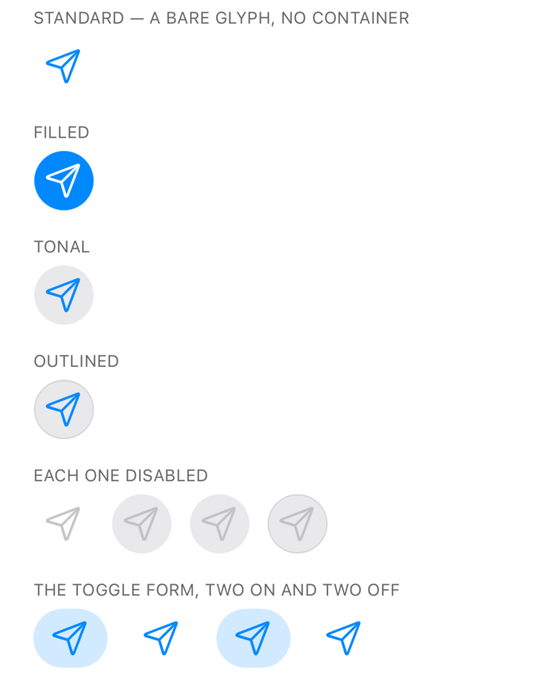</td>
    <td>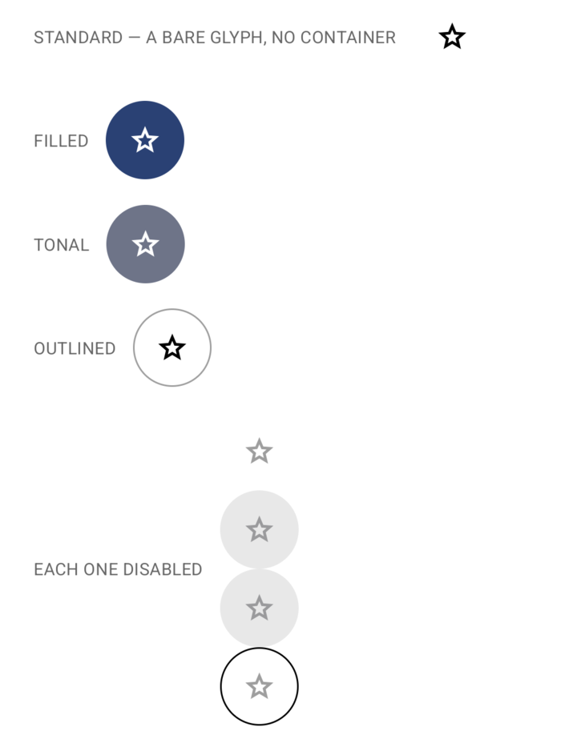</td>
  </tr>
</table>

A single glyph as a control. It has no text, so `accessibilityLabel` is the one
prop this component requires — it is all a screen reader gets, and an empty one
warns in development. `variant` is Material's four icon buttons under Material's
own names (`standard` is the bare glyph with no container); iOS has no icon-button
control, so it draws a `Button` whose label is `.iconOnly` and maps the four looks
onto its four button styles.

```tsx name=icon-button
export function SearchButton({ onSearch }: { onSearch: () => void }) {
  return (
    <IconButton
      accessibilityLabel="Search"
      systemImage="magnifyingglass"
      androidIcon={require('./assets/icons/search_24px.xml')}
      variant="tonal"
      onPress={onSearch}
    />
  );
}
```

Pass `checked` / `onCheckedChange` and the same control is a toggle: Material's
`…IconToggleButton` on Android, `Toggle(…).toggleStyle(.button)` on iOS. It
behaves like `Switch` and `Chip` — the tap is painted at once, the value React
pushes afterwards is the one that stays, and a flip the app refuses reverts.

```tsx name=icon-button-toggle
export function BookmarkButton({
  saved,
  onSave,
}: {
  saved: boolean;
  onSave: (next: boolean) => void;
}) {
  return (
    <IconButton
      accessibilityLabel="Bookmark this post"
      systemImage={saved ? 'bookmark.fill' : 'bookmark'}
      androidIcon="bookmark"
      variant="filled"
      checked={saved}
      onCheckedChange={onSave}
    />
  );
}
```

`size` is the same ladder as `Button`'s, and on Android a rung is Material's own
icon-button container token — with Material's 48 dp minimum touch target
measured rather than assumed, so the two smallest rungs sit in a box larger than
the token they are drawn from. iOS floors its box at Apple's 44 pt target the
same way, so a `small` IconButton is a 20 pt glyph inside a 44 pt target rather
than a 20 pt control, and the styles that draw a bezel reach that target through
a tappable layer behind the control instead of a wider bezel. `width` (`narrow` /
`uniform` / `wide`) is Material's three width options for a rung and is
**Android-only**: it costs width and never height there, and iOS keeps one box for
all three.
[icon-button.md](docs/components/icon-button.md) has both columns measured, and
what each platform does with a glyph it cannot resolve.

### ButtonGroup

<table>
  <tr><th>iOS</th><th>Android</th></tr>
  <tr>
    <td>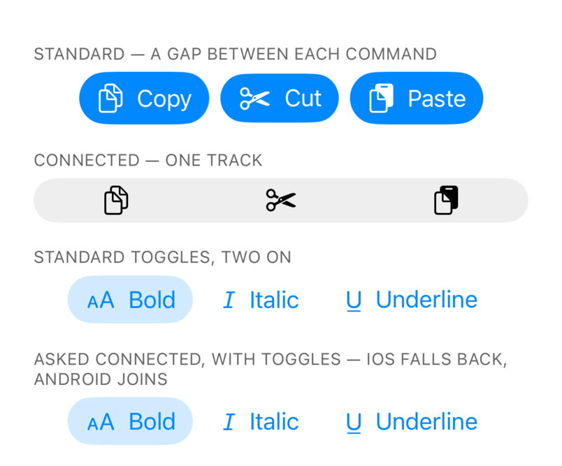</td>
    <td>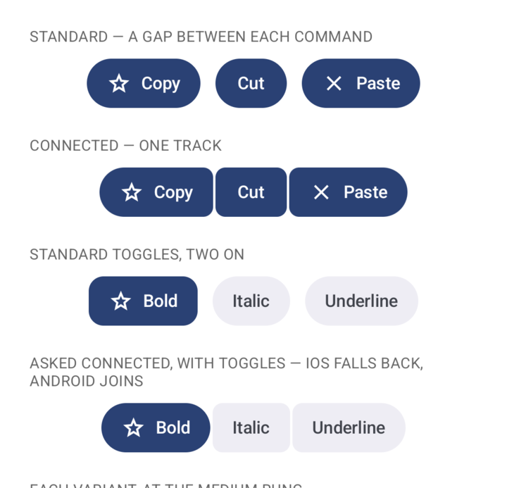</td>
  </tr>
</table>

A row of **commands** — _Copy | Paste | Share_ — optionally with independent
toggles — _Bold | Italic | Underline_. Items are data, `onPress` reports the id you
gave them, and the items that do not fit move into an overflow menu. It has no
selected value: one-of-a-few is `SegmentedControl`, and
[button-group.md](docs/components/button-group.md#buttongroup-or-segmentedcontrol)
says how to tell them apart.

```tsx name=button-group
export function FormatToolbar({
  spellcheck,
  onSpellcheck,
  onCommand,
}: {
  spellcheck: boolean;
  onSpellcheck: (next: boolean) => void;
  onCommand: (id: string) => void;
}) {
  return (
    <ButtonGroup
      items={[
        { id: 'copy', title: 'Copy', systemImage: 'doc.on.doc' },
        { id: 'paste', title: 'Paste', systemImage: 'doc.on.clipboard' },
        // Controlled: this render decides what is drawn.
        {
          id: 'spellcheck',
          title: 'Spellcheck',
          toggle: true,
          checked: spellcheck,
        },
        // Uncontrolled: native owns it after the first render.
        { id: 'bold', title: 'Bold', toggle: true, defaultChecked: true },
      ]}
      appearance="connected"
      onCheckedChange={(id, checked) => {
        if (id === 'spellcheck') onSpellcheck(checked);
      }}
      onPress={onCommand}
    />
  );
}
```

`appearance="connected"` is Material's joined group on Android and SwiftUI's
`ControlGroup` on iOS — one track rather than one control per item. Three of this
control's props do nothing in the iOS connected look, because `ControlGroup`
ignores `.controlSize`, `.tint` and `.buttonStyle` (all measured): `variant`,
`size` and `tintColor`. A connected iOS group that contains a toggle goes back to
the standard row for the same reason — `ControlGroup` draws no on state, so a
toggle in one cannot show what it is.

### Stepper

<table>
  <tr><th>iOS</th><th>Android</th></tr>
  <tr>
    <td>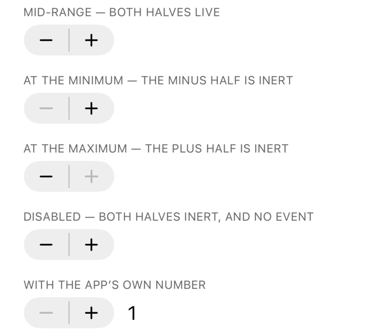</td>
    <td>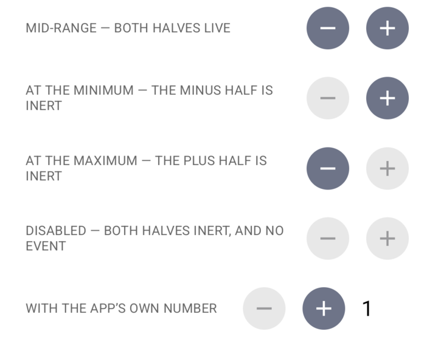</td>
  </tr>
</table>

Two halves that move a number by one `step` each. It draws **no number** — the
value goes to your own text, the way iOS apps do it — and it announces the value
itself, so `accessibilityLabel` is the half it cannot work out.

```tsx name=stepper
export function QuantityPicker({
  quantity,
  onQuantityChange,
}: {
  quantity: number;
  onQuantityChange: (next: number) => void;
}) {
  return (
    <View style={{ alignItems: 'center', flexDirection: 'row', gap: 12 }}>
      <Text style={{ fontSize: 20, minWidth: 32, textAlign: 'center' }}>
        {quantity}
      </Text>
      <Stepper
        accessibilityLabel="Quantity"
        maximumValue={99}
        minimumValue={1}
        onValueChange={onQuantityChange}
        value={quantity}
      />
    </View>
  );
}
```

Leave `value` out and native owns the displayed value, so a step costs no React
render at all — the same three modes as `Switch` and `Chip`: controlled,
uncontrolled, and a step the app refuses, which snaps back.

```tsx name=stepper-uncontrolled
export function BrightnessStep({ onStep }: { onStep: (next: number) => void }) {
  return (
    <Stepper
      accessibilityLabel="Brightness"
      defaultValue={5}
      maximumValue={10}
      minimumValue={1}
      onValueChange={onStep}
    />
  );
}
```

The value rules are `Slider`'s, in the same code: the value snaps to multiples of
`step` measured from `minimumValue`, `maximumValue` is always reachable (`0…10` by
`3` steps 0, 3, 6, 9, 10), and a `0.1` step arrives as `0.3`, not as
`0.30000000000000004`. `step` must be greater than `0` — that is not a small step,
it is no step, and the wrapper says so in development.

iOS is SwiftUI's own `Stepper`, so **hold-to-repeat works there and every repeat
is one step and one event**. Android has no stepper control, so it is composed from
two Material 3 tonal icon buttons with the 8 dp between them, each disabled at its
own bound — which is also why **Android has no hold-to-repeat**: a tap steps once.
At a bound the inert half produces no event at all, on both platforms, and a screen
reader meets one adjustable value rather than two buttons.
[stepper.md](docs/components/stepper.md) has the composition, the measurements and
the accessibility tree.

### SegmentedControl

<table>
  <tr><th>iOS</th><th>Android</th></tr>
  <tr>
    <td></td>
    <td></td>
  </tr>
</table>

`options` is the whole API surface of a segmented row, and it is also what
decides the control's width.

```tsx name=segmented-control
export function ViewToggle() {
  const [index, setIndex] = useState(0);

  return (
    <SegmentedControl
      options={['Day', 'Week', 'Month']}
      selectedIndex={index}
      onChange={(event) => setIndex(event.index)}
    />
  );
}
```

### Picker

<table>
  <tr><th>iOS</th><th>Android</th></tr>
  <tr>
    <td></td>
    <td></td>
  </tr>
</table>

The value is an index into `options`, as with `SegmentedControl`; `label` is
drawn as the Material 3 field's label on Android and used for accessibility on
iOS. `variant="radio"` shows every option instead of opening a menu — a Material
radio group on Android, and on iOS the menu again, because SwiftUI has no
radio-group style (`SegmentedControl` is the iOS control for "all shown").

```tsx name=picker
export function SizePicker() {
  const [index, setIndex] = useState(0);

  return (
    <Picker
      label="Size"
      options={['Small', 'Medium', 'Large']}
      selectedIndex={index}
      onChange={(event) => setIndex(event.index)}
    />
  );
}

export function SizeRadio() {
  const [index, setIndex] = useState(0);

  // `variant="radio"` keeps every option on screen: Android draws a Material radio
  // group, one row per choice; iOS has no radio-group picker style, so it draws the
  // menu above.
  return (
    <Picker
      accessibilityLabel="Size"
      onChange={(event) => setIndex(event.index)}
      options={['Small', 'Medium', 'Large']}
      selectedIndex={index}
      variant="radio"
    />
  );
}
```

### DatePicker

<table>
  <tr><th>iOS</th><th>Android</th></tr>
  <tr>
    <td></td>
    <td></td>
  </tr>
</table>

Dates are `Date` objects. `variant` picks `compact` (a field that opens the
platform picker, the default), `inline` or `wheel`; `mode` picks `date`, `time`
or `datetime`.

```tsx name=date-picker
export function DueDate() {
  const [date, setDate] = useState(() => new Date());

  return (
    <DatePicker accessibilityLabel="Due date" value={date} onChange={setDate} />
  );
}
```

### Menu

<table>
  <tr><th>iOS</th><th>Android</th></tr>
  <tr>
    <td></td>
    <td></td>
  </tr>
</table>

A trigger that opens a list of actions. It has no value, so there is nothing to
keep in sync: `onSelect` reports the `id` of the row that was picked, and the
items are data — never child views. The trigger is drawn like a `Button`, with
`Button`'s variants and sizes. A row can carry a `subtitle` (a second line) and
a `checked` (a check); a checked row is still just a row, so flip your own state
when it is picked. Give it a `primaryAction` and the control carries both a
default action and a list — one button with a long-press on iOS, a split button
on Android.

```tsx name=menu
export function FileActions() {
  const [last, setLast] = useState('nothing yet');
  const [pinned, setPinned] = useState(false);

  const group: MenuGroup = {
    actions: [
      { id: 'rename', title: 'Rename' },
      { id: 'duplicate', title: 'Duplicate', subtitle: 'Keeps the original' },
      { id: 'pin', title: 'Pinned', checked: pinned },
    ],
    sections: [
      {
        id: 'dangerous',
        title: 'Dangerous',
        // `systemImage` is iOS's glyph and `androidIcon` Android's. Each platform
        // ignores the other's, so one row reads the same on both.
        items: [
          {
            id: 'delete',
            title: 'Delete',
            destructive: true,
            systemImage: 'xmark',
            androidIcon: require('./assets/icons/close_24px.xml'),
          },
        ],
      },
    ],
  };

  const handleSelect = (id: string) => {
    setLast(id);
    if (id === 'pin') setPinned((current) => !current);
  };

  const handlePrimary = () => {
    setLast('file itself');
  };

  return (
    <>
      <Text>Last action: {last}</Text>
      <Menu
        accessibilityLabel="File"
        title="File"
        group={group}
        variant="tonal"
        size="medium"
        primaryAction={handlePrimary}
        onSelect={handleSelect}
      />
    </>
  );
}
```

`onOpen`/`onClose` exist but fire on Android only — SwiftUI's `Menu` has no
expansion binding, so iOS never reports either one — and a pick fires
`onSelect` before the `onClose` that follows it. `systemImage` is iOS-only and
`androidIcon` Android-only, on the rows as on the trigger; a row's glyph takes
Material's own leading slot, and on a checked row the check mark takes that slot
instead. A submenu nests on iOS and appears inline as a group of its own on
Android.
`primaryAction` works on both and is drawn each platform's way: on iOS the
trigger stays one button, where a tap runs the action and a long-press opens
the list; on Android it becomes Material 3's split button, so the left half
runs the action and the chevron on the right opens the list.
[menu.md](docs/components/menu.md) says which prop is which platform's.

### ContextMenu

<table>
  <tr><th>iOS</th><th>Android</th></tr>
  <tr>
    <td></td>
    <td></td>
  </tr>
</table>

A `View` that opens a menu on a long press. Its children stay where they are and
keep their own gestures: a tap is theirs, a scroll is the scroll view's, and a
hold that opens the menu cancels their touch, so a `Pressable` inside never
fires `onPress` for it. The rows are `Menu`'s `group`.

```tsx name=context-menu
const MESSAGE_ACTIONS: MenuGroup = {
  actions: [
    { id: 'reply', title: 'Reply', systemImage: 'arrowshape.turn.up.left' },
    { id: 'copy', title: 'Copy text', systemImage: 'doc.on.doc' },
    // iOS draws the SF Symbol; Android draws the `.xml` the app imports.
    {
      id: 'share',
      title: 'Share',
      systemImage: 'square.and.arrow.up',
      androidIcon: require('./assets/icons/share_24px.xml'),
    },
  ],
  sections: [
    {
      id: 'danger',
      items: [{ id: 'delete', title: 'Delete', destructive: true }],
    },
  ],
};

export function MessageRow() {
  const [last, setLast] = useState('nothing yet');

  return (
    <ContextMenu
      group={MESSAGE_ACTIONS}
      onSelect={setLast}
      style={messageStyles.bubble}
    >
      <Text>Hold this message for its menu.</Text>
      <Text>Last action: {last}</Text>
    </ContextMenu>
  );
}

const messageStyles = StyleSheet.create({
  bubble: { padding: 12, borderRadius: 16, backgroundColor: '#f2f2f7' },
});
```

iOS lifts the view itself as the preview (its corners follow `borderRadius`);
Android opens a Material menu at the finger. The rows are `Menu`'s rows, so
`systemImage` and `androidIcon` mean here exactly what they mean on
[Menu](#menu). `onOpen` and `onClose` fire on
both platforms, `onSelect` before the `onClose` that follows it. Set
`accessible` and an `accessibilityLabel` to make it one screen-reader element
with the menu on it. Without `accessible`, Android screen readers can't open the
menu. [context-menu.md](docs/components/context-menu.md) has the gesture rules
and the limits.

### Chip

<table>
  <tr><th>iOS</th><th>Android</th></tr>
  <tr>
    <td></td>
    <td></td>
  </tr>
</table>

A compact control sized to its label, in two kinds. A filter chip (the default)
has a selection: `selected` is controlled the way a Switch's `value` is, and
`defaultSelected` starts an uncontrolled one. An assist chip is an action with
`onPress`.

```tsx name=chip
export function PlaceFilters({
  onDirections,
  onStar,
}: {
  onDirections: () => void;
  onStar: () => void;
}) {
  const [openNow, setOpenNow] = useState(false);

  return (
    <>
      <Chip label="Open now" selected={openNow} onSelectedChange={setOpenNow} />
      <Chip label="Vegan" defaultSelected />
      <Chip
        variant="assist"
        label="Directions"
        systemImage="map"
        onPress={onDirections}
      />
      <Chip
        variant="assist"
        label="Starred"
        systemImage="star"
        androidIcon={require('./assets/icons/star_24px.xml')}
        onPress={onStar}
      />
    </>
  );
}
```

`systemImage` is iOS-only and `androidIcon` Android-only. On Android a selected
filter chip shows Material's check mark and is wider by it — unless a glyph
already holds that slot, in which case the check takes it and the chip does not
move; on iOS selection only changes the fill. [chip.md](docs/components/chip.md)
has the sizes, the icons and the limits.

### Checkbox

<table>
  <tr><th>iOS</th><th>Android</th></tr>
  <tr>
    <td></td>
    <td></td>
  </tr>
</table>

A checkbox: `checked` is controlled the way a Switch's `value` is, and
`defaultChecked` starts an uncontrolled one. `label` is part of the control and
of its size, and the whole row is tappable. iOS has no checkbox —
`CheckboxToggleStyle` is unavailable there — so a Checkbox there is a `Toggle`
wearing a style that draws Apple's own checklist glyph, the one Reminders and
Notes draw; `iosStyle` picks between that circle, a square, and the
`'switch'` look this component shipped with. Android ignores the prop: Material 3
has a checkbox.

```tsx name=checkbox
export function CheckoutOptions({
  onEmailMe,
}: {
  onEmailMe: (email: boolean) => void;
}) {
  const [gift, setGift] = useState(false);

  return (
    <>
      <Checkbox label="Gift wrap" checked={gift} onCheckedChange={setGift} />
      <Checkbox label="Email me the receipt" onCheckedChange={onEmailMe} />
    </>
  );
}
```

`indeterminate` asks for a third glyph, not a third value: a dash on Android and
`minus.circle.fill` on iOS. Each platform names that state for a screen reader in its own
words — Compose says "Partially checked", iOS says "mixed" — and neither says it as a
`checked` value. It is a display, so
`onCheckedChange` never carries a third value, and a press reports the opposite of
what the box shows — empty box → `true`, check mark → `false`, dash → `true`.
`checked` outranks the display on both platforms, so the press that empties a
_checked_ `indeterminate` box reports `false`. Nothing clears `indeterminate` for
you, so a caller resolves it in `onCheckedChange` (`setIndeterminate(false)` beside
`setChecked(next)`).
[checkbox.md](docs/components/checkbox.md) has the sizes and the limits.

### AlertDialog and ConfirmationDialog

Two exports over one native view. A dialog has no box: the view React Native
lays out is a `0 × 0` anchor, and the window is the platform's — UIKit's
`UIAlertController` on iOS (an alert, or an action sheet for a confirmation),
Material 3's `AlertDialog` on Android, and a `ModalBottomSheet` of rows for a
confirmation. The actions are data, like a `Menu`'s rows.

An alert, presented:

<table>
  <tr><th>iOS</th><th>Android</th></tr>
  <tr>
    <td></td>
    <td></td>
  </tr>
</table>

A confirmation, presented — UIKit's action sheet on the left, Material's bottom sheet of rows on the right:

<table>
  <tr><th>iOS</th><th>Android</th></tr>
  <tr>
    <td></td>
    <td></td>
  </tr>
</table>

```tsx name=dialog
const DRAFT_ACTIONS: DialogAction[] = [
  { id: 'keep', title: 'Keep', role: 'cancel' },
  { id: 'delete', title: 'Delete', role: 'destructive' },
];

export function DeleteDraft({ onDelete }: { onDelete: () => void }) {
  const [asking, setAsking] = useState(false);

  return (
    <>
      <Button
        title="Delete draft"
        variant="text"
        size="medium"
        onPress={() => setAsking(true)}
      />
      <AlertDialog
        isPresented={asking}
        onIsPresentedChange={setAsking}
        title="Delete the draft?"
        message="The draft and its photos go for good."
        actions={DRAFT_ACTIONS}
        onAction={(id) => {
          if (id === 'delete') onDelete();
        }}
      />
    </>
  );
}
```

`isPresented` is controlled: every native open or close comes back through
`onIsPresentedChange`, and a tapped action reports `onAction(id)` before the
close. An app that keeps `isPresented` true after a dismissal gets the dialog
back. `dismissible={false}` leaves only the actions as a
way out. On iOS the dialog is presented from a window of its own, so it works
inside and over a React Native `Modal`.
[dialog.md](docs/components/dialog.md) has the platform details.

### TextField

<table>
  <tr><th>iOS</th><th>Android</th></tr>
  <tr>
    <td></td>
    <td></td>
  </tr>
</table>

A single- or multi-line text field with React Native `TextInput`'s prop names:
`UITextField` (a `UITextView` when `multiline`) on iOS, Compose `BasicTextField`
on Android. It is undecorated, like `TextInput`, so a border or a background is
your container's. Controlled by `value`; a `value` written while an IME
composition is open is dropped rather than applied over it, and `ref` gives
`focus()` and `blur()`.

```tsx name=text-field
export function SignInForm({ onSignIn }: { onSignIn: () => void }) {
  const [email, setEmail] = useState('');
  const [password, setPassword] = useState('');
  const passwordField = useRef<TextFieldHandle>(null);

  return (
    <>
      <TextField
        accessibilityLabel="Email"
        placeholder="name@example.com"
        keyboardType="email-address"
        autoCapitalize="none"
        autoCorrect={false}
        returnKeyType="next"
        value={email}
        onChangeText={setEmail}
        onSubmitEditing={() => passwordField.current?.focus()}
      />
      <TextField
        ref={passwordField}
        accessibilityLabel="Password"
        placeholder="Password"
        secureTextEntry
        returnKeyType="go"
        value={password}
        onChangeText={setPassword}
        onSubmitEditing={onSignIn}
      />
    </>
  );
}
```

`maxLength` counts UTF-16 code units, as `string.length` does, and never cuts
an emoji in half. A multi-line field grows with its text; Return then inserts a
newline instead of submitting. A `TextField` cannot be a child of `<Host>` yet.
[text-field.md](docs/components/text-field.md) has the details.

### SearchField

<table>
  <tr><th>iOS</th><th>Android</th></tr>
  <tr>
    <td>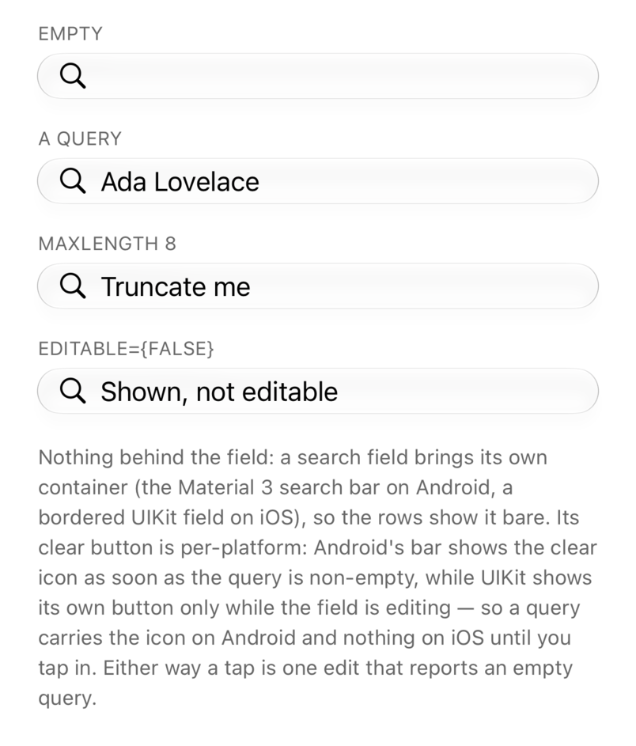</td>
    <td>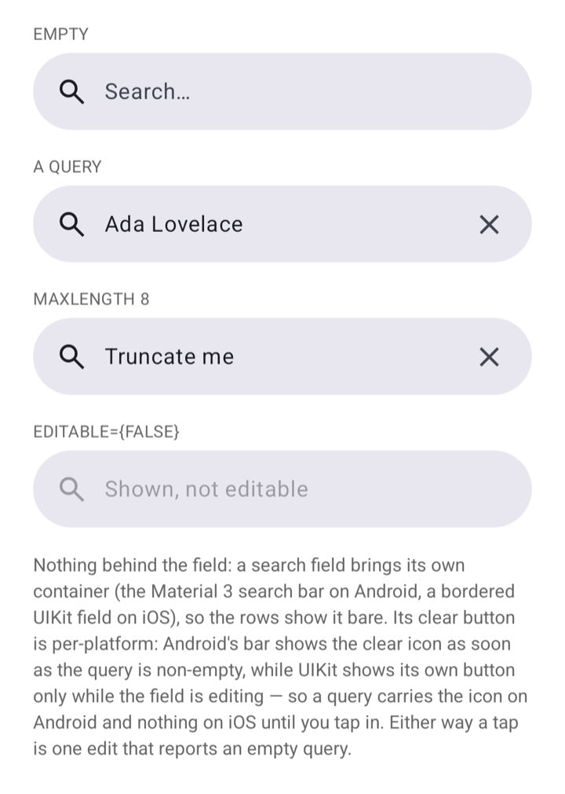</td>
  </tr>
</table>

A search field: one line, the keyboard's Search key, a leading search glyph and a
clear button that comes with the query — on iOS while the field is editing.
UIKit's own `UISearchTextField` on iOS,
Material 3's search input field on Android, so each platform draws its own search
field rather than a copy of the other's. Same React Native `TextInput` prop names
as `TextField` — controlled by `value`, `ref` gives `focus()` and `blur()`, and
the same `keyboardType`, `autoCapitalize` and `autoCorrect`. What stays fixed is
the shape and the key: one line, and Search submits it.

```tsx name=search-field
export function ProductSearch({
  onSearch,
}: {
  onSearch: (query: string) => void;
}) {
  const [query, setQuery] = useState('');

  return (
    <>
      <SearchField
        accessibilityLabel="Search products"
        placeholder="Search the catalogue"
        maxLength={40}
        value={query}
        onChangeText={setQuery}
        onSubmitEditing={onSearch}
      />
      <Text>
        {query === ''
          ? 'Type a product name, then press search.'
          : `Searching for ${query}…`}
      </Text>
    </>
  );
}
```

The Search key submits the query and then dismisses the keyboard, and an empty
query never submits — pressing it with nothing typed reports nothing. Tapping the
clear button is one edit: `onChangeText('')`, with the field still focused. Android
puts the framework's own localized word in an unset placeholder; iOS's standalone
UIKit field has no prompt of its own, so pass one if you want a word there. A
`SearchField`
cannot be a child of `<Host>` yet.
[search-field.md](docs/components/search-field.md) has the details.

### BottomSheet

<table>
  <tr><th>iOS</th><th>Android</th></tr>
  <tr>
    <td></td>
    <td></td>
  </tr>
</table>

A modal sheet whose content is React Native: UIKit's sheet presentation on iOS,
Material 3's `ModalBottomSheet` on Android. The children are laid out at the
sheet's width and take touches as anywhere else in the app; they are mounted
only while the sheet is up.

```tsx name=bottom-sheet
export function Filters() {
  const [open, setOpen] = useState(false);
  const [detent, setDetent] = useState(0);

  return (
    <>
      <Button
        title="Filters"
        variant="tonal"
        size="medium"
        onPress={() => setOpen(true)}
      />
      <BottomSheet
        isPresented={open}
        onIsPresentedChange={setOpen}
        detents={['medium', 'large']}
        onDetentChange={setDetent}
        // The next presentation opens at the first detent again.
        onDismiss={() => setDetent(0)}
        accessibilityLabel="Filters"
      >
        <View style={{ padding: 24, gap: 12 }}>
          <Text>{detent === 0 ? 'Half height' : 'Full height'}</Text>
          <Button
            title="Done"
            variant="filled"
            size="medium"
            onPress={() => setOpen(false)}
          />
        </View>
      </BottomSheet>
    </>
  );
}
```

Detents use SwiftUI's names - `'fit'` (the default: as tall as the content, and
following it), `'medium'`, `'large'`, `{ height }` and `{ fraction }` - and the
detent the user drags to is reported, not controlled. Android's Material sheet
has two rest positions, so there `'medium'` is the half-expanded one and the
largest other detent the expanded one. `isPresented` works as a dialog's does. On
iOS the sheet presents in the screen's own chain, and from a window of its own
when a React Native `Modal` is on top, so closing that `Modal` cannot strand it.
[bottom-sheet.md](docs/components/bottom-sheet.md) has the platform details.

### Tooltip

<table>
  <tr><th>iOS</th><th>Android</th></tr>
  <tr>
    <td>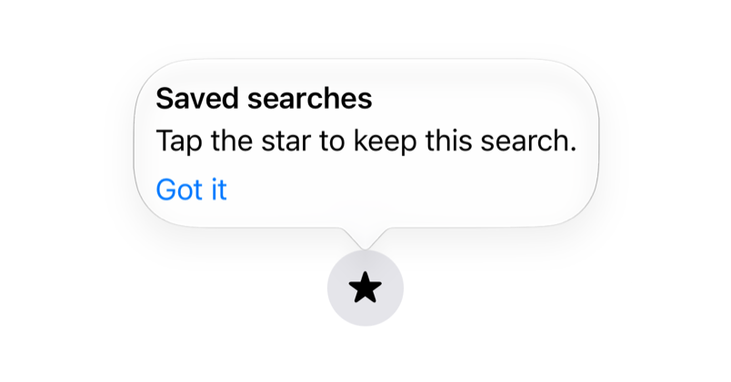</td>
    <td>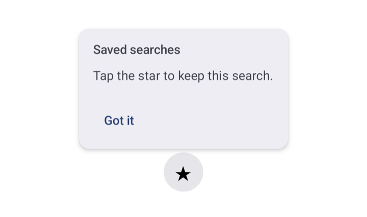</td>
  </tr>
</table>

A tooltip the app opens next to its own views: Material 3's plain or rich
tooltip on Android, and a popover on iOS, which has no tooltip control. The
children are the anchor, laid out in place, and keep their own taps.

```tsx name=tooltip
export function StarHint({ onStar }: { onStar: () => void }) {
  const [hint, setHint] = useState(true);

  return (
    <Tooltip
      isPresented={hint}
      onIsPresentedChange={setHint}
      title="Saved searches"
      message="Tap the star to keep this search."
      actions={[{ id: 'ok', title: 'Got it' }]}
    >
      <Pressable
        accessibilityRole="button"
        accessibilityLabel="Star this search"
        onPress={onStar}
      >
        <Text>★</Text>
      </Pressable>
    </Tooltip>
  );
}
```

There is no long-press trigger and no timeout: the app sets `isPresented`, and
the tooltip stays up until a tap outside, an action, Back (Android, with an
action) or the app closes it. `onAction` comes before the close it causes. The
tooltip follows its anchor through a layout change or a scroll. At most two
actions; a title or an action makes Android's tooltip the rich one.
[tooltip.md](docs/components/tooltip.md) has the platform details.

### Popover

<table>
  <tr><th>iOS</th><th>Android</th></tr>
  <tr>
    <td>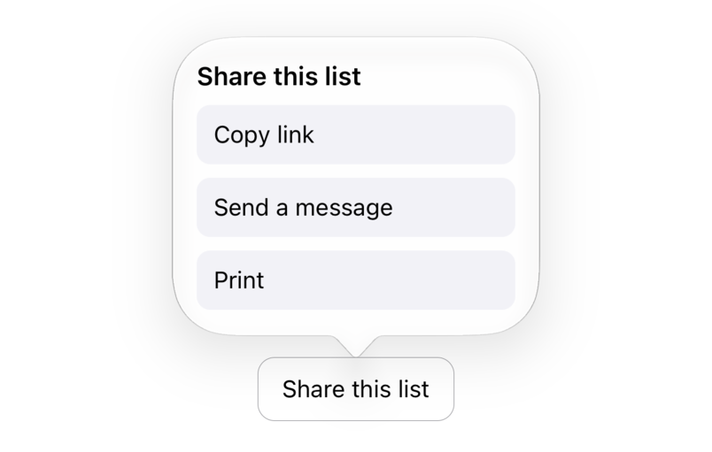</td>
    <td>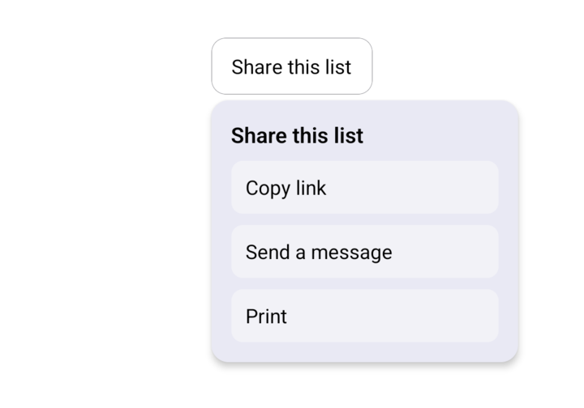</td>
  </tr>
</table>

A bubble anchored to one of your views, whose content is React Native views rather
than a string: `UIPopoverPresentationController` on iOS, and a popup window under a
Material 3 surface on Android, which has no popover of its own. The `anchor` stays in
your layout and keeps its own taps.

```tsx name=popover
export function ShareMenu() {
  const [open, setOpen] = useState(false);

  return (
    <Popover
      isPresented={open}
      onIsPresentedChange={setOpen}
      anchor={
        <Pressable accessibilityRole="button" onPress={() => setOpen(true)}>
          <Text>Share this list</Text>
        </Pressable>
      }
    >
      <Pressable accessibilityRole="button" onPress={() => setOpen(false)}>
        <Text>Copy link</Text>
      </Pressable>
      <Pressable accessibilityRole="button" onPress={() => setOpen(false)}>
        <Text>AirDrop</Text>
      </Pressable>
    </Popover>
  );
}
```

### Form

<table>
  <tr><th>iOS</th><th>Android</th></tr>
  <tr>
    <td>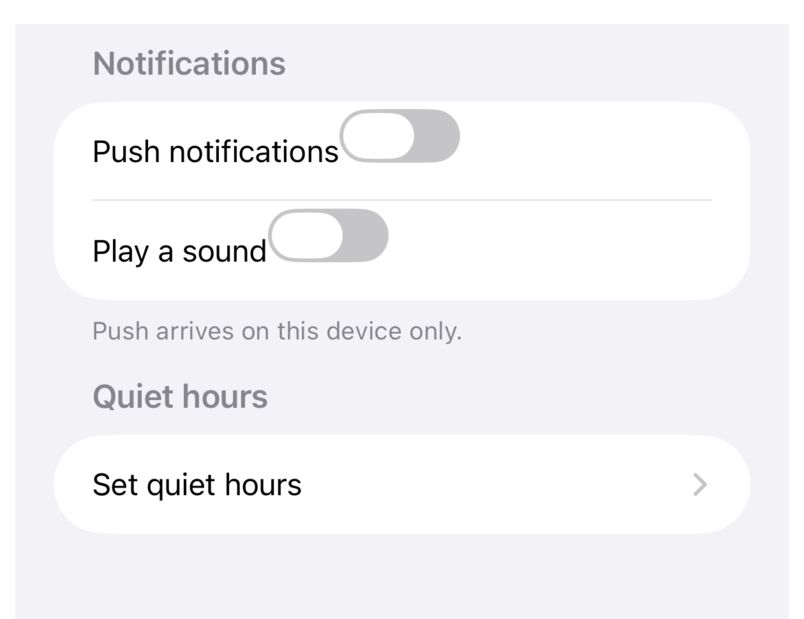</td>
    <td>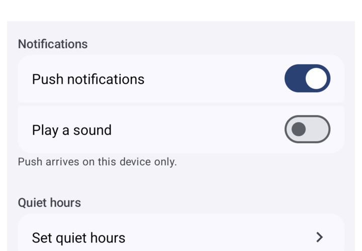</td>
  </tr>
</table>

A grouped, scrolling settings screen whose rows are ordinary React Native views.
`Form.Section` adds a header and a footer, `Form.Row` the cell-level behaviour
(`onPress`, `accessory`, `selected`); a bare child of a section is already a row.
`measure()` of a row is right once scrolling has settled, and a row scrolled out
of the list is not attached to a cell — `docs/components/form.md` has both.
A row lays its content out as one centred row at the row's full content width, so
a label with `flex: 1` puts a control on the trailing edge, level with the label.

```tsx name=form
export function NotificationForm({
  onOpenQuietHours,
}: {
  onOpenQuietHours: () => void;
}) {
  const [push, setPush] = useState(true);
  const [sound, setSound] = useState(false);

  return (
    <Form>
      <Form.Section
        title="Notifications"
        footer="Push arrives on this device only."
      >
        <Form.Row>
          <Text style={{ flex: 1 }}>Push notifications</Text>
          <Switch value={push} onValueChange={setPush} />
        </Form.Row>
        <Form.Row>
          <Text style={{ flex: 1 }}>Play a sound</Text>
          <Switch value={sound} onValueChange={setSound} />
        </Form.Row>
      </Form.Section>
      <Form.Section title="Quiet hours">
        <Form.Row accessory="disclosure" onPress={onOpenQuietHours}>
          <Text>Set quiet hours</Text>
        </Form.Row>
      </Form.Section>
    </Form>
  );
}
```

Your content is laid out in your own tree at up to `maxWidth` before the popover shows
it, so its first frame is already its final size — nothing is measured on the native
side. It goes below the anchor and above it when there is no room, clear of the
keyboard on Android. `onIsPresentedChange` is not called for a change you made, and a
close you refuse presents it again.
[popover.md](docs/components/popover.md) has the platform details.

### ListItem

<table>
  <tr><th>iOS</th><th>Android</th></tr>
  <tr>
    <td>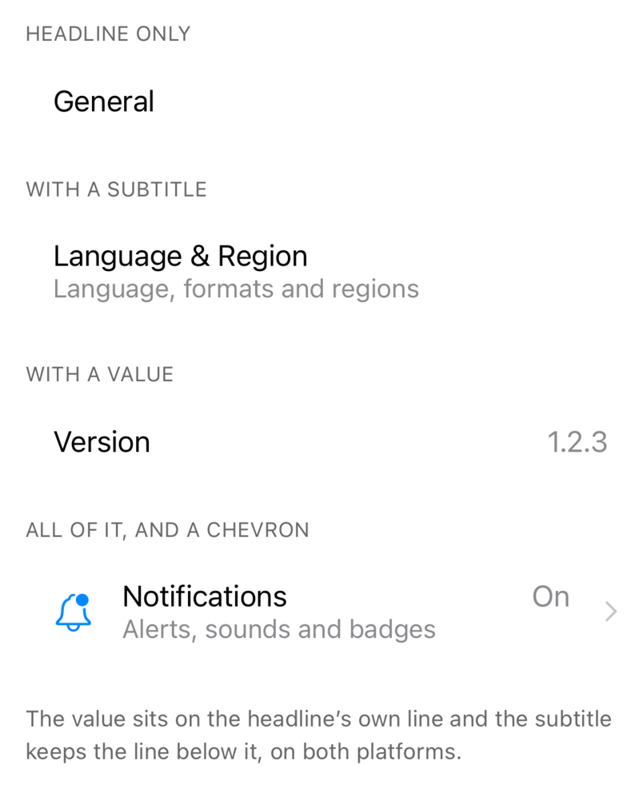</td>
    <td>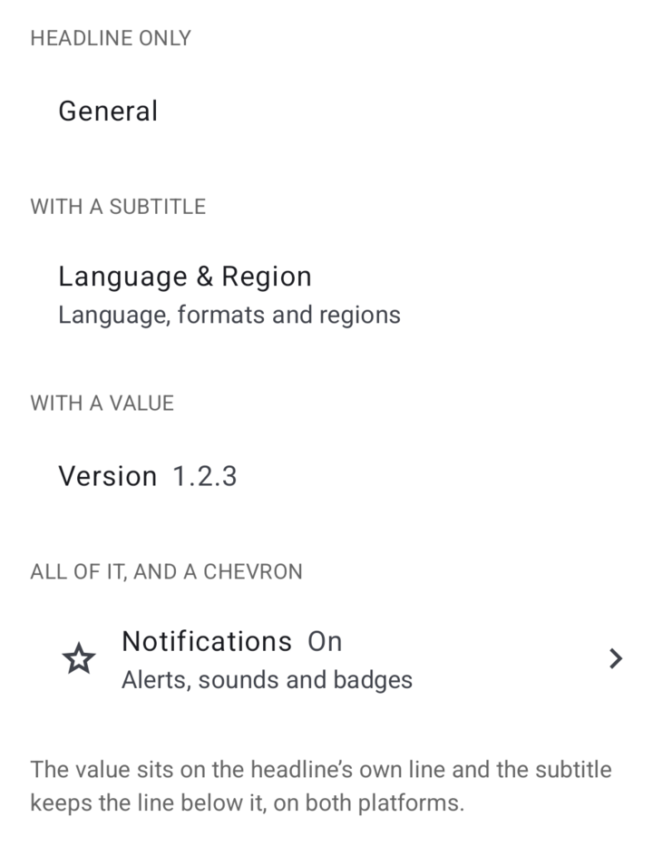</td>
  </tr>
</table>

The row content of a list row, drawn by the platform's own row view — UIKit's
`UIListContentView` on iOS, Material 3's `ListItem` on Android — rather than a
`Text` pair sized to look like one. `title` is the headline, `subtitle` the
supporting line under it, `value` the trailing answer on the headline's _own_
line ("Off", "1.2.3", "Last week"), `systemImage`/`androidIcon` the leading glyph,
and `accessory="disclosure"` the chevron every platform puts on a row that goes
somewhere.

```tsx name=list-item
export function RingtoneList({
  onOpenNotifications,
  onOpenArchive,
}: {
  onOpenNotifications: () => void;
  onOpenArchive: () => void;
}) {
  return (
    <View>
      <ListItem
        accessory="disclosure"
        androidIcon={require('./assets/icons/notifications_24px.xml')}
        onPress={onOpenNotifications}
        subtitle="Only while the app is open"
        systemImage="bell"
        title="Notifications"
      />
      <ListItem title="Version" value="1.2.3" />
      <ListItem
        accessory="disclosure"
        androidIcon={require('./assets/icons/archive_24px.xml')}
        disabled
        onPress={onOpenArchive}
        systemImage="tray.and.arrow.down"
        title="Archived conversations"
        value="Soon"
      />
    </View>
  );
}
```

**Every slot is one line, tail-truncated** — and that is a sizing decision, not a
styling one. It is what makes a row's height a function of _which_ slots are
filled rather than of what was typed into them, so one measured height serves
every row of its configuration: a list of a hundred rows corrects its height four
times, not a hundred, and a row's pitch does not change when the text does. `ListItem`
is `fillWidth`, so it takes the width of whatever it is in and answers only the
height.

`onPress` is what makes a row a row: without it the item has no highlight, is not
a button to a screen reader, and a tap goes through to whatever is behind it.
`disabled` keeps the row drawn and takes nothing — no press, no highlight, no
event. Screen readers get **one element** per item, reading title, subtitle and
value.

Inside a `Form.Row` the item is the content and the row is the cell, so the item
adds no insets, no shape and no press of its own — it draws edge-to-edge in the box
the cell already inset. Nothing has to be configured for that; `ListItem` knows
because `Form.Row` says so.

```tsx name=list-item-in-form
export function AccountForm({ onOpenProfile }: { onOpenProfile: () => void }) {
  return (
    <Form style={{ height: 220 }}>
      <Form.Section title="Account">
        {/* Inside a row the item draws no insets, shape or press of its own: the
            row is the cell, and the cell has already paid for all three. */}
        <Form.Row>
          <ListItem
            accessory="disclosure"
            androidIcon={require('./assets/icons/person_24px.xml')}
            onPress={onOpenProfile}
            subtitle="Signed in on 3 devices"
            systemImage="person.crop.circle"
            title="Profile"
          />
        </Form.Row>
        <Form.Row>
          <ListItem title="Sign out" />
        </Form.Row>
      </Form.Section>
    </Form>
  );
}
```

Either side can carry the press: `Form.Row onPress` makes the item a label inside
the cell, and `ListItem onPress` in a row without one hands that handler up to the
row, so the cell still does the pressing and draws its own pressed state. Wire it on
one of the two, not both — the row's handler is the one that fires.
In a `FlashList` or `FlatList` row the same item recycles with the row and resets
completely — the cell's highlight, the drawn slots and its own press count.
[list-item.md](docs/components/list-item.md) has the measurements per
configuration, both platforms' insets, and the recycle rules.

### Host

Opt-in. On Android its direct hosted children share one Compose composition; on
iOS it is a plain `View`. Its only children may be nitro-ui controls other than
`Chip`, `TextField`, `Checkbox`, `SearchField`, `IconButton`, `BottomSheet`,
`ContextMenu`, `Tooltip` and `Popover`; one of those nine, an RN view, plain text
or a nested `<Host>` throws in development. A hosted `Picker`'s menu,
`DatePicker`'s dialog and `Menu`'s list open under the box the Host drew; they
and a hosted dialog are the Host composition's own windows, and close with it.
Give it a height.

```tsx name=host
export function NotificationSettings() {
  const [push, setPush] = useState(true);
  const [email, setEmail] = useState(false);

  // Android: both Switches render in one Compose composition.
  // iOS: Host is a plain View, so this renders exactly as without it.
  return (
    <Host style={styles.settings}>
      <Switch accessibilityLabel="Push" value={push} onValueChange={setPush} />
      <Switch
        accessibilityLabel="Email"
        value={email}
        onValueChange={setEmail}
      />
    </Host>
  );
}

const styles = StyleSheet.create({
  // Say how tall a Host is: it draws its children into this box.
  settings: { height: 96 },
});
```

## Android theme

Android controls are drawn with **Material 3 Expressive**, Android's design
since Android 16, over the device's dynamic colours (Android 12+) or the default
Material 3 colours, light or dark with the system. Today what the Expressive
theme changes is motion: a Switch's thumb, a Checkbox's mark, a menu or a sheet
opening move with Material's expressive springs, and Material ties more to the
theme with each release. It comes from Material 3 1.5, currently a beta, which
this library brings into your app (see [Requirements](#requirements)).

To keep the baseline Material 3 theme instead, call `setMaterialTheme` once:

```tsx name=material-theme
// Once, at startup — before the first screen renders.
setMaterialTheme('baseline');
```

The choice is the whole app's: every control and every `<Host>` follows it, and
there is no per-control prop. `setMaterialTheme('expressive')` goes back to the
default, and a later call still reaches the controls already on screen without
resetting them: an open sheet or menu stays open and a focused field keeps its
focus. It does nothing on iOS.

## Sizing

A control's box is **its own measurement**, taken at runtime on the device your
app is running on, and reported to the layout engine — not a constant written
into the library. A Switch is 61 × 28 pt on iOS 26+ and 51 × 31 pt on iOS 15–25
because the running OS says so. `Slider`, a `linear` `Progress`, `TextField`, a
`wheel` `Picker` and an `inline` or `wheel` `DatePicker` are `fillWidth`: their
width is the box their parent gives them and only their height is their own.

- **Your styles win.** `width`, `height` or `flex` fix the box and the control
  centres inside it, exactly as with a stock RN component.
- **One difference from stock RN:** measured sizes leave Yoga nothing to stretch,
  so a parent's `alignItems: 'stretch'` does not widen an intrinsic control. Ask
  for the fill on the control itself: `alignSelf: 'stretch'`.
- **The first mount of a new configuration can be one frame off.** A
  "configuration" is the set of props a control's size depends on — a Button's
  title, a SegmentedControl's option list, a Progress's variant. The very first
  instance of one is laid out at a declared fallback size for a single frame and
  then corrected; every later instance of that configuration lays out exactly on
  its first frame, and an app never pays it for a Switch or a Slider (they have
  one configuration each). On iOS 26+ an app that sets
  `UIDesignRequiresCompatibility` pays that one-frame correction even for a
  Switch, because the OS control is a different size than the one the platform
  now declares.
- **`prewarm` makes the first mount exact.** `prewarm(['NitroUiSwitch'])` adopts
  a component's declared size as this environment's provisional answer before the
  first screen mounts, so nothing shows the fallback frame. It is cheap, safe to
  call with a name a future version does not know, and the sizing engine still
  treats it as provisional: a real measurement replaces it if it disagrees. It
  seeds a component's default configuration only, which covers `Switch`,
  `Slider` and a `linear` `Progress`; there is no way yet to pre-warm a
  particular Button title, option list or DatePicker.
- **A control inside `<Host>` is not measured at all** on Android: the Host
  draws its children in one column at its own width, so the box to get right is
  the Host's. See [host.md](docs/components/host.md#sizing-d24).

[sizing.md](docs/architecture/sizing.md) has the rule, the counters and the
traps; [core.md](docs/architecture/core.md) has the hosting model underneath it.

## Performance

The controls are benchmarked in Release builds against two alternatives, on the
same device and in the same run:

- **React Native core** — the pure-JS answer (a row of `Pressable`s, the stock
  `ActivityIndicator`, …). It is a floor, not a peer: it draws less and hosts no
  native UI framework.
- **[`@expo/ui`](https://docs.expo.dev/versions/latest/sdk/ui/)**, which wraps
  the same SwiftUI and Compose controls, measured two ways: one hosting view per
  control, and one hosting view shared by all of them. The shared host is the
  one nitro-ui aims to match.

The headline results come from an iPhone 17 simulator (iOS 27) and an API 35
Pixel 9 emulator, for `Switch`, `Slider`, `Progress`, `Button`,
`SegmentedControl`, `Picker`, `DatePicker` and `Menu`. Each figure is nitro-ui
divided by `@expo/ui`, so below 1× is better:

- **Against one hosting view per control** — the shape nitro-ui has too —
  nitro-ui is faster and lighter on every result clear enough to call: time
  until the controls are on screen 0.16–0.45× on iOS and 0.51–0.88× on Android,
  UI-thread CPU 0.04–0.48× and 0.45–0.84×, memory 0.67–0.98× and 0.49–0.82×.
- **iOS, against the shared host:** time to screen is at parity or better on
  every control with a clear result (`DatePicker` and `Menu` read about 2× on
  one run, too noisy to call). Memory per instance is 1.34–1.48× on `Slider`,
  `Progress`, `Button` and `Menu`, because each control owns a SwiftUI hosting
  controller where `@expo/ui` shares one, and at parity or below on the rest.
  There is no known fix: a shared iOS host was built and measured, and it made
  mount and unmount CPU worse. UI-thread CPU is lower on `Switch`, `Slider`,
  `SegmentedControl`, `DatePicker` and `Picker`, and 1.13–1.38× on `Progress`,
  `Button` and `Menu`.
- **Android, against the shared host:** an unhosted control owns its own
  Compose composition, so most cost more memory — 1.1–2.8× per instance — and
  more UI-thread CPU per mount, up to 1.8×. `Picker` and `Menu` are below it on
  memory (0.91×, 0.85×), because `@expo/ui`'s versions of those two are heavy.
- **`<Host>` is the Android answer.** Inside one, the same controls use
  0.26–0.58× the memory and 0.44–0.70× the UI-thread CPU of unhosted ones, which
  puts them at or below the shared host's memory (`Slider` is level at 1.02×).
  The cost is JS-thread CPU, 2–32 % more per mount. On an Android screen with
  many controls — a settings list, a long form — wrap them in a `<Host>`.

The main caveat: these are simulator and emulator numbers from development
Macs, not physical devices. Two machines agree on the shape but not on every
cell, and at 50 controls an iOS mount often fits inside one 16 ms frame for
every library, so 1.00× there is the frame, not a tie. `Chip`, `TextField`, the
dialogs and `BottomSheet` have no published comparison yet.

[docs/performance.md](docs/performance.md) has every cell, the runs they came
from, and the readings behind these lines.

## Known limitations

The full list per control is in its doc; these are the ones that bite.

- **An over-wide row still reads badly on Android.** `SegmentedControl`,
  `Button` and `Picker` fit what they are given: content wider than its box is
  laid out at the box's width. Fitting is not the same as legible, though — Material 3 shares a row's width equally between its
  segments, so four labels in 140 dp each collapse to an ellipsis. Keep option
  lists and titles within the available width.
- **iOS `SegmentedControl` ignores `tintColor`.** A SwiftUI segmented `Picker`
  ignores `.tint()`, so a tinted row looks like the default one on iOS. It works
  on Android.
- **A determinate circular `Progress` draws a spinner on iOS.** SwiftUI's
  `.circular` `ProgressView` keeps spinning whatever fraction it is handed; the
  value reaches VoiceOver, not the pixels. Android draws the ring filled. An
  indeterminate **linear** bar on iOS shows an empty track and does not visibly
  animate.
- **`trackColor` is Android-only** (nothing in SwiftUI addresses the track) and
  **`systemImage` is iOS-only** (Android ignores it). Both are accepted on both
  platforms so the JS API means one thing.
- **Android's wheels are Material's own.** With `variant="wheel"`, `Picker` gets a
  `ScrollField` drum and a `DatePicker` in `mode="time"` gets Material's time drums —
  each reporting one change per settled roll. A drum keeps the vertical drag that begins
  on it, so a page with a wheel in it is scrolled beside the wheel. There is no _date_
  wheel: `DatePicker` with `mode="date"` or `"datetime"` keeps the inline calendar there.
  Android also has no combined date-and-time control: `mode="datetime"` opens a date
  dialog and then a time dialog.
- **`Menu`'s open state is Android-only, and its splits are iOS's.** SwiftUI's
  `Menu` has no expansion binding, so **iOS never fires `onOpen` or `onClose`**,
  and a `disabled` that arrives while the menu is open closes it on Android only —
  an iOS menu can stay up over a disabled trigger. Build app state
  on `onSelect`. A submenu nests on iOS and renders inline under a divider on
  Android. `primaryAction` runs on both platforms: on iOS one button does both — a
  tap runs it and a long press opens the list; on Android they are two halves, and
  the trigger is wider.
- **`<Host>` only helps on Android, and holds nitro-ui controls only** — every
  one except `Chip`, `TextField`, `Checkbox`, `SearchField`, `IconButton`,
  `BottomSheet`, `ContextMenu`, `Tooltip` and `Popover`. Any other child — one of
  those nine, an RN view, text, another `<Host>` — throws in development. Give
  a Host a height; per-child sizes, `gap`, `flexDirection` and `alignItems` do
  not reach what it draws.
- **Expo Go is not supported** — a dev build is required, because Nitro Modules
  needs native code.
- **`testID` lands on the host** on Android (`View.tag`), because Compose has no
  test id; a test that looks a control up by `testID` finds that view. Inside a `<Host>` the view
  that carries a Switch's `testID` is not where the Switch is drawn — it reads
  back `0 × 0` at mount and the child's Yoga frame after any later layout pass
  over it — so find hosted controls by `accessibilityLabel`.
- **Accessibility props belong on the control, not the box.** The label lives on
  the hosted control, so adding `accessible` or an `accessibilityRole` to a
  control's container can hide that control from VoiceOver / TalkBack. Style the
  box; do not re-role it. `aria-label` / `aria-disabled` are not translated.
- **Small platform differences:** iOS `Slider` answers drags that start on the
  thumb (that is `UISlider`); Android infers `onSlidingStart` from the first
  value change; a rejected controlled change reverts without animation; segment
  widths are equal shares on Android and SwiftUI's own distribution on iOS.

## How it works

- Each control is a Nitro Hybrid View specified in `src/*.nitro.ts`. The
  code `nitrogen` generates from those specs ships in the package
  (`nitrogen/generated/`), so your build runs no code generation.
- `cpp/`, `ios/` and `android/` hold the C++ core, the SwiftUI hosting and the
  Compose hosting. The Compose and SwiftUI build configuration lives in this
  package, so your app inherits it.
- Prop changes are batched: a render that changes several props updates the
  native control once, and the hosting view is created once and never rebuilt.
  Controlled values use an event-count handshake, so a value React sends while
  the user is changing the control can never overwrite what the user just did.
- Sizing is a shared C++ engine that measures each control, caches the answer
  per configuration, and corrects a wrong guess in one frame.

[core.md](docs/architecture/core.md) (how a control is hosted) and
[sizing.md](docs/architecture/sizing.md) have the long form.

## Contributing

- [Development workflow](CONTRIBUTING.md) — prerequisites, the scripts, the
  tests and how a change is checked
- [Storybook](example/README.md#storybook) - the example app is also a showcase
  app: `bun run storybook:ios` / `bun run storybook:android` starts it, and
  `bun run storybook` runs its Metro server separately
- [Sending a pull request](CONTRIBUTING.md#sending-a-pull-request)
- [Code of conduct](CODE_OF_CONDUCT.md)

## License

[MIT](LICENSE)
