# react-native-nitro-ui

Native SwiftUI and Jetpack Compose components for React Native, built on
[Nitro Modules](https://nitro.margelo.com/).

Most "native" component libraries re-implement a platform control in React
Native and copy the screenshots. This one hosts the real thing: each control is
a SwiftUI view or a Jetpack Compose composable inside a Nitro Hybrid View, so
the toggle animates like Apple's, the slider takes drags the way `UISlider`
does, the iOS segmented row truncates labels the way the OS does, and VoiceOver and
TalkBack get the control's own accessibility instead of an approximation of it.
Layout still belongs to Yoga — the control measures itself, reports its size to
the layout engine, and React never sees a native node.

## Components

| Component          | iOS                                                         | Android                                                      | Status | Docs                                                         |
| ------------------ | ----------------------------------------------------------- | ------------------------------------------------------------ | ------ | ------------------------------------------------------------ |
| `Switch`           | `Toggle(…).toggleStyle(.switch)`                            | `androidx.compose.material3.Switch`                          | 0.1.0  | [switch.md](docs/components/switch.md)                       |
| `Slider`           | `Slider(value:in:step:onEditingChanged:)`                   | `androidx.compose.material3.Slider`                          | 0.1.0  | [slider.md](docs/components/slider.md)                       |
| `Progress`         | `ProgressView` + `.progressViewStyle(.linear / .circular)`  | `LinearProgressIndicator` / `CircularProgressIndicator` (M3) | 0.1.0  | [progress.md](docs/components/progress.md)                   |
| `Button`           | `Button(action:) { Label }` + `.buttonStyle(…)`             | the five Material 3 button composables                       | 0.1.0  | [button.md](docs/components/button.md)                       |
| `SegmentedControl` | `Picker(…).pickerStyle(.segmented)`                         | `SingleChoiceSegmentedButtonRow`                             | 0.1.0  | [segmented-control.md](docs/components/segmented-control.md) |
| `Picker`           | `Picker(…).pickerStyle(.menu / .wheel)`                     | `ExposedDropdownMenuBox` (M3)                                | 0.1.0  | [picker.md](docs/components/picker.md)                       |
| `DatePicker`       | `DatePicker` (`.graphical` / `.wheel`, compact field)       | M3 `DatePicker` / `TimePicker` and their dialogs             | 0.1.0  | [date-picker.md](docs/components/date-picker.md)             |
| `Menu`             | `Menu(content:label:primaryAction:)`, `.menuStyle(.button)` | `ExposedDropdownMenuBox` (`menuAnchor`) + `DropdownMenuItem` | 0.4.0  | [menu.md](docs/components/menu.md)                           |
| `Host`             | a plain `View` (passthrough, by design)                     | one shared Compose composition for its hosted children       | 0.1.0  | [host.md](docs/components/host.md)                           |

`Host` is a container, not a control: an opt-in way to give a batch of controls
one Compose composition on Android instead of one each. It held Switches only
in 0.1.0; `Slider`, `Progress` and `Button` joined it in 0.2.0,
`SegmentedControl`, `Picker` and `DatePicker` in 0.3.0, and `Menu` in 0.4.0, so
it holds every control the library ships. See [Performance](#performance) for
what it buys and what it costs.

Everything is exported from the package root, along with `nitroUiCore` (a
monotonic clock, `CLOCK_UPTIME_RAW` / `CLOCK_MONOTONIC`, plus sizing
diagnostics) and `prewarm` (see [Sizing](#sizing)):

```ts
import {
  Button,
  DatePicker,
  Host,
  Menu,
  Picker,
  Progress,
  SegmentedControl,
  Slider,
  Switch,
} from 'react-native-nitro-ui';
```

## Requirements

| Platform | Minimum                                                                     |
| -------- | --------------------------------------------------------------------------- |
| iOS      | `min_ios_version_supported` (RN's floor — 15.1 on RN 0.86 / 0.88)           |
| Android  | `minSdkVersion` 24, `compileSdkVersion` 36 (inherited from the RN template) |
| RN       | `>= 0.86` with the new architecture                                         |
| Nitro    | `react-native-nitro-modules ^0.37.1`                                        |

Jetpack Compose (compiler plugin + Material 3 BOM) is configured inside this
package's `android/build.gradle`, so your app does not have to opt in to Compose
to use one slider, and no Podfile or Gradle edits are needed either way.

A dev build is required: Expo Go is not supported, because Nitro Modules needs
native code.

## Installation

```sh
npm install react-native-nitro-ui react-native-nitro-modules
```

React Native autolinks the native code: no config plugin, no Podfile or Gradle
edits, no manual linking. `react-native-nitro-modules` is a peer dependency —
every control here is a Nitro Hybrid View, so your app needs it too.

What is left is compiling the new native code in, which needs more than a Metro
reload. Both routes below are what the consumer smoke tests run.

Expo (Continuous Native Generation):

```sh
npx expo prebuild   # or: npx expo run:ios / npx expo run:android / eas build
```

Bare React Native CLI — the template ships a Gemfile, so use it:

```sh
cd ios && bundle install && bundle exec pod install
```

Then `npx expo run:ios` / `run:android`, or `npx react-native run-ios` /
`run-android`.

### Without npm

From a clone (a fork, or a fix you need before the next release): the package
needs a build step (`bob build`, which also regenerates the Nitro code) before
an app can use it, so build the tarball and install that. You need
[bun](https://bun.sh) 1.4 and Node 24 (see
[CONTRIBUTING](CONTRIBUTING.md#prerequisites)).

```sh
git clone https://github.com/dannyhw/react-native-nitro-ui.git
cd react-native-nitro-ui
bun install
bun run prepare                          # builds lib/ with builder-bob
npm pack                                 # writes react-native-nitro-ui-<version>.tgz
```

Then, in your app:

```sh
npm install /path/to/react-native-nitro-ui-<version>.tgz react-native-nitro-modules
```

and rebuild as above. This is the path the consumer smoke tests take
(`bun run smoke:pack`, then `npm install` of the tarball into a freshly
generated app); see [Consumer smoke tests](CONTRIBUTING.md#consumer-smoke-tests).

Installing straight from GitHub (`npm install github:dannyhw/react-native-nitro-ui`)
is untested: npm would have to install this repo's development dependencies,
including its example and benchmark workspaces, and run the build during your
install. Use the tarball.

### What has been tried

The consumer smoke tests (`scripts/smoke/`) install the packed tarball with
`npm` into a fresh app, build **Release**, launch it and check that every
control mounts with a non-zero size - the eight controls the app mounts today,
plus a `<Host>` holding two Switches. The `Smoke` workflow is disabled and
dispatch-only, so these run by hand; `CI`, `Release`, `Release tag` and
`Changeset status` are the workflows that run on GitHub. Every ticked cell below
was green for the 0.1.0 tarball on 2026-10-26 and nothing has been re-run since -
`Menu` joined the smoke app after that, so no consumer run has printed a
`menu=WxH` box:

| Consumer              | iOS | Android |
| --------------------- | --- | ------- |
| Expo SDK 58 (RN 0.88) | ✅  | ✅      |
| RN CLI 0.88.0         | ✅  | ✅      |
| RN CLI 0.86.3         | n/a | ✅      |

RN 0.86.3 is the supported floor, and its iOS cell cannot be ticked on this
machine: UIKit terminates a freshly generated 0.86.3 app at launch on the iOS 27
simulator runtime for not adopting the scene lifecycle, before any JavaScript
runs, and the crash names UIKit's scene check with no library frames in it. The
same launch failure was measured earlier with this library absent. The row needs
a run on an older iOS runtime.

## Usage

Each control has the props of the platform control it wraps, not a
lowest-common-denominator subset. The tables in the component docs list every
prop against the TypeScript type; these are the shapes you will actually write.
The screenshots are the example app's Storybook (`bun run storybook:ios` /
`bun run storybook:android`) on an iPhone 17 simulator (iOS 27) and an Android 15
emulator, light appearance.

### Switch

<table>
  <tr><th>iOS</th><th>Android</th></tr>
  <tr>
    <td>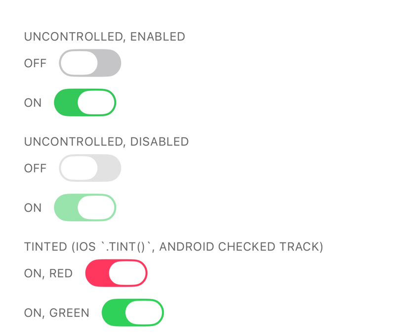</td>
    <td>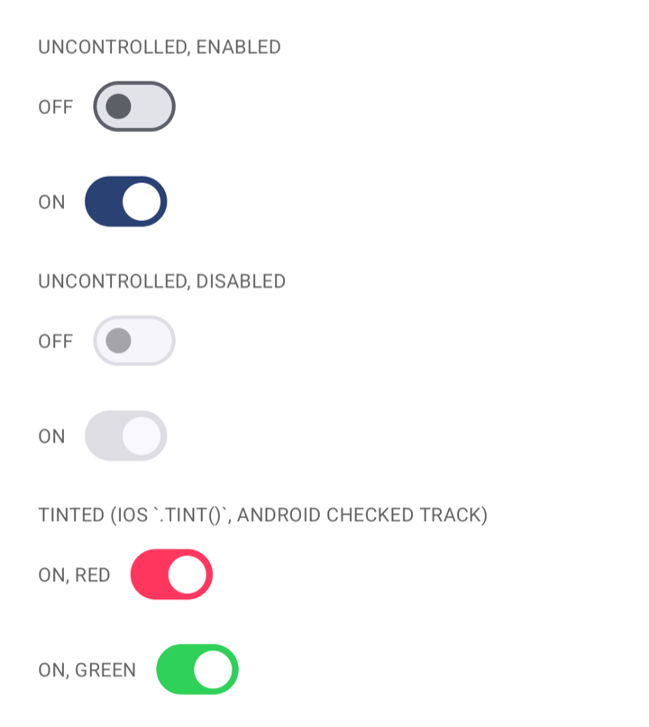</td>
  </tr>
</table>

Controlled by `value`; omit it and native owns the displayed state (a toggle
then costs no React render).

```tsx name=switch
export function WifiSettings() {
  const [enabled, setEnabled] = useState(false);

  return (
    <>
      <Text>Wi-Fi</Text>
      <Switch
        accessibilityLabel="Wi-Fi"
        value={enabled}
        onValueChange={setEnabled}
      />
    </>
  );
}
```

### Slider

<table>
  <tr><th>iOS</th><th>Android</th></tr>
  <tr>
    <td>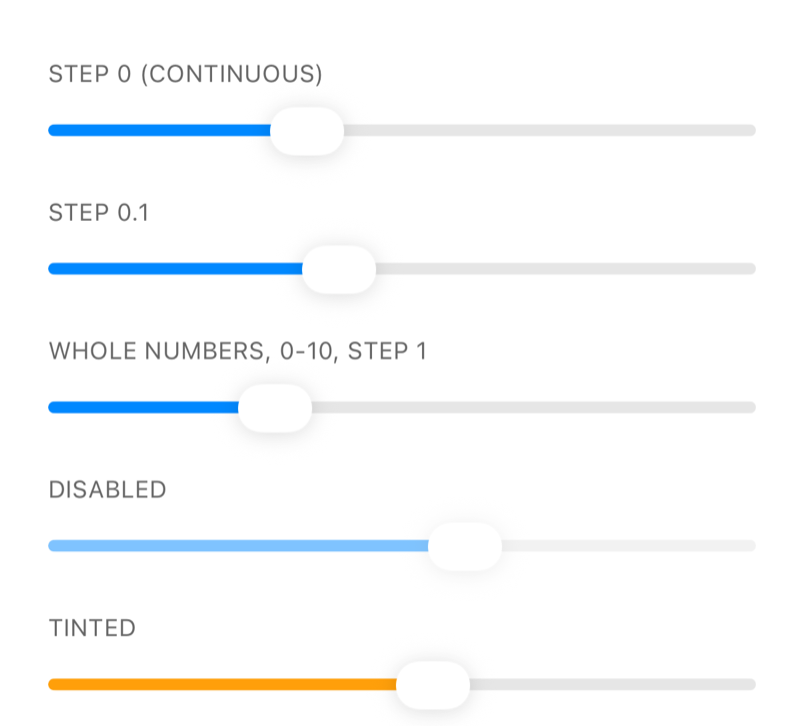</td>
    <td>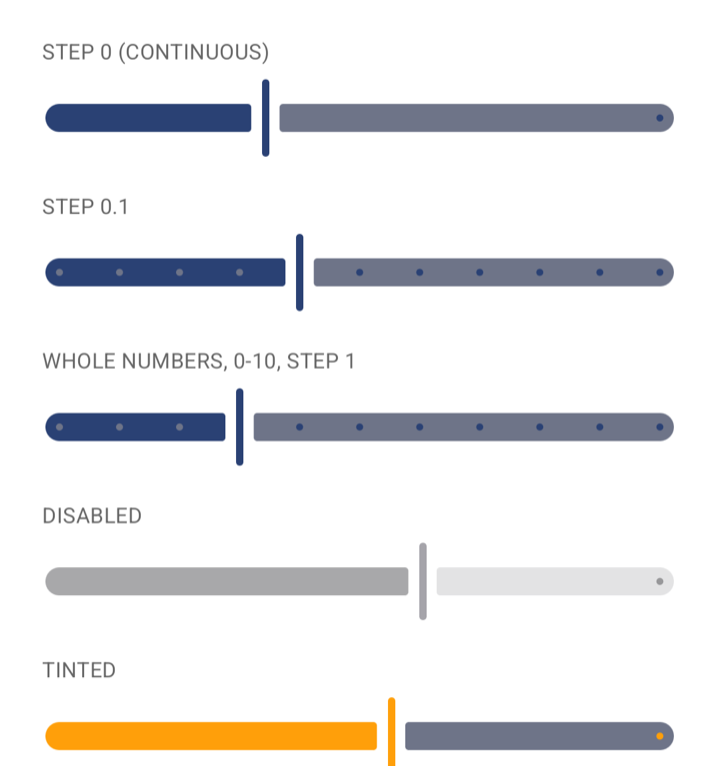</td>
  </tr>
</table>

`onValueChange` fires at most once per frame during a drag;
`onSlidingComplete` always fires once with the value the gesture settled on.

```tsx name=slider
export function VolumeSlider() {
  const [volume, setVolume] = useState(0.5);

  return (
    <Slider
      accessibilityLabel="Volume"
      value={volume}
      onValueChange={setVolume}
      minimumValue={0}
      maximumValue={1}
      step={0.05}
    />
  );
}
```

### Progress

<table>
  <tr><th>iOS</th><th>Android</th></tr>
  <tr>
    <td>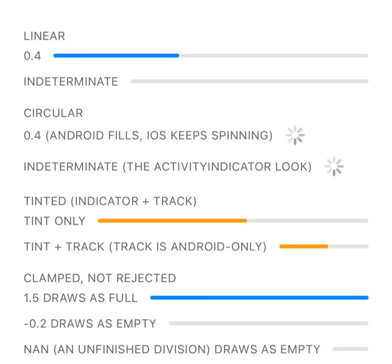</td>
    <td>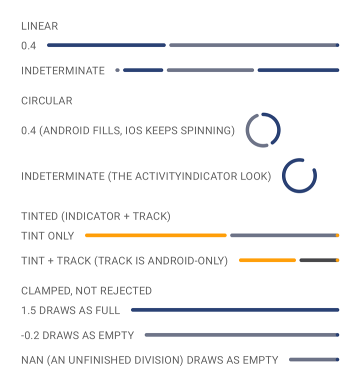</td>
  </tr>
</table>

`value` is a fraction of the whole; `null` means indeterminate rather than
empty.

```tsx name=progress
export function UploadProgress({ fraction }: { fraction: number | null }) {
  // `null` is indeterminate ("working"); a number 0…1 is a determinate bar.
  return <Progress accessibilityLabel="Uploading" value={fraction} />;
}
```

### Button

<table>
  <tr><th>iOS</th><th>Android</th></tr>
  <tr>
    <td>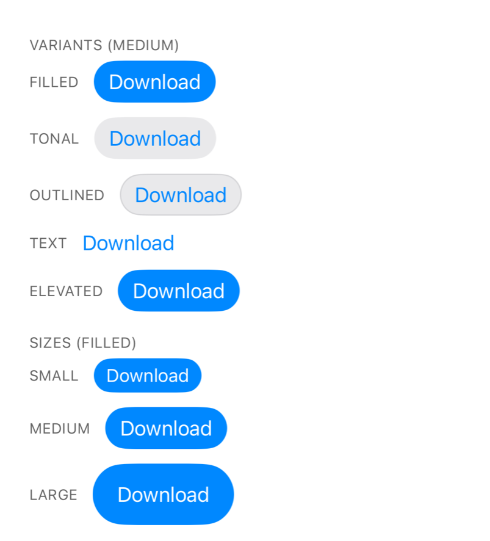</td>
    <td>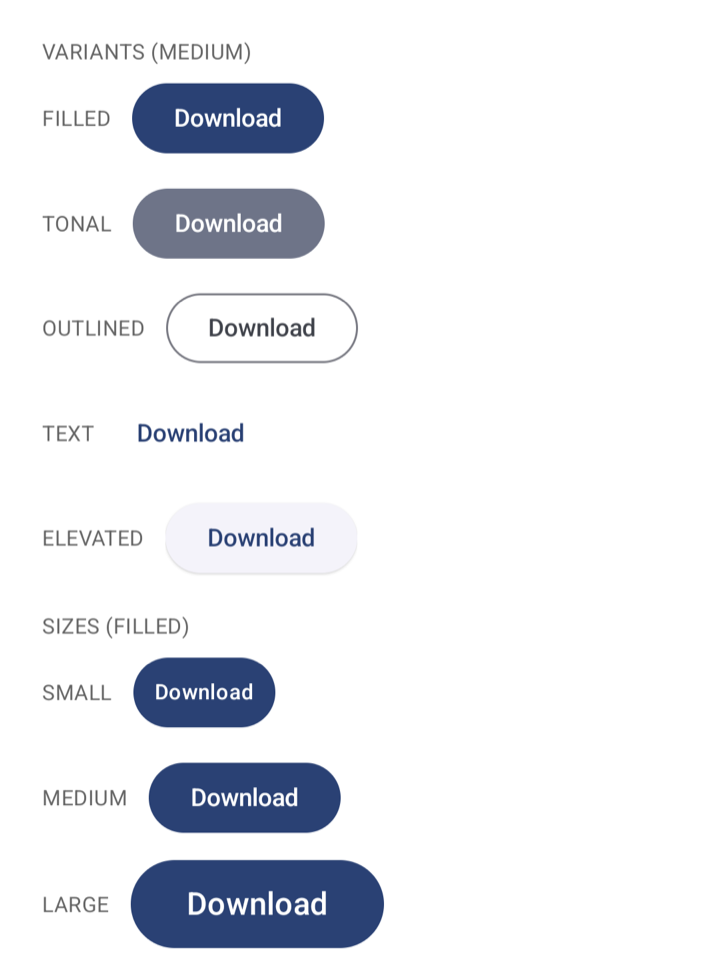</td>
  </tr>
</table>

`variant` and `size` map to the closest idiomatic style on each platform, so the
two columns deliberately do not look alike — neither one fakes the other.

```tsx name=button
export function SaveButton() {
  const [saving, setSaving] = useState(false);

  return (
    <Button
      title={saving ? 'Saving…' : 'Save'}
      variant="filled"
      size="medium"
      disabled={saving}
      onPress={() => setSaving(true)}
    />
  );
}
```

### SegmentedControl

<table>
  <tr><th>iOS</th><th>Android</th></tr>
  <tr>
    <td>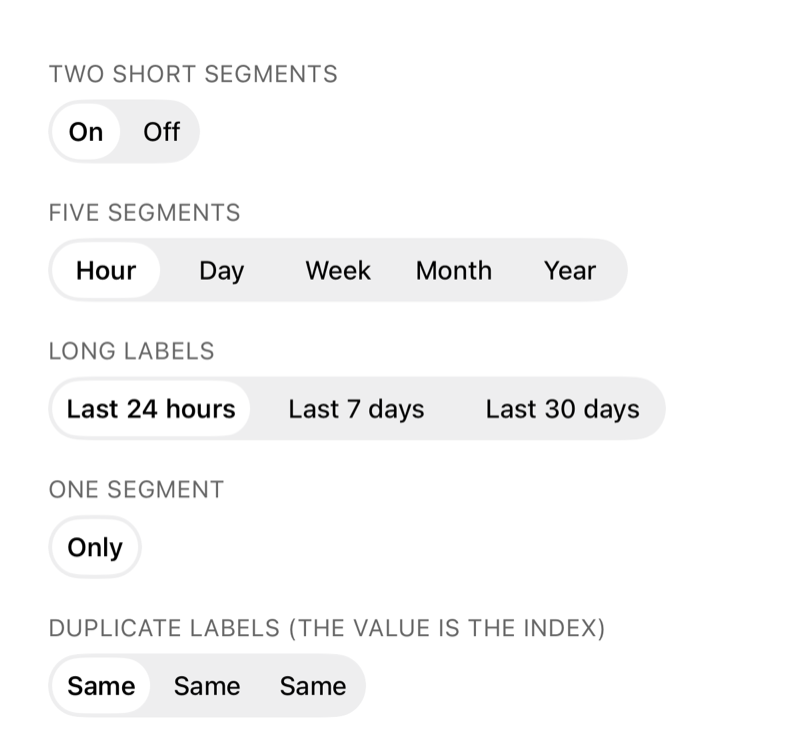</td>
    <td>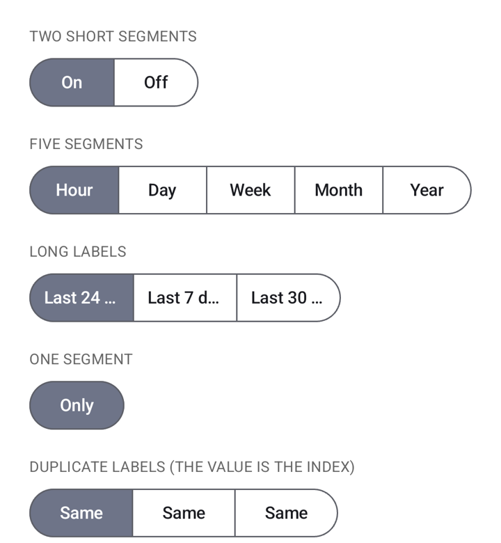</td>
  </tr>
</table>

`options` is the whole API surface of a segmented row, and it is also what
decides the control's width.

```tsx name=segmented-control
export function ViewToggle() {
  const [index, setIndex] = useState(0);

  return (
    <SegmentedControl
      options={['Day', 'Week', 'Month']}
      selectedIndex={index}
      onChange={(event) => setIndex(event.index)}
    />
  );
}
```

### Picker

<table>
  <tr><th>iOS</th><th>Android</th></tr>
  <tr>
    <td>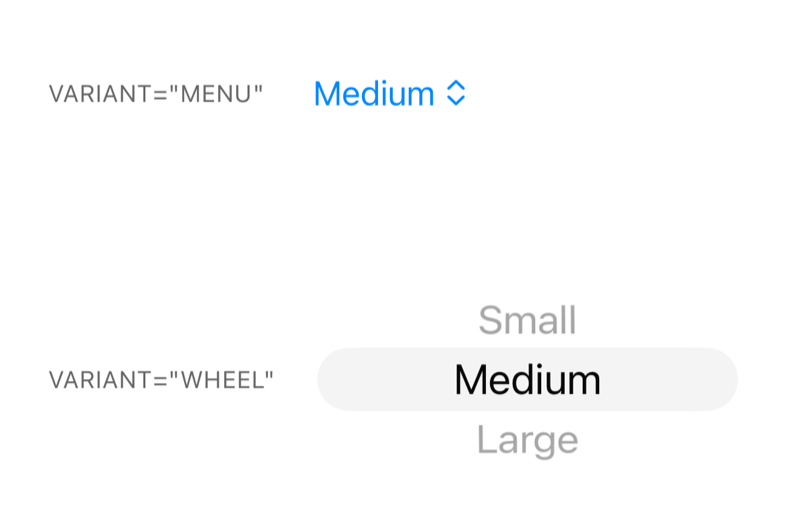</td>
    <td>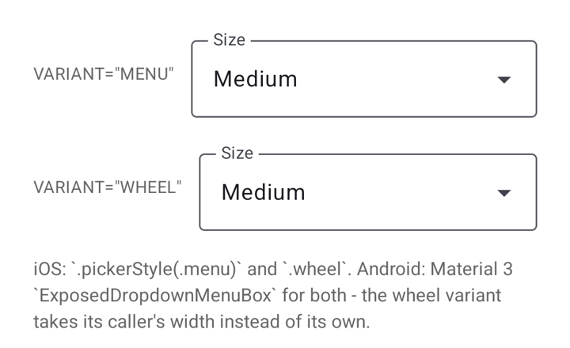</td>
  </tr>
</table>

The value is an index into `options`, as with `SegmentedControl`; `label` is
drawn as the Material 3 field's label on Android and used for accessibility on
iOS.

```tsx name=picker
export function SizePicker() {
  const [index, setIndex] = useState(0);

  return (
    <Picker
      label="Size"
      options={['Small', 'Medium', 'Large']}
      selectedIndex={index}
      onChange={(event) => setIndex(event.index)}
    />
  );
}
```

### DatePicker

<table>
  <tr><th>iOS</th><th>Android</th></tr>
  <tr>
    <td>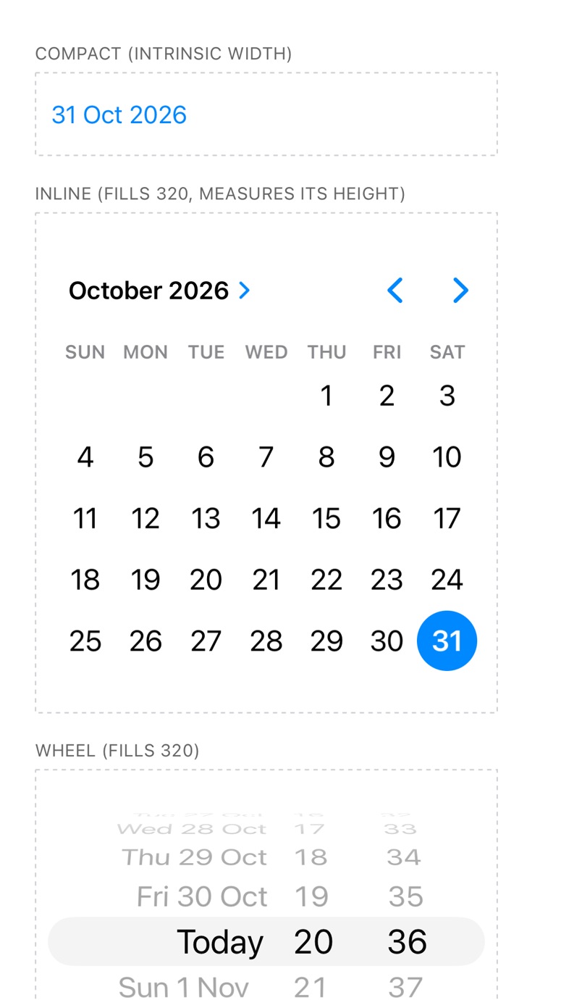</td>
    <td>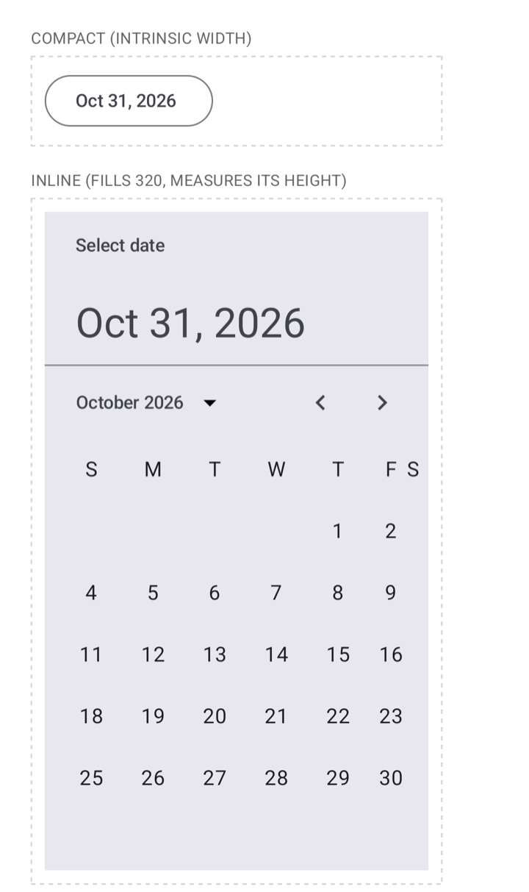</td>
  </tr>
</table>

Dates are `Date` objects. `variant` picks `compact` (a field that opens the
platform picker, the default), `inline` or `wheel`; `mode` picks `date`, `time`
or `datetime`.

```tsx name=date-picker
export function DueDate() {
  const [date, setDate] = useState(() => new Date());

  return (
    <DatePicker accessibilityLabel="Due date" value={date} onChange={setDate} />
  );
}
```

### Menu

<table>
  <tr><th>iOS</th><th>Android</th></tr>
  <tr>
    <td>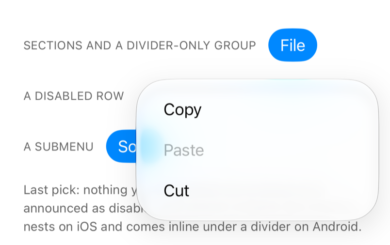</td>
    <td>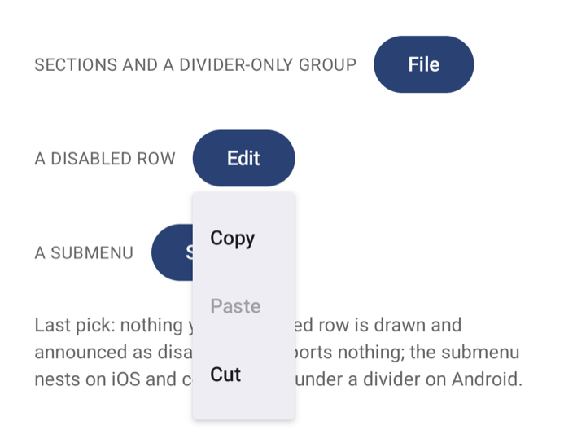</td>
  </tr>
</table>

A trigger that opens a list of actions. It has no value, so there is nothing to
keep in sync: `onSelect` reports the `id` of the row that was picked, and the
items are data — never child views. The trigger is drawn like a `Button`, with
`Button`'s variants and sizes.

```tsx name=menu
const FILE_ACTIONS: MenuGroup = {
  actions: [
    { id: 'rename', title: 'Rename' },
    { id: 'duplicate', title: 'Duplicate' },
  ],
  sections: [
    {
      id: 'dangerous',
      title: 'Dangerous',
      items: [{ id: 'delete', title: 'Delete', destructive: true }],
    },
  ],
};

export function FileActions() {
  const [last, setLast] = useState('nothing yet');

  return (
    <>
      <Text>Last action: {last}</Text>
      <Menu
        accessibilityLabel="File"
        title="File"
        group={FILE_ACTIONS}
        variant="tonal"
        size="medium"
        onSelect={setLast}
      />
    </>
  );
}
```

`onOpen`/`onClose` exist but fire on Android only — SwiftUI's `Menu` has no
expansion binding, so iOS never reports either one (DECISIONS D32), and a pick
fires `onSelect` before the `onClose` that follows it. `systemImage` and
`primaryAction` (tap runs it, long-press opens the menu) are iOS-only; a
submenu nests on iOS and appears inline under a divider on Android.
[menu.md](docs/components/menu.md) says which prop is which platform's.

### Host

Opt-in. On Android its direct hosted children share one Compose composition; on
iOS it is a plain `View`. Its only children may be nitro-ui controls — all eight
since 0.4.0 (0.2.0 hosts `Switch`, `Slider`, `Progress` and `Button`); an RN
view, plain text or a nested `<Host>` throws in development. A hosted
`Picker`'s menu, `DatePicker`'s dialog and `Menu`'s list are the Host
composition's own windows: each opens under the box the Host drew and closes
with the composition. Give it a height.

```tsx name=host
export function NotificationSettings() {
  const [push, setPush] = useState(true);
  const [email, setEmail] = useState(false);

  // Android: both Switches render in one Compose composition.
  // iOS: Host is a plain View, so this renders exactly as without it.
  return (
    <Host style={styles.settings}>
      <Switch accessibilityLabel="Push" value={push} onValueChange={setPush} />
      <Switch
        accessibilityLabel="Email"
        value={email}
        onValueChange={setEmail}
      />
    </Host>
  );
}

const styles = StyleSheet.create({
  // Say how tall a Host is: it draws its children into this box.
  settings: { height: 96 },
});
```

## Sizing

A control's box is **its own measurement**, taken at runtime on the device your
app is running on, and reported to the layout engine — not a constant written
into the library. A Switch is 61 × 28 pt on iOS 26+ and 51 × 31 pt on iOS 15–25
because the running OS says so. `Slider`, a `linear` `Progress`, a `wheel`
`Picker` and an `inline` or `wheel` `DatePicker` are `fillWidth`: their width is
the box their parent gives them and only their height is their own.

- **Your styles win.** `width`, `height` or `flex` fix the box and the control
  centres inside it, exactly as with a stock RN component.
- **One difference from stock RN:** measured sizes leave Yoga nothing to stretch,
  so a parent's `alignItems: 'stretch'` does not widen an intrinsic control. Ask
  for the fill on the control itself: `alignSelf: 'stretch'`.
- **The first mount of a new configuration can be one frame off.** A
  "configuration" is the set of props a control's size depends on — a Button's
  title, a SegmentedControl's option list, a Progress's variant. The very first
  instance of one is laid out at a declared fallback size for a single frame and
  then corrected; every later instance of that configuration lays out exactly on
  its first frame, and an app never pays it for a Switch or a Slider (they have
  one configuration each). On iOS 26+ an app that sets
  `UIDesignRequiresCompatibility` pays that one-frame correction even for a
  Switch, because the OS control is a different size than the one the platform
  now declares.
- **`prewarm` makes the first mount exact.** `prewarm(['NitroUiSwitch'])` adopts
  a component's declared size as this environment's provisional answer before the
  first screen mounts, so nothing shows the fallback frame. It is cheap, safe to
  call with a name a future version does not know, and the sizing engine still
  treats it as provisional: a real measurement replaces it if it disagrees. It
  seeds a component's default configuration only, which covers `Switch`,
  `Slider` and a `linear` `Progress`; there is no way yet to pre-warm a
  particular Button title, option list or DatePicker.
- **A control inside `<Host>` is not measured at all** on Android: the Host
  draws its children in one column at its own width, so the box to get right is
  the Host's. See [host.md](docs/components/host.md#sizing-d24).

[sizing.md](docs/architecture/sizing.md) has the rule, the counters and the
traps; [core.md](docs/architecture/core.md) has the hosting model underneath it.

## Performance

`bun bench` (`docs/architecture/benchmarks.md`) measures this library against
three arms in the same run, on the same device, in Release builds:

- `rn-core` — the pure-JS answer (row of `Pressable`s, stock `ActivityIndicator`,
  …). A floor, not a peer: it draws fewer pixels and hosts nothing.
- `expo-ui-host-per-control` — the same SwiftUI / Compose controls through
  `@expo/ui`, one hosting view per control.
- `expo-ui-shared-host` — the same controls through `@expo/ui`, one hosting view
  for all of them. This is the arm worth being measured against, and the target
  is ≤ 1.0× on mount latency, UI CPU and memory.

The numbers below are from the runs that produced `maintainer-mac-1`'s committed
baselines in `bench/baselines/`: one `--plan full --launches 8` run per platform, on a
clean tree and an idle machine — an iPhone 17 simulator (iOS 27) at `c9548f6` and an
API 35 Pixel 9 emulator with ART primed to `speed-profile` at `3533d64`. Each
cell is the launch-paired median ratio of nitro-ui to `expo-ui-shared-host`;
mount is at N=50, memory at N=200. `✓` meets the ≤ 1.0× target, `✗` misses it,
`n/v` means that cell's spread across launches was over 10 %, so the harness
gives it no verdict, and no mark means the run is at parity within rounding.

| Component          | iOS presented | iOS UI CPU  | iOS memory | Android presented | Android UI CPU  | Android memory  |
| ------------------ | ------------- | ----------- | ---------- | ----------------- | --------------- | --------------- |
| `Switch`           | 1.00×         | 0.88× ✓     | 1.00×      | 1.01×             | 1.51× `n/v`     | 2.72× ✗         |
| `Slider`           | 1.00×         | 1.07× `n/v` | 1.48× ✗    | 1.02× ✗           | 1.52× ✗         | 2.42× ✗         |
| `Progress`         | 0.47× ✓       | 1.20× `n/v` | 1.38× ✗    | 1.00×             | 1.02×           | 1.44× ✗         |
| `Button`           | 1.00×         | 1.13× `n/v` | 1.34× ✗    | 1.01× ✗           | 1.59× `n/v`     | 2.46× ✗         |
| `SegmentedControl` | 0.24× `n/v`   | 0.66× ✓     | 0.83× ✓    | 0.89× ✓           | 1.39× `n/v`     | 1.10× ✗         |
| `DatePicker`       | 1.00×         | 0.08× ✓     | 0.70× ✓    | not in this run   | not in this run | not in this run |

Two things are missing from that table. `maintainer-mac-1` measured no `Picker`
at all, and the Android `DatePicker` has no `@expo/ui` arm to divide by on any
machine (`ARMS_WITHOUT_COMPONENT` in `scripts/bench/lib.mjs`), so that ratio
cannot exist. `maintainer-mac-2`'s baselines do carry `Picker` on both platforms,
and its quiet re-run of both platforms on 2026-10-30 — one `--plan full
--launches 8` each, at `abe68a1`, `problems: []` — carries `Picker` and `Menu` on
both platforms; its per-cell tables are in
[`A5-quiet-bench-mac2.report.md`](docs/tasks/A5-quiet-bench-mac2.report.md).
That machine is an Apple M1 Max with 10 cores and a load ceiling of 5.0, where
`maintainer-mac-1` is an M4 Pro with 14 cores and a ceiling of 7.0, so a cell from
one is not a repeat of the other — read the two together for the shape, and a
cell against its own machine's baseline for a verdict. `Menu` has no committed
cell on either machine yet, because a mint replaces a whole baseline file and
G7b's run covered only Menu (X14 adds the merge mint that fixes that); its
numbers are in [`G7b-menu-finish.report.md`](docs/tasks/G7b-menu-finish.report.md)
and in A5's tables, quoted under [the Host](#host-on-android) below.

The same plan on `maintainer-mac-2`, both platforms quiet, adds the two controls
the run above does not have and re-reads the six it does:

| Component          | iOS presented | iOS UI CPU    | iOS memory | Android presented  | Android UI CPU     | Android memory     |
| ------------------ | ------------- | ------------- | ---------- | ------------------ | ------------------ | ------------------ |
| `Switch`           | 0.80× ✓       | 0.75× ✓       | 0.99× ✓    | 1.12× ✗            | 1.80× ✗            | 2.84× ✗            |
| `Slider`           | 0.63× ✓       | 0.90× ✓       | 1.46× ✗    | 1.23× ✗            | 1.77× ✗            | 2.37× ✗            |
| `Progress`         | 0.40× ✓       | 1.13× ✗       | 1.35× ✗    | 0.96× ✓            | 0.92× ✓            | 1.70× ✗ `n/v`      |
| `Button`           | 1.00×         | 1.38× ✗       | 1.36× ✗    | 1.25× ✗            | 1.77× ✗            | 2.45× ✗            |
| `SegmentedControl` | 0.27× ✓       | 0.57× ✓       | 0.84× ✓    | 1.19× ✗            | 1.43× ✗            | 1.15× ✗            |
| `DatePicker`       | 2.24× ✗ `n/v` | 0.10× ✓ `n/v` | 0.90× ✓    | not on any machine | not on any machine | not on any machine |
| `Picker`           | 0.21× ✓       | 0.29× ✓       | 0.76× ✓    | 1.03× ✗            | 1.47× ✗            | **0.91× ✓**        |
| `Menu`             | 2.04× ✗ `n/v` | 1.28× ✗       | 1.34× ✗    | 0.98× ✓            | 1.26× ✗            | **0.85× ✓**        |

Three things follow from reading the two together. The Android memory miss is
real and it is _not_ universal — `Switch` 2.84×, `Button` 2.45×, `Slider` 2.37×,
`Progress` 1.70× `n/v` and `SegmentedControl` 1.15× are above the shared host, while
`Picker` (0.91×) and `Menu` (0.85×) are _below_ it — not because ours are
lighter (292.2 and 213.1 KiB are heavy), but because `@expo/ui`'s `Picker` and
`Menu` cost 320.0 and 250.4 KiB, against 50.6–77.4 KiB for its `Switch`, `Slider`,
`Progress` and `Button` there. Mount latency moves the other way with the machine: on
`maintainer-mac-1` `SegmentedControl` was the one control under the shared host
(0.89×), on `maintainer-mac-2` it is 1.19× and `Progress` (0.96×) and `Menu`
(0.98×) hold the line instead. And the iOS memory miss survives a whole machine
change (1.34–1.46× on `Slider`, `Progress`, `Button` and `Menu`, parity on
`Switch`), which is the strongest evidence yet that DECISIONS D23's "no known
fix" is about the shape, not the tuning.

Reading it honestly — these read the `maintainer-mac-1` run above, cell by cell:

- **Android memory is the consistent miss.** Every control in that run costs more
  than the shared host per instance — `Switch` 142.7 KiB against 52.1, `Button`
  188.5 against 77.0 — because each control owns its own Compose composition.
  `maintainer-mac-2` reverses the word _every_: its `Picker` and `Menu` land
  below the shared host (0.91×, 0.85×) because `@expo/ui`'s `Picker` and `Menu` are
  heavy, not because ours are light. Mount
  UI CPU is 1.39–1.59× on four controls; `Progress` is at 1.02×, just over the
  line. `SegmentedControl` is the one control that beats the shared host on
  mount latency (0.89×). On the update path Android `presented` is 0.32–0.61×,
  while update UI CPU is above the shared host on `Switch` (1.24×) and `Button`
  (1.94×) and below it on `SegmentedControl` (0.74×).
- **iOS `presented` at N=50 mostly measures the frame — on that machine.** On
  `Switch`, `Slider`, `Button` and `DatePicker` every arm lands in the same 16 ms
  frame, so 1.00× is the frame floor, not a result. `Progress` and
  `SegmentedControl` are the two cells where the shared host spans more frames and
  the ratio means something. `maintainer-mac-2`, which is slower per mount, shows
  how much of that is the machine: there only `Button` is on the floor for both
  arms (16.10 ms against 16.13), while `Switch` reads 49.4 ms against 61.6,
  `Slider` 35.0 against 55.2, `SegmentedControl` 45.2 against 171.0 and `Picker`
  42.3 against 198.9 ms — several frames each, so the same ratios do carry a
  verdict there. On the update path nitro-ui itself is on the floor on both
  machines for `Switch`, `Slider`, `Button` and `Progress` (16.1 ms either side),
  while the arm beside it is not always: `DatePicker`'s shared host takes 119.9 ms
  to push a new value on this machine, and `Picker` (62.9 against 65.5 ms) and
  `Menu` (32.8 against 16.1 ms) are several frames for one arm or the other.
- **iOS UI CPU** is below the shared host on `Switch`, `SegmentedControl` and
  `DatePicker`, and above it on `Slider`, `Progress` and `Button` (1.07–1.20×,
  all three too noisy for a verdict). On the update path iOS UI CPU is below the
  shared host on every control except `Button` (1.52×). Nothing is reversed by
  `maintainer-mac-2`, but one reading moves: its `Slider` cell is 0.90× — below —
  where this run's 1.07× had no verdict because it was `n/v`, and `Progress`
  (1.13×) and `Button` (1.38×) do carry one there. The update path reads the same
  way on both: below on everything except `Button` (1.65×, and `Menu` at 2.19×).
- **iOS memory is at parity on `Switch` and below on `SegmentedControl` and
  `DatePicker`, and it misses on `Slider`, `Progress` and `Button`** — 1.34–1.48×,
  or +47 to +85 KiB per instance (`Slider` 263.1 KiB against 178.0). That gap is
  one hosting controller and its SwiftUI graph per control, where `@expo/ui`
  shares one across all of them. **There is no known fix for it.** A shared iOS
  host was built and measured: it narrowed the memory gap (Slider still missed)
  but made mount and unmount UI CPU worse, so it did not ship (DECISIONS D23); and the
  lighter public hosting-view type that might have cut the per-instance bytes
  does not exist in the iOS 27 SDK.
- **iOS `mounted`** (time spent inside the mount transaction, not in the table)
  is several times the shared host's. That is the library measuring each control
  synchronously while it mounts, so the first frame is laid out at the right
  size, where `@expo/ui` does the equivalent SwiftUI work after the transaction;
  total main-thread work per mount — the UI CPU column — is the fairer
  comparison.

Against `expo-ui-host-per-control` — the same one-host-per-control shape,
reached through `@expo/ui` — nitro-ui is below it on every cell that carries a
verdict: iOS presented 0.16–0.45×, UI CPU 0.04–0.48×, memory 0.67–0.98×; Android
presented 0.51–0.88×, UI CPU 0.45–0.84×, memory 0.49–0.82×. Both ranges are
`maintainer-mac-2`'s quiet run's, over the cells that carry a verdict — the iOS
presented range therefore skips `DatePicker`'s 0.05× and `Menu`'s 0.29×, both `n/v`.
8 components on iOS, 7 on Android (no Android `DatePicker`), each ratio
launch-paired within that run.

### `<Host>` on Android

`<Host>` is the one place the Android memory bill is paid the other way.
Measured on the same emulator (one `--plan quick` run, all five arms including a
hosted `nitro-ui-host` arm, ART `speed-profile`, no problems reported),
Switches inside one Host against `expo-ui-shared-host` — memory at N=200, the
rest at N=50:

|                       | `Switch` without a Host | `Switch` in a `<Host>` |
| --------------------- | ----------------------- | ---------------------- |
| Mount memory (N=200)  | 2.75×                   | **0.86×**              |
| Mount UI CPU per op   | 1.39×                   | **0.87×**              |
| Mount `mounted`       | 1.13×                   | **0.97×**              |
| Mount `presented`     | 1.01×                   | **0.99×**              |
| Mount JS CPU per op   | 0.73×                   | 1.18×                  |
| Unmount UI CPU per op | 1.31×                   | 0.78× `n/v`            |

That is 44.5 KiB per hosted Switch against the shared host's 51.9 KiB. The axis
it loses on is the JS thread — roughly 1.2× the shared host, where the unhosted
control is below it — because a hosted control is still a React Native node
_and_ a child of somebody else's composition. That is why `Host` is something an
app opts into for a dense list rather than what every container does. On iOS
`Host` is a passthrough `View` (DECISIONS D23). `maintainer-mac-2`'s quiet full
plan reads that hosted column on its own emulator as 0.91× memory (46.0 KiB
against the shared host's 50.6), 0.84× UI CPU, 0.97× `mounted`, 1.01×
`presented`, 1.17× JS CPU and 0.57× `n/v` unmount: the shape reproduces on a
different machine, and the memory cell is 0.05 closer to the shared host than the
figure above (0.91× against 0.86×); the runs differ in machine, plan and code, so
the gap is not attributed. The JS axis is the same ~1.2×.

0.2.0 extends the same mechanism to `Slider`, `Progress` and `Button`, and 0.3.0
to `SegmentedControl`, `Picker` and `DatePicker`; `Menu` joined them in 0.4.0, so
a Host holds all eight. Three of those last four present something outside their
own box: a `Picker` opens a menu, a `DatePicker` a dialog and a `Menu` its list,
and all three belong to the Host's composition once hosted. A
`SegmentedControl` owns no window at all; it is on the list because it
draws itself, which is the question a Host asks. All seven controls with a Host
arm were then re-priced on `maintainer-mac-2` by one **quiet** `--plan full
--launches 8` run — 2 128 launches, 2 825 load samples against a ceiling of 5.0,
median 1.43, one over (0.04 %), `problems: []`, ART `speed-profile` — so these
replace the indicative `quick`-plan tables those runs published. Against
`expo-ui-shared-host`, and against the same control with no Host:

|                                         | `Switch`  | `Slider`  | `Progress`  | `Button`  |
| --------------------------------------- | --------- | --------- | ----------- | --------- |
| Mount memory (N=200)                    | **0.91×** | 1.02×     | 0.45× `n/v` | **0.80×** |
| Mount UI CPU per op                     | **0.84×** | **0.85×** | **0.40×**   | **0.88×** |
| Mount JS CPU per op                     | 1.17×     | 1.11×     | **0.77×**   | **0.69×** |
| Unmount UI CPU per op                   | `n/v`     | `n/v`     | `n/v`       | `n/v`     |
| Memory vs the same control with no Host | **0.32×** | **0.43×** | **0.26×**   | **0.33×** |
| Mount UI CPU vs no Host                 | **0.46×** | **0.47×** | **0.44×**   | **0.50×** |
| Mount JS CPU vs no Host                 | 1.20×     | 1.05×     | 1.32×       | 1.12×     |

The `Switch` row lands near where H1's published 0.86× / 0.87× sits (0.91× / 0.84×
on this machine), which is what makes the rest of the run readable. What it shows:
the UI-thread win holds on all four, `Progress` most of all (0.40×); the memory win
holds on `Switch` and `Button`, `Progress` reads 0.45× but `n/v`, and `Slider` is
level at 1.02×; JS costs 1.17× on `Switch` and 1.11× on `Slider`,
while `Progress` (0.77×) and `Button` (0.69×) are below the shared host, as unhosted
(0.59×, 0.62×) — and the unmount cells are still spread too wide for any claim at
all, on this machine and at 8 launches.

The other four cost nearly the same shape ([`A5's
tables`](docs/tasks/A5-quiet-bench-mac2.report.md) have every cell). `SegmentedControl`'s
hosted mount UI CPU is the one verdict that moves here: 1.00× — parity — where the
indicative run published 0.92×:

|                                         | `SegmentedControl` | `Picker`  | `DatePicker`    | `Menu`    |
| --------------------------------------- | ------------------ | --------- | --------------- | --------- |
| Mount memory (N=200)                    | **0.56×**          | **0.53×** | no Android cell | **0.31×** |
| Mount UI CPU per op                     | 1.00×              | **0.78×** | —               | **0.57×** |
| Mount JS CPU per op                     | **0.30×**          | **0.18×** | —               | **0.22×** |
| Memory vs the same control with no Host | **0.49×**          | **0.58×** | **0.49×**       | **0.36×** |
| Mount UI CPU vs no Host                 | **0.70×**          | **0.53×** | **0.58×**       | **0.45×** |
| Mount JS CPU vs no Host                 | 1.02×              | 1.05×     | 1.11×           | 1.09×     |

No Android `@expo/ui` arm has `DatePicker` cells, so that column is hosted-vs-unhosted
only. Every cell above carries a verdict except the unmount ones and `Progress`
memory: read against this machine's own baseline, `--check` on the same run **fails
nothing** — 159 rows within tolerance, 33 noisy, and the only over-threshold row that
is not noisy is `update:nitro-ui:1` UI CPU at 1.26× with a 95 % CI of 0.98–1.38× that
covers 1.05, so it is reported and not conclusive. And **no number here is about an
open window**: the bench arm mounts the anchor row and never presses it, so no menu or
dialog is composed while these are read. What the run does show is that a control
which can own a window hosts like the others — memory roughly halved or better,
UI thread down, and JS CPU per op up 2–11 %.

`Menu` is the clearest case in the set: 77.6 KiB per hosted Menu against the
shared host's 250.4 (0.31×) and `rn-core`'s 76.3, with mount UI CPU at 0.57× and
JS CPU at 0.22×. Unhosted it is 213.1 KiB (0.85×) — the one control besides
`Picker` whose own composition already costs less than the shared host's. On iOS,
where a Host is a passthrough, Menu is the usual per-control story: 352.8 KiB
against the shared host's 263.6 (1.34×), presented 33.0 ms against 16.1 (`n/v`),
UI CPU 1.28×. No run composed a popup — the arm never opens a menu.
[G7b's tables](docs/tasks/G7b-menu-finish.report.md) and
[A5's](docs/tasks/A5-quiet-bench-mac2.report.md) have the whole set.

### Baselines and gating

Baselines are committed per machine as well as per device —
`bench/baselines/<machine-label>/<deviceKey>.json` — because a ratio to `rn-core`
only cancels drift inside the machine that measured it. Both machines that have
minted one have both canonical devices
(`bench/baselines/maintainer-mac-1/`, `bench/baselines/maintainer-mac-2/`), so
`bun bench --check` gates on both platforms there; a machine without its own
directory refuses rather than reading another's. Each baseline stores ratios to
`rn-core`, not absolute times; see
`bench/baselines/README.md` for the rules a baseline run has to meet. Measurement
details — absolutes, per-launch spreads, noise flags and the update cells — are in the
reports for the
[iOS baseline](docs/tasks/A1c-baselines.report.md),
[Android baseline](docs/tasks/A1b-baselines.report.md) and
[`<Host>`](docs/tasks/H1-android-host.report.md) runs and its
[H2a](docs/tasks/H2a-host-more-controls.report.md) and
[H2b](docs/tasks/H2b-host-popups.report.md) follow-ups.

## Known limitations

The full list per control is in its doc; these are the ones that bite.

- **An over-wide row still reads badly on Android.** `SegmentedControl`,
  `Button` and `Picker` fit what they are given: content wider than its box is
  laid out at the box's width (it used to be drawn at its measured width,
  centred, with both ends cut off and untappable). Fitting is not the same as
  legible, though — Material 3 shares a row's width equally between its
  segments, so four labels in 140 dp each collapse to an ellipsis. Keep option
  lists and titles within the available width.
- **iOS `SegmentedControl` ignores `tintColor`.** A SwiftUI segmented `Picker`
  ignores `.tint()`, so a tinted row looks like the default one on iOS. It works
  on Android.
- **A determinate circular `Progress` draws a spinner on iOS.** SwiftUI's
  `.circular` `ProgressView` keeps spinning whatever fraction it is handed; the
  value reaches VoiceOver, not the pixels. Android draws the ring filled. An
  indeterminate **linear** bar on iOS shows an empty track and does not visibly
  animate.
- **`trackColor` is Android-only** (nothing in SwiftUI addresses the track) and
  **`systemImage` is iOS-only** (Android ignores it). Both are accepted on both
  platforms so the JS API means one thing.
- **No wheel on Android.** `Picker` and `DatePicker` accept `variant="wheel"`,
  but Material 3 has no wheel, so Android renders the menu (`Picker`) or the
  inline calendar (`DatePicker`). Android also has no combined date-and-time
  control: `mode="datetime"` opens a date dialog and then a time dialog.
- **`Menu`'s open state is Android-only, and its splits are iOS's.** SwiftUI's
  `Menu` has no expansion binding, so **iOS never fires `onOpen` or `onClose`**,
  and a `disabled` that arrives while the menu is open closes it on Android only —
  an iOS menu can stay up over a disabled trigger (DECISIONS D32). Build app state
  on `onSelect`. A submenu nests on iOS and renders inline under a divider on
  Android, and `primaryAction` (tap runs it, long-press opens) is iOS-only and
  changes what a tap does there.
- **`<Host>` only helps on Android, and holds nitro-ui controls only.** All
  eight since 0.4.0 (Switches only in 0.1.0; `Slider`, `Progress` and `Button`
  added in 0.2.0). Any other child — an RN view, text, another `<Host>` — throws
  in development. Give a Host a height; per-child sizes, `gap`, `flexDirection`
  and `alignItems` do not reach what it draws.
- **Expo Go is not supported** — a dev build is required, because Nitro Modules
  needs native code.
- **RN 0.86 on iOS is not verified** — UIKit terminates a fresh 0.86 app at
  launch on the iOS 27 simulator even without this library, and no older runtime
  has been tried.
- **`testID` lands on the host** on Android (`View.tag`): Compose has no test id,
  which is what `findNodeByName` and the harness read. Inside a `<Host>` the view
  that carries a Switch's `testID` is not where the Switch is drawn — it reads
  back `0 × 0` at mount and the child's Yoga frame after any later layout pass
  over it — so find hosted controls by `accessibilityLabel`.
- **Accessibility props belong on the control, not the box.** The label lives on
  the hosted control, so adding `accessible` or an `accessibilityRole` to a
  control's container can hide that control from VoiceOver / TalkBack. Style the
  box; do not re-role it. `aria-label` / `aria-disabled` are not translated.
- **Small platform differences:** iOS `Slider` answers drags that start on the
  thumb (that is `UISlider`); Android infers `onSlidingStart` from the first
  value change; a rejected controlled change reverts without animation; segment
  widths are equal shares on Android and SwiftUI's own distribution on iOS.

## How it works

- `src/*.nitro.ts` are Nitro IDL specs; `nitrogen` generates the C++ specs into
  `nitrogen/generated/`, which is **committed and drift-checked**.
- `cpp/`, `ios/`, `android/` hold the C++ core, SwiftUI hosting and Compose
  hosting. Compose and SwiftUI build configuration lives in this package, not in
  the example app, so consumers inherit it.
- Every control follows the same perf contract: prop setters only store and mark
  dirty, one `afterUpdate()` applies, the hosting view is created once at init
  and never rebuilt, and controlled values use an event-count handshake so a
  write in flight can never clobber what the user just did.
- Sizing is a shared C++ engine (`docs/architecture/sizing.md`) that measures
  each control, caches per configuration, and corrects a wrong guess in one
  frame.

`docs/architecture/` has the long form — [core.md](docs/architecture/core.md)
(how a control is hosted), [sizing.md](docs/architecture/sizing.md) and
[benchmarks.md](docs/architecture/benchmarks.md). `docs/research/` holds the
notes that shaped these choices and [docs/DECISIONS.md](docs/DECISIONS.md) the
calls.

## Contributing

- [Development workflow](CONTRIBUTING.md) — prerequisites, the scripts, and the
  gates. `CI` runs `bun run check`, the host native tests and an Android debug
  build on every push and pull request; `Release` and `Release tag` run the release
  path, and `Changeset status` warns on a pull request that has no changeset. The two device workflows — `Bench` and `Smoke` — are
  disabled and dispatch-only, so the harness, real-input, smoke and bench suites a
  change cites are the ones someone ran locally
- [Storybook](example/README.md#storybook) - the example app is also a showcase
  app: `bun run storybook:ios` / `bun run storybook:android` starts it, and
  `bun run storybook` runs its Metro server separately
- [Sending a pull request](CONTRIBUTING.md#sending-a-pull-request)
- [Code of conduct](CODE_OF_CONDUCT.md)

## License

[MIT](LICENSE)
