# react-native-nitro-ui

Native SwiftUI and Jetpack Compose components for React Native, built on
[Nitro Modules](https://nitro.margelo.com/).

Most "native" component libraries re-implement a platform control in React
Native and copy the screenshots. This one hosts the real thing: each control is
a SwiftUI view or a Jetpack Compose composable inside a Nitro Hybrid View, so
the toggle animates like Apple's, the slider takes drags the way `UISlider`
does, the iOS segmented row truncates labels the way the OS does, and VoiceOver and
TalkBack get the control's own accessibility instead of an approximation of it.
Layout still belongs to Yoga — the control measures itself, reports its size to
the layout engine, and React never sees a native node.

## Components

| Component            | iOS                                                            | Android                                                      | Since | Docs                                                         |
| -------------------- | -------------------------------------------------------------- | ------------------------------------------------------------ | ----- | ------------------------------------------------------------ |
| `Switch`             | `Toggle(…).toggleStyle(.switch)`                               | `androidx.compose.material3.Switch`                          | 0.1.0 | [switch.md](docs/components/switch.md)                       |
| `Slider`             | `Slider(value:in:step:onEditingChanged:)`                      | `androidx.compose.material3.Slider`                          | 0.1.0 | [slider.md](docs/components/slider.md)                       |
| `Progress`           | `ProgressView` + `.progressViewStyle(.linear / .circular)`     | `LinearProgressIndicator` / `CircularProgressIndicator` (M3) | 0.1.0 | [progress.md](docs/components/progress.md)                   |
| `Button`             | `Button(action:) { Label }` + `.buttonStyle(…)`                | the five Material 3 button composables                       | 0.1.0 | [button.md](docs/components/button.md)                       |
| `SegmentedControl`   | `Picker(…).pickerStyle(.segmented)`                            | `SingleChoiceSegmentedButtonRow`                             | 0.1.0 | [segmented-control.md](docs/components/segmented-control.md) |
| `Picker`             | `Picker(…).pickerStyle(.menu / .wheel)`                        | `ExposedDropdownMenuBox` (M3)                                | 0.1.0 | [picker.md](docs/components/picker.md)                       |
| `DatePicker`         | `DatePicker` (`.graphical` / `.wheel`, compact field)          | M3 `DatePicker` / `TimePicker` and their dialogs             | 0.1.0 | [date-picker.md](docs/components/date-picker.md)             |
| `Menu`               | `Menu(content:label:primaryAction:)`, `.menuStyle(.button)`    | `ExposedDropdownMenuBox` (`menuAnchor`) + `DropdownMenuItem` | 0.4.0 | [menu.md](docs/components/menu.md)                           |
| `ContextMenu`        | `UIContextMenuInteraction` on the view, a `UIMenu`             | M3 `DropdownMenu` opened at the finger                       | next  | [context-menu.md](docs/components/context-menu.md)           |
| `Chip`               | `Toggle(…).toggleStyle(.button)` / a bordered capsule `Button` | M3 `FilterChip` / `AssistChip`                               | 0.6.0 | [chip.md](docs/components/chip.md)                           |
| `Checkbox`           | `Toggle(isOn:…).toggleStyle(.switch)` — iOS has no checkbox    | M3 `Checkbox` / `TriStateCheckbox`                           | next  | [checkbox.md](docs/components/checkbox.md)                   |
| `AlertDialog`        | `UIAlertController(preferredStyle: .alert)`                    | `androidx.compose.material3.AlertDialog`                     | 0.5.0 | [dialog.md](docs/components/dialog.md)                       |
| `ConfirmationDialog` | `UIAlertController(preferredStyle: .actionSheet)`              | M3 `ModalBottomSheet` with one row per action                | 0.5.0 | [dialog.md](docs/components/dialog.md)                       |
| `TextField`          | `UITextField` / `UITextView` (multi-line)                      | `BasicTextField(TextFieldState)`                             | 0.6.0 | [text-field.md](docs/components/text-field.md)               |
| `BottomSheet`        | `UISheetPresentationController` (`.pageSheet`, detents)        | M3 `ModalBottomSheet` with React Native content              | 0.6.0 | [bottom-sheet.md](docs/components/bottom-sheet.md)           |
| `Host`               | a plain `View` (passthrough, by design)                        | one shared Compose composition for its hosted children       | 0.1.0 | [host.md](docs/components/host.md)                           |

`Host` is a container, not a control: an opt-in way to give a batch of controls
one Compose composition on Android instead of one each. It holds every control
except `Chip`, `TextField`, `Checkbox`, `BottomSheet` and `ContextMenu`, and
refuses those five with an error that names them. The first three wait for a
round that measures them inside a Host; the last two are refused by design,
because each is a `View` around React Native children, not a control a
composition could draw.
See [Performance](#performance) for what it buys and what it costs.

Everything is exported from the package root, along with `nitroUiCore` (a
monotonic clock, `CLOCK_UPTIME_RAW` / `CLOCK_MONOTONIC`, plus sizing
diagnostics) and `prewarm` (see [Sizing](#sizing)):

```ts
import {
  AlertDialog,
  BottomSheet,
  Button,
  Checkbox,
  Chip,
  ConfirmationDialog,
  ContextMenu,
  DatePicker,
  Host,
  Menu,
  Picker,
  Progress,
  SegmentedControl,
  Slider,
  Switch,
  TextField,
} from 'react-native-nitro-ui';
```

## Requirements

| Platform | Minimum                                                                                                 |
| -------- | ------------------------------------------------------------------------------------------------------- |
| RN       | `>= 0.88` with the new architecture, or Expo SDK 58                                                     |
| iOS      | `min_ios_version_supported` (React Native's own floor — 15.1 on RN 0.88)                                |
| Android  | `minSdkVersion` 24; the app compiles with `compileSdkVersion` 37 and Android Gradle Plugin 9.1 or newer |
| Nitro    | `react-native-nitro-modules ^0.37.1`                                                                    |

A new RN 0.88 or Expo SDK 58 app already meets the Android line: both templates
compile against SDK 37 with AGP 9.2. An app upgraded from an older template may
still say `compileSdkVersion = 36` in `android/build.gradle`; raise it to 37, or
the build stops with an AAR metadata error that names Material 3.

Jetpack Compose (the compiler plugin, Compose 1.12 and Material 3 1.5) is
configured inside this package's `android/build.gradle`, so your app does not
have to opt in to Compose to use one slider, and no Podfile or Gradle edits are
needed either way.

Material 3 1.5 is still a beta (`androidx.compose.material3:material3:1.5.0-beta02`),
and it is the version this library needs for the Expressive theme. Gradle picks
the newest version any library asks for, so if your app uses Material 3 itself,
installing this library raises your app's Material 3 to that beta as well.

A dev build is required: Expo Go is not supported, because Nitro Modules needs
native code.

## Installation

```sh
npm install react-native-nitro-ui react-native-nitro-modules
```

React Native autolinks the native code: no config plugin, no Podfile or Gradle
edits, no manual linking. `react-native-nitro-modules` is a peer dependency —
every control here is a Nitro Hybrid View, so your app needs it too.

What is left is compiling the new native code in, which needs more than a Metro
reload.

Expo (Continuous Native Generation):

```sh
npx expo prebuild   # or: npx expo run:ios / npx expo run:android / eas build
```

Bare React Native CLI — the template ships a Gemfile, so use it:

```sh
cd ios && bundle install && bundle exec pod install
```

Then `npx expo run:ios` / `run:android`, or `npx react-native run-ios` /
`run-android`.

### Without npm

From a clone (a fork, or a fix you need before the next release): the package
needs a build step (`bob build`, which also regenerates the Nitro code) before
an app can use it, so build the tarball and install that. You need
[bun](https://bun.sh) 1.4 and Node 24 (see
[CONTRIBUTING](CONTRIBUTING.md#prerequisites)).

```sh
git clone https://github.com/dannyhw/react-native-nitro-ui.git
cd react-native-nitro-ui
bun install
bun run prepare                          # builds lib/ with builder-bob
npm pack                                 # writes react-native-nitro-ui-<version>.tgz
```

Then, in your app:

```sh
npm install /path/to/react-native-nitro-ui-<version>.tgz react-native-nitro-modules
```

and rebuild as above.

Installing straight from GitHub (`npm install github:dannyhw/react-native-nitro-ui`)
is untested: npm would have to install this repo's development dependencies,
including its example and benchmark workspaces, and run the build during your
install. Use the tarball.

The project's [consumer smoke tests](CONTRIBUTING.md#consumer-smoke-tests)
install the packed tarball with npm into fresh Expo and React Native CLI apps
and build them in Release; CONTRIBUTING lists which apps have passed, and on
which release.

## Usage

Each control has the props of the platform control it wraps, not a
lowest-common-denominator subset. The tables in the component docs list every
prop against the TypeScript type; these are the shapes you will actually write.
The screenshots come from the example app's Storybook, in light appearance at
the default text size, on an iOS 27 iPhone simulator and an API 35 (Android 15)
emulator. A dialog or a sheet is shown presented.

### Switch

<table>
  <tr><th>iOS</th><th>Android</th></tr>
  <tr>
    <td>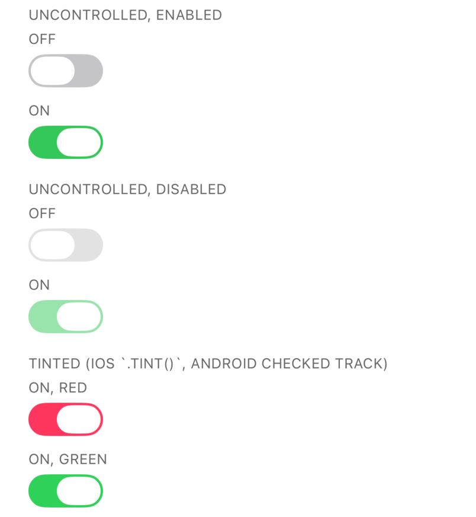</td>
    <td>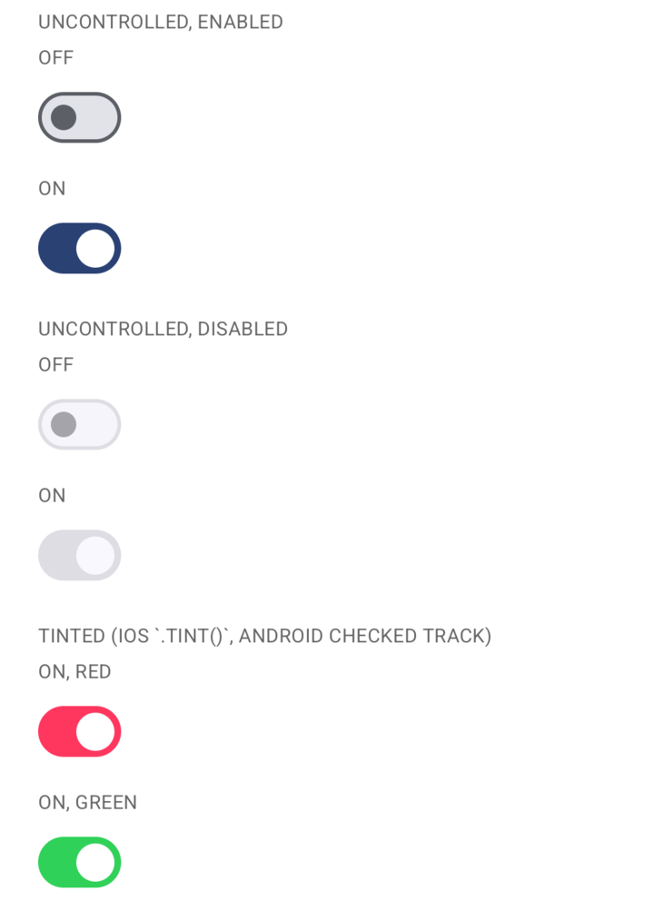</td>
  </tr>
</table>

Controlled by `value`; omit it and native owns the displayed state (a toggle
then costs no React render).

```tsx name=switch
export function WifiSettings() {
  const [enabled, setEnabled] = useState(false);

  return (
    <>
      <Text>Wi-Fi</Text>
      <Switch
        accessibilityLabel="Wi-Fi"
        value={enabled}
        onValueChange={setEnabled}
      />
    </>
  );
}
```

### Slider

<table>
  <tr><th>iOS</th><th>Android</th></tr>
  <tr>
    <td>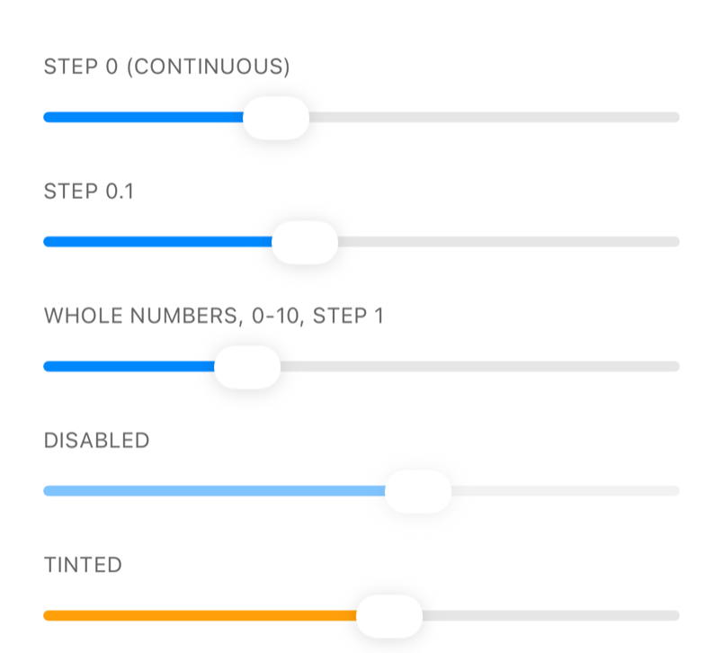</td>
    <td>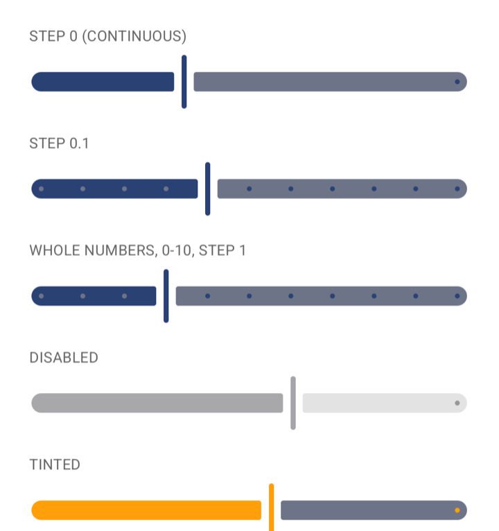</td>
  </tr>
</table>

`onValueChange` fires at most once per frame during a drag;
`onSlidingComplete` always fires once with the value the gesture settled on.

```tsx name=slider
export function VolumeSlider() {
  const [volume, setVolume] = useState(0.5);

  return (
    <Slider
      accessibilityLabel="Volume"
      value={volume}
      onValueChange={setVolume}
      minimumValue={0}
      maximumValue={1}
      step={0.05}
    />
  );
}
```

### Progress

<table>
  <tr><th>iOS</th><th>Android</th></tr>
  <tr>
    <td>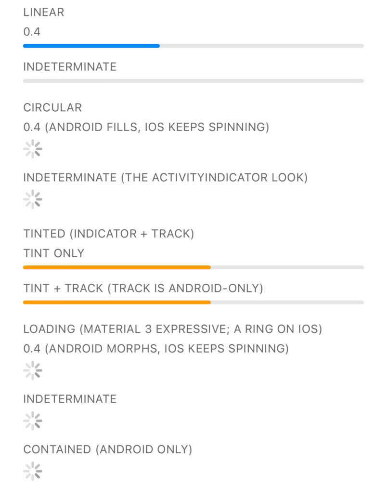</td>
    <td>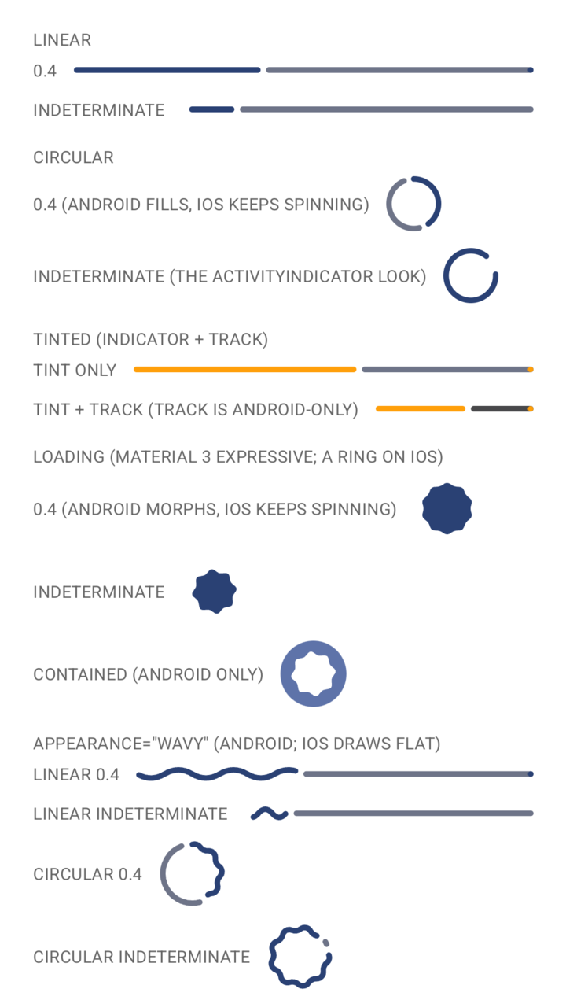</td>
  </tr>
</table>

`value` is a fraction of the whole; `null` means indeterminate rather than
empty.

```tsx name=progress
export function UploadProgress({ fraction }: { fraction: number | null }) {
  // `null` is indeterminate ("working"); a number 0…1 is a determinate bar.
  return <Progress accessibilityLabel="Uploading" value={fraction} />;
}
```

### Button

<table>
  <tr><th>iOS</th><th>Android</th></tr>
  <tr>
    <td>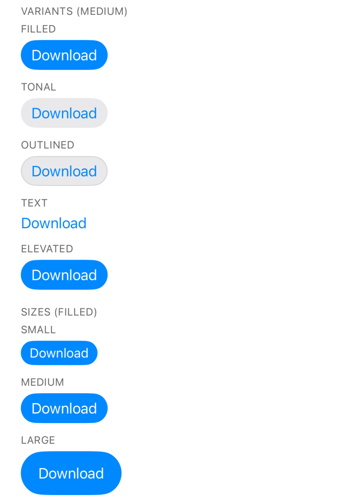</td>
    <td>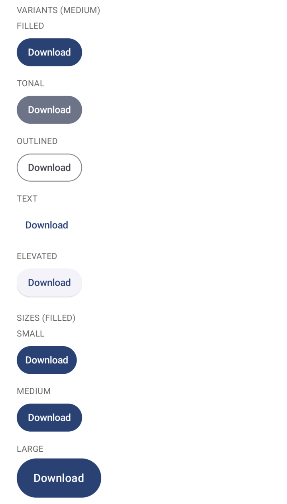</td>
  </tr>
</table>

`variant` and `size` map to the closest idiomatic style on each platform, so the
two columns deliberately do not look alike — neither one fakes the other.

```tsx name=button
export function SaveButton() {
  const [saving, setSaving] = useState(false);

  return (
    <Button
      title={saving ? 'Saving…' : 'Save'}
      variant="filled"
      size="medium"
      disabled={saving}
      onPress={() => setSaving(true)}
    />
  );
}
```

### SegmentedControl

<table>
  <tr><th>iOS</th><th>Android</th></tr>
  <tr>
    <td>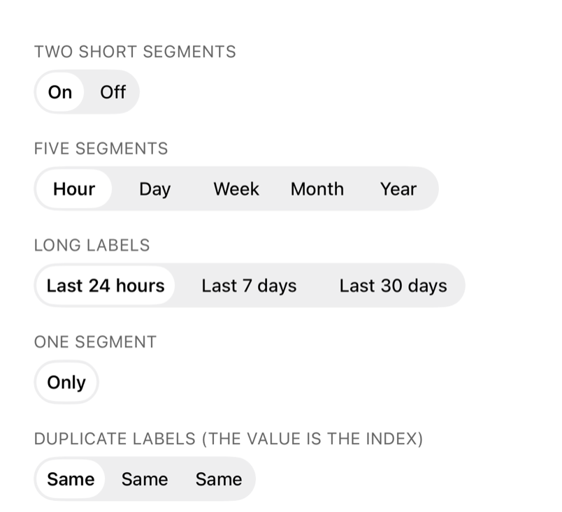</td>
    <td>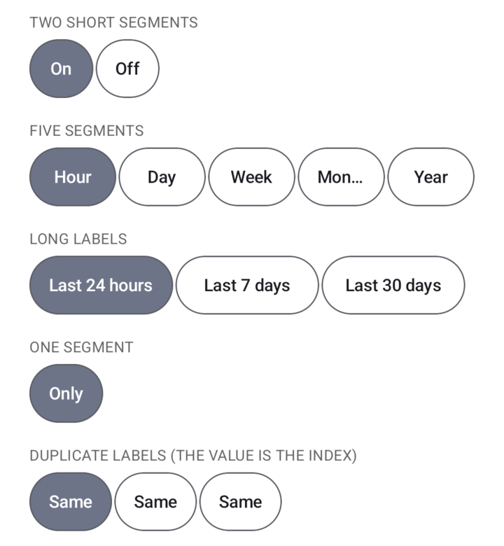</td>
  </tr>
</table>

`options` is the whole API surface of a segmented row, and it is also what
decides the control's width.

```tsx name=segmented-control
export function ViewToggle() {
  const [index, setIndex] = useState(0);

  return (
    <SegmentedControl
      options={['Day', 'Week', 'Month']}
      selectedIndex={index}
      onChange={(event) => setIndex(event.index)}
    />
  );
}
```

### Picker

<table>
  <tr><th>iOS</th><th>Android</th></tr>
  <tr>
    <td>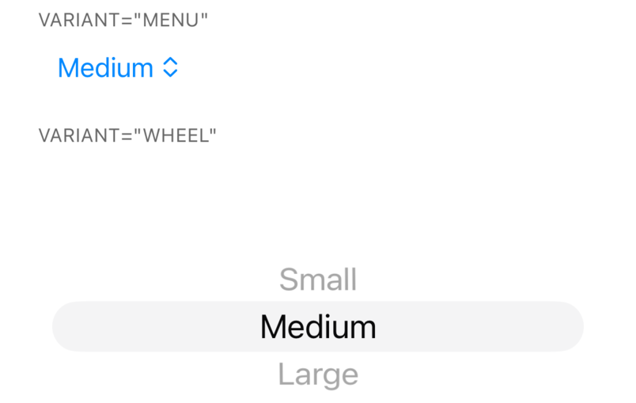</td>
    <td>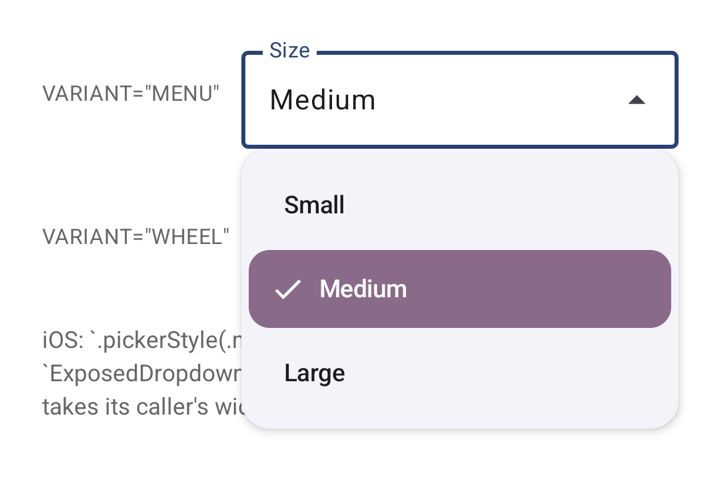</td>
  </tr>
</table>

The value is an index into `options`, as with `SegmentedControl`; `label` is
drawn as the Material 3 field's label on Android and used for accessibility on
iOS.

```tsx name=picker
export function SizePicker() {
  const [index, setIndex] = useState(0);

  return (
    <Picker
      label="Size"
      options={['Small', 'Medium', 'Large']}
      selectedIndex={index}
      onChange={(event) => setIndex(event.index)}
    />
  );
}
```

### DatePicker

<table>
  <tr><th>iOS</th><th>Android</th></tr>
  <tr>
    <td>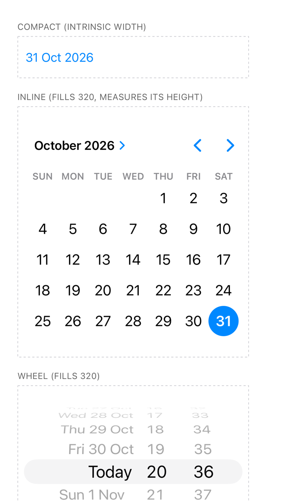</td>
    <td>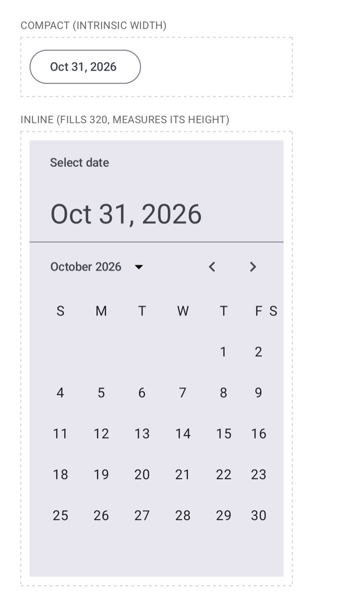</td>
  </tr>
</table>

Dates are `Date` objects. `variant` picks `compact` (a field that opens the
platform picker, the default), `inline` or `wheel`; `mode` picks `date`, `time`
or `datetime`.

```tsx name=date-picker
export function DueDate() {
  const [date, setDate] = useState(() => new Date());

  return (
    <DatePicker accessibilityLabel="Due date" value={date} onChange={setDate} />
  );
}
```

### Menu

<table>
  <tr><th>iOS</th><th>Android</th></tr>
  <tr>
    <td>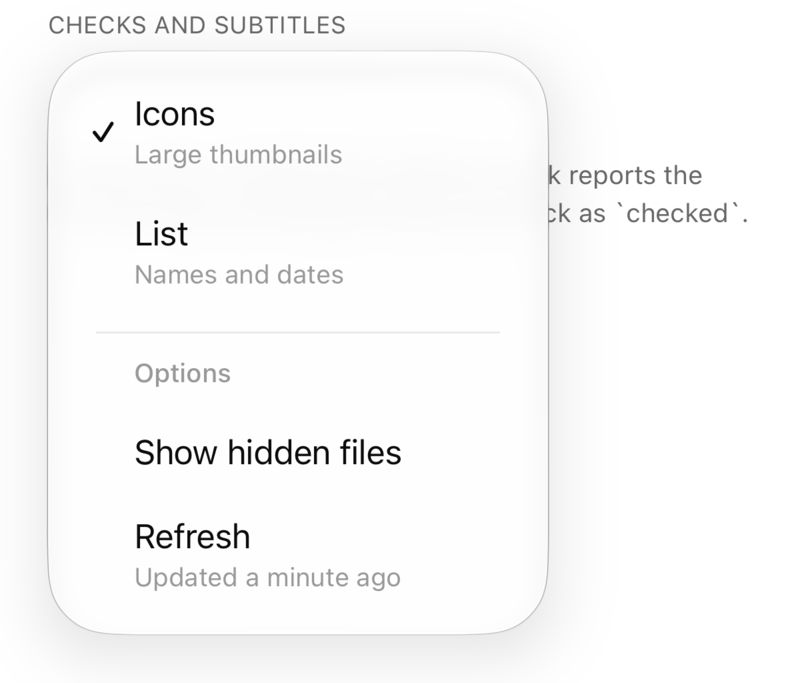</td>
    <td>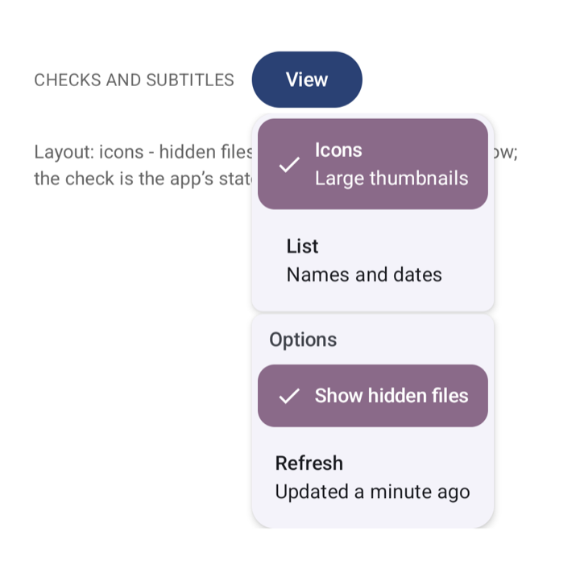</td>
  </tr>
</table>

A trigger that opens a list of actions. It has no value, so there is nothing to
keep in sync: `onSelect` reports the `id` of the row that was picked, and the
items are data — never child views. The trigger is drawn like a `Button`, with
`Button`'s variants and sizes.

```tsx name=menu
const FILE_ACTIONS: MenuGroup = {
  actions: [
    { id: 'rename', title: 'Rename' },
    { id: 'duplicate', title: 'Duplicate' },
  ],
  sections: [
    {
      id: 'dangerous',
      title: 'Dangerous',
      items: [{ id: 'delete', title: 'Delete', destructive: true }],
    },
  ],
};

export function FileActions() {
  const [last, setLast] = useState('nothing yet');

  return (
    <>
      <Text>Last action: {last}</Text>
      <Menu
        accessibilityLabel="File"
        title="File"
        group={FILE_ACTIONS}
        variant="tonal"
        size="medium"
        onSelect={setLast}
      />
    </>
  );
}
```

`onOpen`/`onClose` exist but fire on Android only — SwiftUI's `Menu` has no
expansion binding, so iOS never reports either one — and a pick fires
`onSelect` before the `onClose` that follows it. `systemImage` and
`primaryAction` (tap runs it, long-press opens the menu) are iOS-only; a
submenu nests on iOS and appears inline under a divider on Android.
[menu.md](docs/components/menu.md) says which prop is which platform's.

### ContextMenu

<table>
  <tr><th>iOS</th><th>Android</th></tr>
  <tr>
    <td>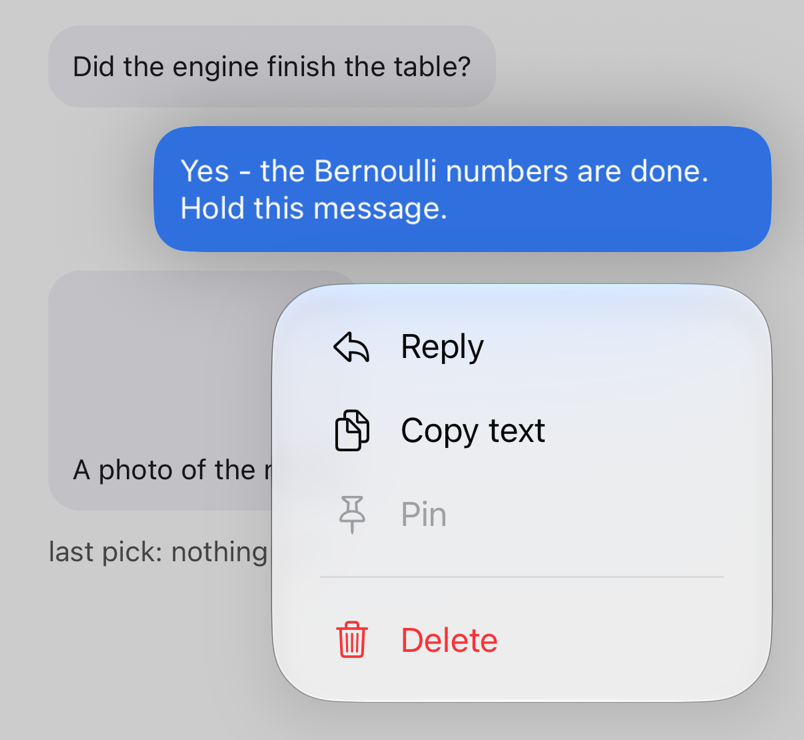</td>
    <td>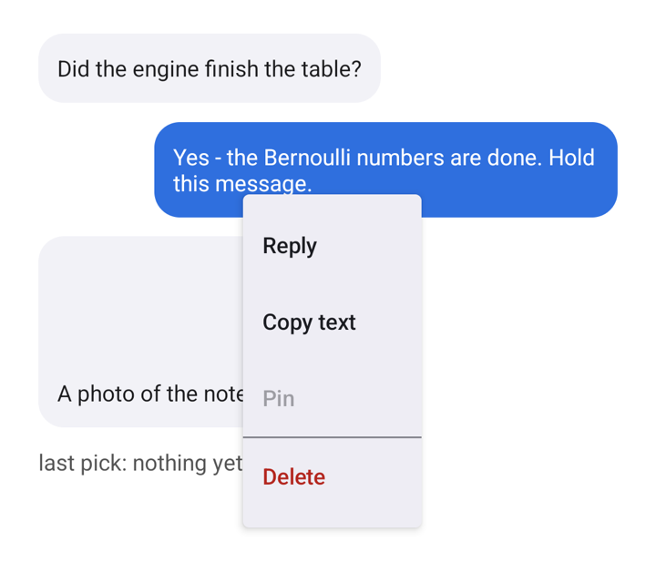</td>
  </tr>
</table>

A `View` that opens a menu on a long press. Its children stay where they are and
keep their own gestures: a tap is theirs, a scroll is the scroll view's, and a
hold that opens the menu cancels their touch, so a `Pressable` inside never
fires `onPress` for it. The rows are `Menu`'s `group`.

```tsx name=context-menu
const MESSAGE_ACTIONS: MenuGroup = {
  actions: [
    { id: 'reply', title: 'Reply', systemImage: 'arrowshape.turn.up.left' },
    { id: 'copy', title: 'Copy text', systemImage: 'doc.on.doc' },
  ],
  sections: [
    {
      id: 'danger',
      items: [{ id: 'delete', title: 'Delete', destructive: true }],
    },
  ],
};

export function MessageRow() {
  const [last, setLast] = useState('nothing yet');

  return (
    <ContextMenu
      group={MESSAGE_ACTIONS}
      onSelect={setLast}
      style={messageStyles.bubble}
    >
      <Text>Hold this message for its menu.</Text>
      <Text>Last action: {last}</Text>
    </ContextMenu>
  );
}

const messageStyles = StyleSheet.create({
  bubble: { padding: 12, borderRadius: 16, backgroundColor: '#f2f2f7' },
});
```

iOS lifts the view itself as the preview (its corners follow `borderRadius`);
Android opens a Material menu at the finger. `onOpen` and `onClose` fire on
both platforms, `onSelect` before the `onClose` that follows it. Set
`accessible` and an `accessibilityLabel` to make it one screen-reader element
with the menu on it. Without `accessible`, Android screen readers can't open the
menu. [context-menu.md](docs/components/context-menu.md) has the gesture rules
and the limits.

### Chip

<table>
  <tr><th>iOS</th><th>Android</th></tr>
  <tr>
    <td>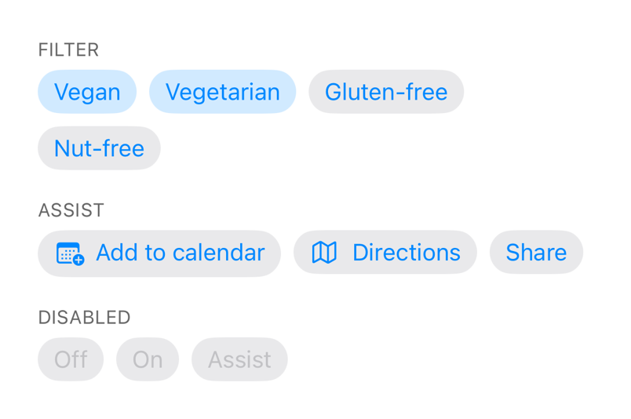</td>
    <td>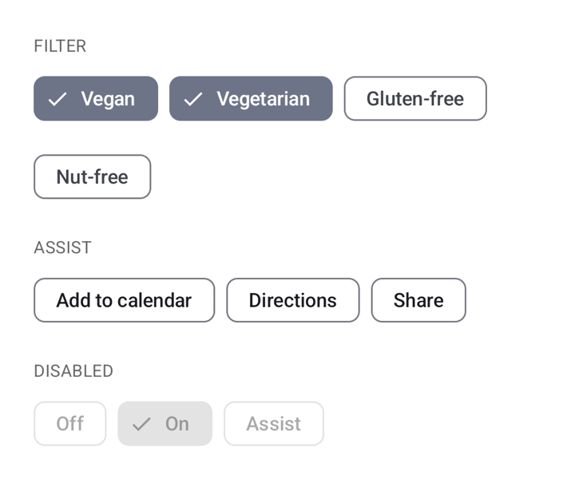</td>
  </tr>
</table>

A compact control sized to its label, in two kinds. A filter chip (the default)
has a selection: `selected` is controlled the way a Switch's `value` is, and
`defaultSelected` starts an uncontrolled one. An assist chip is an action with
`onPress`.

```tsx name=chip
export function PlaceFilters({ onDirections }: { onDirections: () => void }) {
  const [openNow, setOpenNow] = useState(false);

  return (
    <>
      <Chip label="Open now" selected={openNow} onSelectedChange={setOpenNow} />
      <Chip label="Vegan" defaultSelected />
      <Chip
        variant="assist"
        label="Directions"
        systemImage="map"
        onPress={onDirections}
      />
    </>
  );
}
```

`systemImage` is iOS-only. On Android a selected filter chip shows Material's
check mark and is wider by it; on iOS selection only changes the fill.
[chip.md](docs/components/chip.md) has the sizes and the limits.

### Checkbox

<table>
  <tr><th>iOS</th><th>Android</th></tr>
  <tr>
    <td>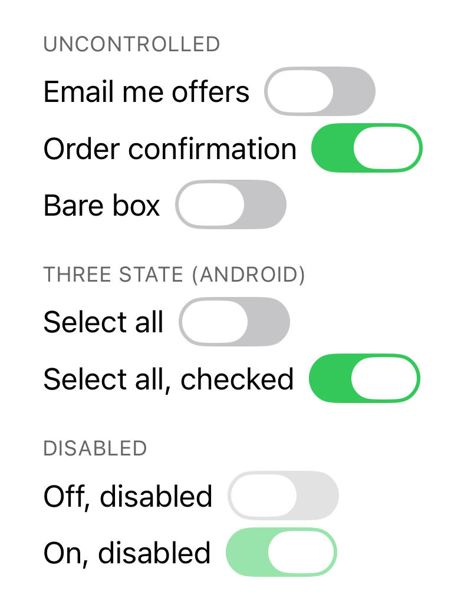</td>
    <td>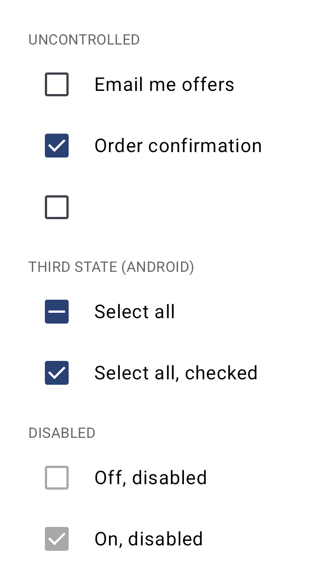</td>
  </tr>
</table>

A checkbox: `checked` is controlled the way a Switch's `value` is, and
`defaultChecked` starts an uncontrolled one. `label` is part of the control and
of its size, and the whole row is tappable. `indeterminate` is Material's third
state and Android-only: iOS has no checkbox — `CheckboxToggleStyle` is
unavailable there — so a Checkbox is a `Toggle` with the switch style, which is
what Expo's universal `Checkbox` renders too.

```tsx name=checkbox
export function CheckoutOptions({
  onEmailMe,
}: {
  onEmailMe: (email: boolean) => void;
}) {
  const [gift, setGift] = useState(false);

  return (
    <>
      <Checkbox label="Gift wrap" checked={gift} onCheckedChange={setGift} />
      <Checkbox label="Email me the receipt" onCheckedChange={onEmailMe} />
    </>
  );
}
```

`indeterminate` asks for a third glyph, not a third value, and iOS has nowhere to put it.
A press reports the opposite of what the box shows — empty box → `true`, check mark →
`false`, dash → `true` — and since Android draws a check mark for a _checked_
`indeterminate` box, the press that empties that one reports `false`. Nothing clears
`indeterminate` for you, so an Android caller resolves it in `onCheckedChange`
(`setIndeterminate(false)` beside `setChecked(next)`). On iOS every press reports
`!checked` and the third state reads as off.
[checkbox.md](docs/components/checkbox.md) has the sizes and the limits.

### AlertDialog and ConfirmationDialog

Two exports over one native view. A dialog has no box: the view React Native
lays out is a `0 × 0` anchor, and the window is the platform's — UIKit's
`UIAlertController` on iOS (an alert, or an action sheet for a confirmation),
Material 3's `AlertDialog` on Android, and a `ModalBottomSheet` of rows for a
confirmation. The actions are data, like a `Menu`'s rows.

An alert, presented:

<table>
  <tr><th>iOS</th><th>Android</th></tr>
  <tr>
    <td>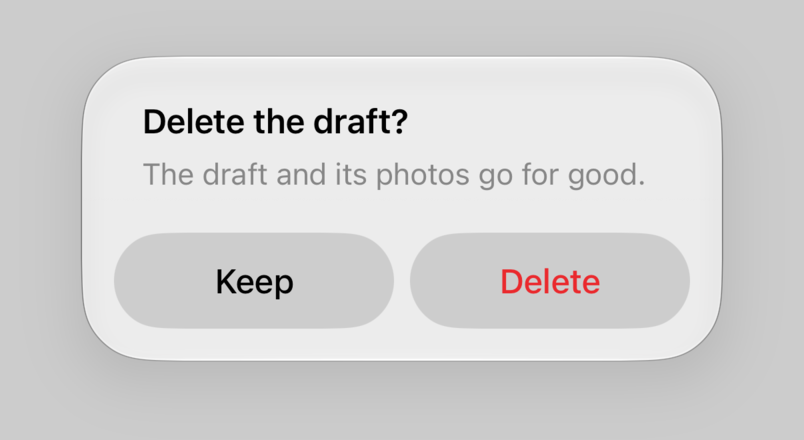</td>
    <td>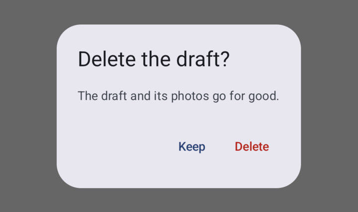</td>
  </tr>
</table>

A confirmation, presented — UIKit's action sheet on the left, Material's bottom sheet of rows on the right:

<table>
  <tr><th>iOS</th><th>Android</th></tr>
  <tr>
    <td>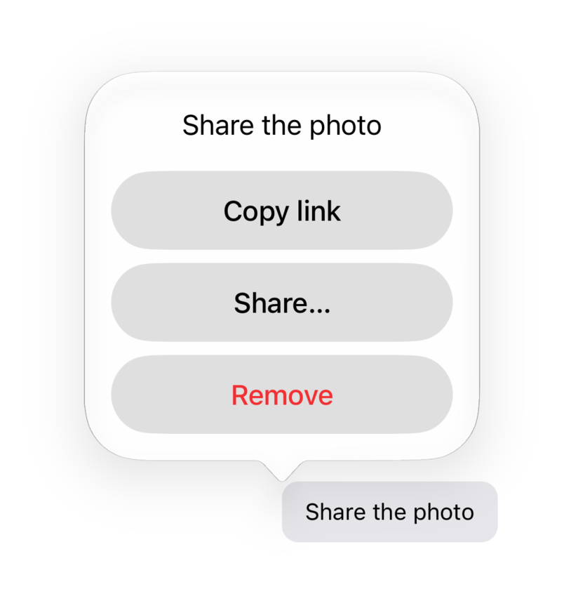</td>
    <td>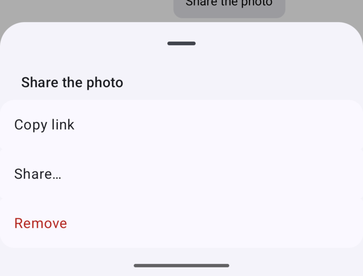</td>
  </tr>
</table>

```tsx name=dialog
const DRAFT_ACTIONS: DialogAction[] = [
  { id: 'keep', title: 'Keep', role: 'cancel' },
  { id: 'delete', title: 'Delete', role: 'destructive' },
];

export function DeleteDraft({ onDelete }: { onDelete: () => void }) {
  const [asking, setAsking] = useState(false);

  return (
    <>
      <Button
        title="Delete draft"
        variant="text"
        size="medium"
        onPress={() => setAsking(true)}
      />
      <AlertDialog
        isPresented={asking}
        onIsPresentedChange={setAsking}
        title="Delete the draft?"
        message="The draft and its photos go for good."
        actions={DRAFT_ACTIONS}
        onAction={(id) => {
          if (id === 'delete') onDelete();
        }}
      />
    </>
  );
}
```

`isPresented` is controlled: every native open or close comes back through
`onIsPresentedChange`, and a tapped action reports `onAction(id)` before the
close. An app that keeps `isPresented` true after a dismissal gets the dialog
back. `dismissible={false}` leaves only the actions as a
way out. On iOS the dialog is presented from a window of its own, so it works
inside and over a React Native `Modal`.
[dialog.md](docs/components/dialog.md) has the platform details.

### TextField

<table>
  <tr><th>iOS</th><th>Android</th></tr>
  <tr>
    <td>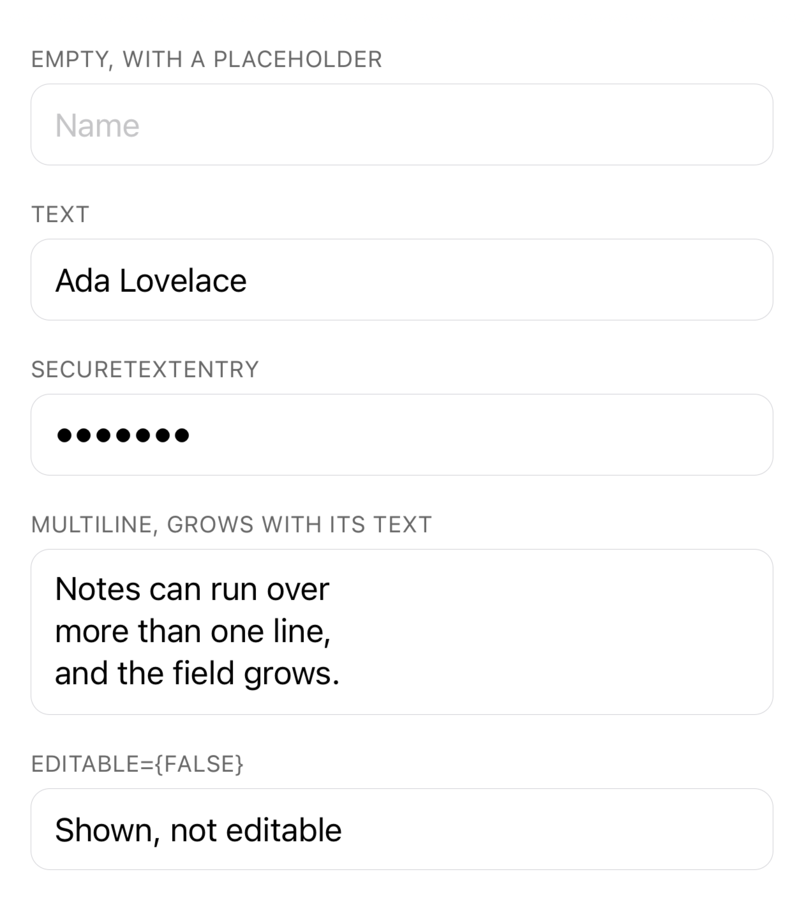</td>
    <td>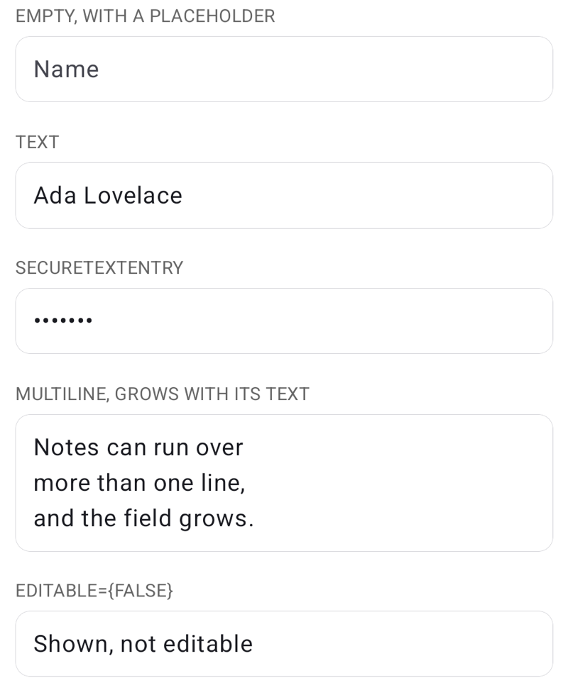</td>
  </tr>
</table>

A single- or multi-line text field with React Native `TextInput`'s prop names:
`UITextField` (a `UITextView` when `multiline`) on iOS, Compose `BasicTextField`
on Android. It is undecorated, like `TextInput`, so a border or a background is
your container's. Controlled by `value`; a `value` written while an IME
composition is open is dropped rather than applied over it, and `ref` gives
`focus()` and `blur()`.

```tsx name=text-field
export function SignInForm({ onSignIn }: { onSignIn: () => void }) {
  const [email, setEmail] = useState('');
  const [password, setPassword] = useState('');
  const passwordField = useRef<TextFieldHandle>(null);

  return (
    <>
      <TextField
        accessibilityLabel="Email"
        placeholder="name@example.com"
        keyboardType="email-address"
        autoCapitalize="none"
        autoCorrect={false}
        returnKeyType="next"
        value={email}
        onChangeText={setEmail}
        onSubmitEditing={() => passwordField.current?.focus()}
      />
      <TextField
        ref={passwordField}
        accessibilityLabel="Password"
        placeholder="Password"
        secureTextEntry
        returnKeyType="go"
        value={password}
        onChangeText={setPassword}
        onSubmitEditing={onSignIn}
      />
    </>
  );
}
```

`maxLength` counts UTF-16 code units, as `string.length` does, and never cuts
an emoji in half. A multi-line field grows with its text; Return then inserts a
newline instead of submitting. A `TextField` cannot be a child of `<Host>` yet.
[text-field.md](docs/components/text-field.md) has the details.

### BottomSheet

<table>
  <tr><th>iOS</th><th>Android</th></tr>
  <tr>
    <td>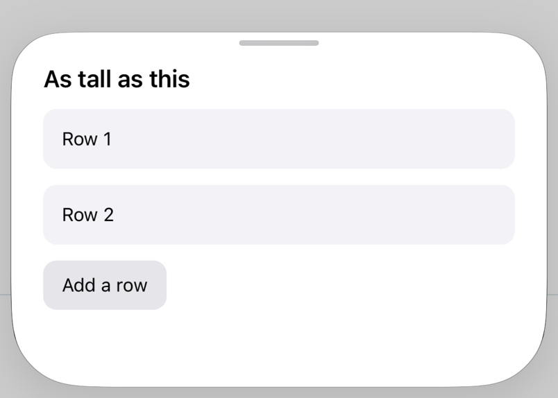</td>
    <td>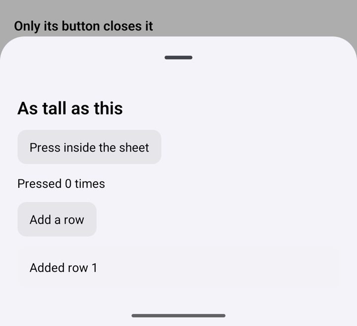</td>
  </tr>
</table>

A modal sheet whose content is React Native: UIKit's sheet presentation on iOS,
Material 3's `ModalBottomSheet` on Android. The children are laid out at the
sheet's width and take touches as anywhere else in the app; they are mounted
only while the sheet is up.

```tsx name=bottom-sheet
export function Filters() {
  const [open, setOpen] = useState(false);
  const [detent, setDetent] = useState(0);

  return (
    <>
      <Button
        title="Filters"
        variant="tonal"
        size="medium"
        onPress={() => setOpen(true)}
      />
      <BottomSheet
        isPresented={open}
        onIsPresentedChange={setOpen}
        detents={['medium', 'large']}
        onDetentChange={setDetent}
        // The next presentation opens at the first detent again.
        onDismiss={() => setDetent(0)}
        accessibilityLabel="Filters"
      >
        <View style={{ padding: 24, gap: 12 }}>
          <Text>{detent === 0 ? 'Half height' : 'Full height'}</Text>
          <Button
            title="Done"
            variant="filled"
            size="medium"
            onPress={() => setOpen(false)}
          />
        </View>
      </BottomSheet>
    </>
  );
}
```

Detents use SwiftUI's names - `'fit'` (the default: as tall as the content, and
following it), `'medium'`, `'large'`, `{ height }` and `{ fraction }` - and the
detent the user drags to is reported, not controlled. Android's Material sheet
has two rest positions, so there `'medium'` is the half-expanded one and the
largest other detent the expanded one. `isPresented` works as a dialog's does. On
iOS the sheet presents in the screen's own chain, and from a window of its own
when a React Native `Modal` is on top, so closing that `Modal` cannot strand it.
[bottom-sheet.md](docs/components/bottom-sheet.md) has the platform details.

### Host

Opt-in. On Android its direct hosted children share one Compose composition; on
iOS it is a plain `View`. Its only children may be nitro-ui controls other than
`Chip`, `TextField`, `Checkbox`, `BottomSheet` and `ContextMenu`; one of those
five, an RN view, plain text or a nested `<Host>` throws in development. A hosted `Picker`'s menu,
`DatePicker`'s dialog and `Menu`'s list open under the box the Host drew; they
and a hosted dialog are the Host composition's own windows, and close with it.
Give it a height.

```tsx name=host
export function NotificationSettings() {
  const [push, setPush] = useState(true);
  const [email, setEmail] = useState(false);

  // Android: both Switches render in one Compose composition.
  // iOS: Host is a plain View, so this renders exactly as without it.
  return (
    <Host style={styles.settings}>
      <Switch accessibilityLabel="Push" value={push} onValueChange={setPush} />
      <Switch
        accessibilityLabel="Email"
        value={email}
        onValueChange={setEmail}
      />
    </Host>
  );
}

const styles = StyleSheet.create({
  // Say how tall a Host is: it draws its children into this box.
  settings: { height: 96 },
});
```

## Android theme

Android controls are drawn with **Material 3 Expressive**, Android's design
since Android 16, over the device's dynamic colours (Android 12+) or the default
Material 3 colours, light or dark with the system. Today what the Expressive
theme changes is motion: a Switch's thumb, a Checkbox's mark, a menu or a sheet
opening move with Material's expressive springs, and Material ties more to the
theme with each release. It comes from Material 3 1.5, currently a beta, which
this library brings into your app (see [Requirements](#requirements)).

To keep the baseline Material 3 theme instead, call `setMaterialTheme` once:

```tsx name=material-theme
// Once, at startup — before the first screen renders.
setMaterialTheme('baseline');
```

The choice is the whole app's: every control and every `<Host>` follows it, and
there is no per-control prop. `setMaterialTheme('expressive')` goes back to the
default, and a later call still reaches the controls already on screen, which
redraw under the new theme. It does nothing on iOS.

## Sizing

A control's box is **its own measurement**, taken at runtime on the device your
app is running on, and reported to the layout engine — not a constant written
into the library. A Switch is 61 × 28 pt on iOS 26+ and 51 × 31 pt on iOS 15–25
because the running OS says so. `Slider`, a `linear` `Progress`, `TextField`, a
`wheel` `Picker` and an `inline` or `wheel` `DatePicker` are `fillWidth`: their
width is the box their parent gives them and only their height is their own.

- **Your styles win.** `width`, `height` or `flex` fix the box and the control
  centres inside it, exactly as with a stock RN component.
- **One difference from stock RN:** measured sizes leave Yoga nothing to stretch,
  so a parent's `alignItems: 'stretch'` does not widen an intrinsic control. Ask
  for the fill on the control itself: `alignSelf: 'stretch'`.
- **The first mount of a new configuration can be one frame off.** A
  "configuration" is the set of props a control's size depends on — a Button's
  title, a SegmentedControl's option list, a Progress's variant. The very first
  instance of one is laid out at a declared fallback size for a single frame and
  then corrected; every later instance of that configuration lays out exactly on
  its first frame, and an app never pays it for a Switch or a Slider (they have
  one configuration each). On iOS 26+ an app that sets
  `UIDesignRequiresCompatibility` pays that one-frame correction even for a
  Switch, because the OS control is a different size than the one the platform
  now declares.
- **`prewarm` makes the first mount exact.** `prewarm(['NitroUiSwitch'])` adopts
  a component's declared size as this environment's provisional answer before the
  first screen mounts, so nothing shows the fallback frame. It is cheap, safe to
  call with a name a future version does not know, and the sizing engine still
  treats it as provisional: a real measurement replaces it if it disagrees. It
  seeds a component's default configuration only, which covers `Switch`,
  `Slider` and a `linear` `Progress`; there is no way yet to pre-warm a
  particular Button title, option list or DatePicker.
- **A control inside `<Host>` is not measured at all** on Android: the Host
  draws its children in one column at its own width, so the box to get right is
  the Host's. See [host.md](docs/components/host.md#sizing-d24).

[sizing.md](docs/architecture/sizing.md) has the rule, the counters and the
traps; [core.md](docs/architecture/core.md) has the hosting model underneath it.

## Performance

The controls are benchmarked in Release builds against two alternatives, on the
same device and in the same run:

- **React Native core** — the pure-JS answer (a row of `Pressable`s, the stock
  `ActivityIndicator`, …). It is a floor, not a peer: it draws less and hosts no
  native UI framework.
- **[`@expo/ui`](https://docs.expo.dev/versions/latest/sdk/ui/)**, which wraps
  the same SwiftUI and Compose controls, measured two ways: one hosting view per
  control, and one hosting view shared by all of them. The shared host is the
  one nitro-ui aims to match.

The headline results come from an iPhone 17 simulator (iOS 27) and an API 35
Pixel 9 emulator, for `Switch`, `Slider`, `Progress`, `Button`,
`SegmentedControl`, `Picker`, `DatePicker` and `Menu`. Each figure is nitro-ui
divided by `@expo/ui`, so below 1× is better:

- **Against one hosting view per control** — the shape nitro-ui has too —
  nitro-ui is faster and lighter on every result clear enough to call: time
  until the controls are on screen 0.16–0.45× on iOS and 0.51–0.88× on Android,
  UI-thread CPU 0.04–0.48× and 0.45–0.84×, memory 0.67–0.98× and 0.49–0.82×.
- **iOS, against the shared host:** time to screen is at parity or better on
  every control with a clear result (`DatePicker` and `Menu` read about 2× on
  one run, too noisy to call). Memory per instance is 1.34–1.48× on `Slider`,
  `Progress`, `Button` and `Menu`, because each control owns a SwiftUI hosting
  controller where `@expo/ui` shares one, and at parity or below on the rest.
  There is no known fix: a shared iOS host was built and measured, and it made
  mount and unmount CPU worse. UI-thread CPU is lower on `Switch`, `Slider`,
  `SegmentedControl`, `DatePicker` and `Picker`, and 1.13–1.38× on `Progress`,
  `Button` and `Menu`.
- **Android, against the shared host:** an unhosted control owns its own
  Compose composition, so most cost more memory — 1.1–2.8× per instance — and
  more UI-thread CPU per mount, up to 1.8×. `Picker` and `Menu` are below it on
  memory (0.91×, 0.85×), because `@expo/ui`'s versions of those two are heavy.
- **`<Host>` is the Android answer.** Inside one, the same controls use
  0.26–0.58× the memory and 0.44–0.70× the UI-thread CPU of unhosted ones, which
  puts them at or below the shared host's memory (`Slider` is level at 1.02×).
  The cost is JS-thread CPU, 2–32 % more per mount. On an Android screen with
  many controls — a settings list, a long form — wrap them in a `<Host>`.

The main caveat: these are simulator and emulator numbers from development
Macs, not physical devices. Two machines agree on the shape but not on every
cell, and at 50 controls an iOS mount often fits inside one 16 ms frame for
every library, so 1.00× there is the frame, not a tie. `Chip`, `TextField`, the
dialogs and `BottomSheet` have no published comparison yet.

[docs/performance.md](docs/performance.md) has every cell, the runs they came
from, and the readings behind these lines.

## Known limitations

The full list per control is in its doc; these are the ones that bite.

- **An over-wide row still reads badly on Android.** `SegmentedControl`,
  `Button` and `Picker` fit what they are given: content wider than its box is
  laid out at the box's width. Fitting is not the same as legible, though — Material 3 shares a row's width equally between its
  segments, so four labels in 140 dp each collapse to an ellipsis. Keep option
  lists and titles within the available width.
- **iOS `SegmentedControl` ignores `tintColor`.** A SwiftUI segmented `Picker`
  ignores `.tint()`, so a tinted row looks like the default one on iOS. It works
  on Android.
- **A determinate circular `Progress` draws a spinner on iOS.** SwiftUI's
  `.circular` `ProgressView` keeps spinning whatever fraction it is handed; the
  value reaches VoiceOver, not the pixels. Android draws the ring filled. An
  indeterminate **linear** bar on iOS shows an empty track and does not visibly
  animate.
- **`trackColor` is Android-only** (nothing in SwiftUI addresses the track) and
  **`systemImage` is iOS-only** (Android ignores it). Both are accepted on both
  platforms so the JS API means one thing.
- **No wheel on Android.** `Picker` and `DatePicker` accept `variant="wheel"`,
  but Material 3 has no wheel, so Android renders the menu (`Picker`) or the
  inline calendar (`DatePicker`). Android also has no combined date-and-time
  control: `mode="datetime"` opens a date dialog and then a time dialog.
- **`Menu`'s open state is Android-only, and its splits are iOS's.** SwiftUI's
  `Menu` has no expansion binding, so **iOS never fires `onOpen` or `onClose`**,
  and a `disabled` that arrives while the menu is open closes it on Android only —
  an iOS menu can stay up over a disabled trigger. Build app state
  on `onSelect`. A submenu nests on iOS and renders inline under a divider on
  Android, and `primaryAction` (tap runs it, long-press opens) is iOS-only and
  changes what a tap does there.
- **`<Host>` only helps on Android, and holds nitro-ui controls only** — every
  one except `Chip`, `TextField`, `Checkbox`, `BottomSheet` and `ContextMenu`.
  Any other child — one of those five, an RN view, text, another `<Host>` —
  throws in development. Give
  a Host a height; per-child sizes, `gap`, `flexDirection` and `alignItems` do
  not reach what it draws.
- **Expo Go is not supported** — a dev build is required, because Nitro Modules
  needs native code.
- **`testID` lands on the host** on Android (`View.tag`), because Compose has no
  test id; a test that looks a control up by `testID` finds that view. Inside a `<Host>` the view
  that carries a Switch's `testID` is not where the Switch is drawn — it reads
  back `0 × 0` at mount and the child's Yoga frame after any later layout pass
  over it — so find hosted controls by `accessibilityLabel`.
- **Accessibility props belong on the control, not the box.** The label lives on
  the hosted control, so adding `accessible` or an `accessibilityRole` to a
  control's container can hide that control from VoiceOver / TalkBack. Style the
  box; do not re-role it. `aria-label` / `aria-disabled` are not translated.
- **Small platform differences:** iOS `Slider` answers drags that start on the
  thumb (that is `UISlider`); Android infers `onSlidingStart` from the first
  value change; a rejected controlled change reverts without animation; segment
  widths are equal shares on Android and SwiftUI's own distribution on iOS.

## How it works

- Each control is a Nitro Hybrid View specified in `src/*.nitro.ts`. The
  code `nitrogen` generates from those specs ships in the package
  (`nitrogen/generated/`), so your build runs no code generation.
- `cpp/`, `ios/` and `android/` hold the C++ core, the SwiftUI hosting and the
  Compose hosting. The Compose and SwiftUI build configuration lives in this
  package, so your app inherits it.
- Prop changes are batched: a render that changes several props updates the
  native control once, and the hosting view is created once and never rebuilt.
  Controlled values use an event-count handshake, so a value React sends while
  the user is changing the control can never overwrite what the user just did.
- Sizing is a shared C++ engine that measures each control, caches the answer
  per configuration, and corrects a wrong guess in one frame.

[core.md](docs/architecture/core.md) (how a control is hosted) and
[sizing.md](docs/architecture/sizing.md) have the long form.

## Contributing

- [Development workflow](CONTRIBUTING.md) — prerequisites, the scripts, the
  tests and how a change is checked
- [Storybook](example/README.md#storybook) - the example app is also a showcase
  app: `bun run storybook:ios` / `bun run storybook:android` starts it, and
  `bun run storybook` runs its Metro server separately
- [Sending a pull request](CONTRIBUTING.md#sending-a-pull-request)
- [Code of conduct](CODE_OF_CONDUCT.md)

## License

[MIT](LICENSE)
