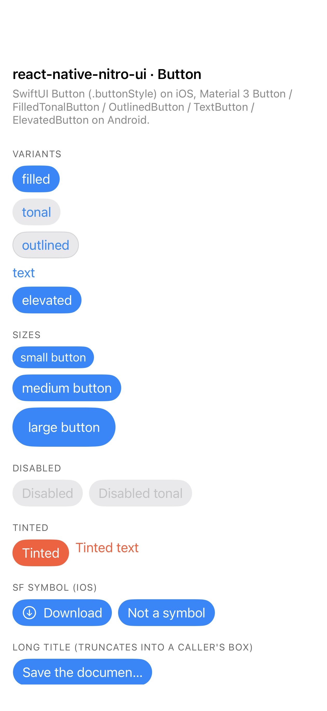
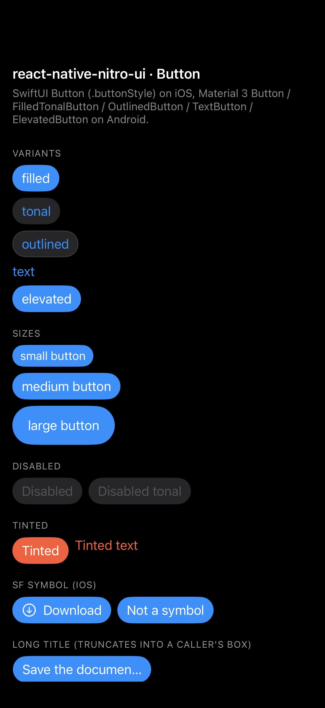
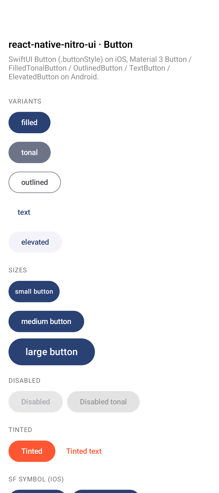
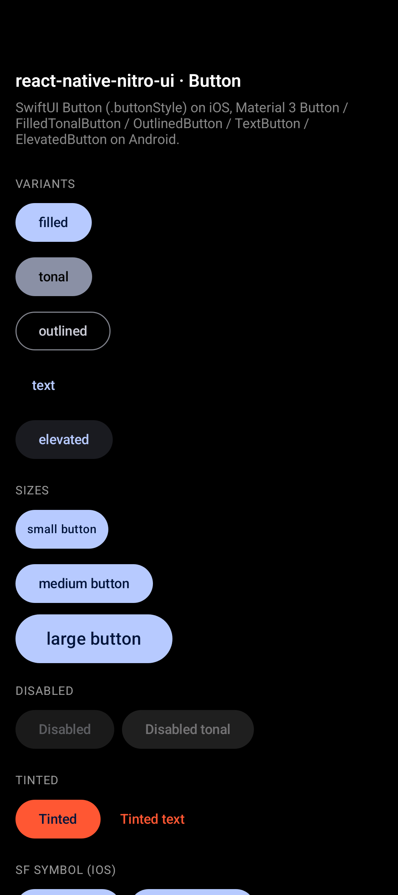

# Button

The platform button: SwiftUI `Button` with a `.buttonStyle(...)` per variant on
iOS, Material 3 `Button` / `FilledTonalButton` / `OutlinedButton` / `TextButton`
/ `ElevatedButton` on Android. Both are hosted by the core runtime
(`docs/architecture/core.md`), so pressed, hovered and focused states, haptics,
a11y behaviour and dynamic type belong to the control, not to us.

```tsx
import { Button } from 'react-native-nitro-ui';

<Button title="Save" onPress={save} variant="tonal" size="small" />;
```

There are no children: v0.1 supports only leaf Hybrid Views
(`docs/architecture/core.md`), so the label is the `title` string.

## API

| Prop                 | Type                                          | Default  | Maps to                                                        |
| -------------------- | --------------------------------------------- | -------- | -------------------------------------------------------------- |
| `title`              | `string`                                      | required | The label — and one of the props that decide the width.         |
| `onPress`            | `(() => void) \| undefined`                   | —        | SwiftUI `Button(action:)` / Compose `onClick`. One per tap.     |
| `variant`            | `'filled' \| 'tonal' \| 'outlined' \| 'text' \| 'elevated'` | `filled` | The style per platform — see the table below.       |
| `size`               | `'small' \| 'medium' \| 'large'`              | `medium` | SwiftUI `.controlSize` / content padding + label typography.    |
| `disabled`           | `boolean \| undefined`                        | `false`  | SwiftUI `.disabled()` / Compose `enabled = false`.              |
| `tintColor`          | `ColorValue \| undefined`                     | platform | SwiftUI `.tint()` / the variant's container or label colour.    |
| `systemImage`        | `string \| undefined`                         | —        | iOS `Label` icon. **Ignored on Android in v0.1** (see Limits).  |
| `style`              | `ViewStyle`                                   | —        | Overrides the measured box (see Sizing).                        |
| `testID`             | `string \| undefined`                         | —        | iOS `accessibilityIdentifier` (RN's own), Android `View.tag`.    |
| `accessibilityLabel` | `string \| undefined`                         | —        | Label of the control itself; falls back to `title`.             |
| `hybridRef`          | `(view: handle) => void`                      | —        | **Internal.** Read-only handle for this repo's harness and benchmarks. |
| `nuiPerfId`          | `number \| null \| undefined`                 | `null`   | **Internal.** Instance id for perf marks; `null` disables marks.  |

`Button` is a `View`, so any other `ViewProps` (`onLayout`, …) work as usual.
An unknown `variant` or `size` string resolves to the default rather than
throwing, on both platforms and in JS.

`hybridRef` and `nuiPerfId` are not app API (DECISIONS D14): the handle is
read-only plus `measureContent()`, and it runs once, when the view mounts.

## Platform mapping

| Concept         | iOS                                                | Android                                                   |
| ------------- | ---------------------------------------------------- | ----------------------------------------------------------- |
| Control       | `Button(action:) { Label }` + `.buttonStyle(...)`     | One of the five M3 button composables                        |
| Host          | `UIHostingController` inside `NitroSwiftUIHost`       | `NitroComposeHost<M>: AbstractComposeView`                   |
| Theme         | system traits, `.tint()`                             | `MaterialTheme` + dynamic color on Android 12+               |
| Scale         | `.controlSize(.small/.regular/.large)`               | `contentPadding` + `labelMedium`/`labelLarge`/18 sp          |
| Disabled      | `.disabled(true)` + native dimming                   | `enabled = false` + M3 disabled colors                       |
| Test id       | RN's `testID` → `accessibilityIdentifier`            | `host.tag` (Compose has no test id)                          |
| Label         | `.accessibilityLabel(_:)` on the Button              | `Modifier.semantics { contentDescription }` on the button    |
| Recycle       | hosting controller reused                            | objects reused; composition rebuilt (`core.md` §6)          |

### Variants

The roles are named after Material 3 because that is the taxonomy with five
named roles. Each platform gets its closest *idiomatic* style; the two columns
deliberately do not look alike, and neither one fakes the other.

| `variant`  | iOS                                          | Android                        |
| ---------- | ---------------------------------------------- | -------------------------------- |
| `filled`   | `.borderedProminent`                           | `Button` (M3 filled)             |
| `tonal`    | `.bordered`                                    | `FilledTonalButton`              |
| `outlined` | `.bordered` + capsule hairline (`separator`)   | `OutlinedButton`                 |
| `text`     | `.borderless`                                  | `TextButton`                     |
| `elevated` | `.borderedProminent`                           | `ElevatedButton`                 |

iOS has no outlined and no elevated button style. `outlined` is `.bordered` with
a 1 pt capsule stroke in the separator colour, which is the shape an iOS user
reads as an outline and which keeps working in dark mode. `elevated` maps to
`.borderedProminent`, the iOS primary action; Material's shadow has no iOS
analogue, so `filled` and `elevated` are the same control on iOS.

| iOS light                                     | iOS dark                                      |
| ----------------------------------------------- | ----------------------------------------------- |
|    |    |

| Android light                                     | Android dark                                     |
| --------------------------------------------------- | ---------------------------------------------------- |
|  |  |

Each screenshot is the example screen (`example/src/ButtonScreen.tsx`) as it
opens, down to the tinted pair and the SF Symbol row: the five variants, the
three sizes, the disabled pair, the tinted pair and — since `systemImage` is
iOS-only — the symbol row that shows title-only labels on Android. Below the
fold the screen continues with the truncating long title, a title that changes
on a timer, a row of differently sized buttons and a 200-button list.

### What `tintColor` recolours

| `variant`            | iOS `.tint()`          | Android `tintColor`       |
| ---------------------- | ------------------------ | --------------------------- |
| `filled`, `elevated`   | container colour         | `containerColor`            |
| `tonal`                | label + background tint  | `containerColor`            |
| `outlined`, `text`     | label colour             | `contentColor` (and M3's border for `outlined`) |

Material's `outlined` and `text` containers are transparent by design, so the
tint goes to the label there — the same trade the Switch's `tintColor` makes.

## Sizing

Button is the library's first control whose size comes from its **props**, so it
owns the R3 verification of `docs/architecture/sizing.md` (D16):
`example/__tests__/Button.harness.tsx` asserts the laid-out box against the
control's own measurement after every `title` and `size` change.

The sizing key is `variant|size|systemImage|title`
(`src/components/Button/Button.tsx:136`) — everything that moves the control's
size, nothing that only repaints it (`disabled`, `tintColor`) and no environment
inputs, which native folds in through the epoch. Free-form values come last so a
`|` inside one cannot shift a fixed field.

Measured, with `title="Save"` and nothing overridden (iPhone Air / iOS 27 in pt;
`nitroui_t02`, API 35 at 420 dpi, in dp):

| `variant`  | iOS S        | iOS M        | iOS L        | Android S   | Android M   | Android L    |
| ---------- | -------------- | -------------- | -------------- | -------------- | -------------- | -------------- |
| `filled`   | 53.3 × 28.0    | 61.0 × 34.3    | 77.0 × 50.3    | 57.9 × 48.0    | 78.5 × 48.0    | 103.2 × 50.3   |
| `tonal`    | 53.3 × 28.0    | 61.0 × 34.3    | 77.0 × 50.3    | 57.9 × 48.0    | 78.5 × 48.0    | 103.2 × 50.3   |
| `outlined` | 53.3 × 28.0    | 61.0 × 34.3    | 77.0 × 50.3    | 57.9 × 48.0    | 78.5 × 48.0    | 103.2 × 50.3   |
| `elevated` | 53.3 × 28.0    | 61.0 × 34.3    | 77.0 × 50.3    | 57.9 × 48.0    | 78.5 × 48.0    | 103.2 × 50.3   |
| `text`     | 33.3 × 18.0    | 37.0 × 20.3    | 37.0 × 20.3    | 57.9 × 48.0    | 57.9 × 48.0    | 87.2 × 50.3    |

Nothing here is a constant: the box is what the control measured, so the
platforms disagree by design. Material 3 keeps a 48 dp minimum interactive
height, which is why Android `small` and `medium` are the same height and why
Android `text` is not smaller than `filled`. iOS `.borderless` does not grow at
`.large`, which is SwiftUI's own behaviour.

Width is the title's, so the same control at the same size is a different width
per label — measured at iOS M 61.0 / 76.7 / 92.7 and Android M 78.5 / 91.0 /
104.0 for `Save` / `Cancel` / `Continue`. Two Buttons with different titles in
one row therefore get two different widths, which the harness asserts as
cache-key correctness (dropping `title` from the key makes every Button the
width of the first one).

**What the engine starts from.** The fallback is the one number declared before
any measurement exists, and the engine keys fallbacks per component, so it is one
pair: `77 × 35` pt (`ios/components/Button/HybridNitroUiButton.swift:210`) and
`91 × 48` dp (`android/.../HybridNitroUiButton.kt:481`). Both are the middle of
the measured table above rather than a guess, because a fallback smaller than the
control makes SwiftUI paint outside its box. Per D17 the first instance of a
configuration may show that fallback for one frame and is then corrected; every
instance whose configuration is already exact in the cache must be exact on its
first frame. `prewarmKeys` is the way to make even the first mount exact.

Android's answer is never stale for a prop change; iOS may show one stale frame
after an **environment** change (D16) and none for a prop change, because every
size-affecting setter there calls `host.noteContentSizeMayHaveChanged()` next to
`markDirty()` — a setter that forgot it would keep the old box, since
`NitroSwiftUIHost` only re-measures when its bounds or traits move.

A user `style` still wins: `width`, `height` or `flex` fixes the box and the
control centres inside it, and a `width` narrower than the label truncates it
(one line, tail) instead of painting outside. The cross axis is the documented
difference from stock RN: once the engine has written a size, Yoga has nothing
left to stretch, so a parent's `alignItems: 'stretch'` does not widen a Button —
ask for it with `alignSelf: 'stretch'`. The base style is `alignSelf:
'flex-start'` (`src/components/Button/Button.tsx:150`) for the same reason RN's
own `Switch` has one: in a column, stretch would decide the width for us and the
measurement would never be asked for.

Text size does move this control (unlike the Switch): the label is text, so
Dynamic Type and `font_scale` change the fitting size. Neither platform is told
about that from JS in v0.1 — native picks up the new size from the trait or
configuration change, and the epoch invalidation is what drops the now-wrong
cached sizes (`docs/architecture/sizing.md` §9; the harness drives it through
`invalidateSizingEnvironment()`).

## Behaviour notes

- **One callback per tap.** `onPress` is a Nitro callback prop that is *always*
  sent — with a module-level no-op when the caller passed nothing — because
  Nitro reads `undefined` as "unset", and a prop that disappears would leave a
  recycled view holding the previous mount's handler.
- **Disabled is native.** `.disabled(true)` / `enabled = false` swallow the tap;
  JS gets nothing, and the control dims with its own disabled colours.
- **Recycling is safe.** `NitroUiButton` implements `RecyclableView` on both
  platforms: the model resets, `systemImage`/`accessibilityLabel` go back to
  `null`, and on Android the composition is disposed before reuse and rebuilt on
  the next attach (`docs/architecture/core.md` §6). One batched commit per JS
  update; no hosting recreation per update.
- **Cached, never rebuilt.** The M3 `ButtonColors` per `(scheme, variant, tint)`
  and the derived `labelLarge` at 18 sp are served from a cache keyed on the
  theme's identity (`android/.../HybridNitroUiButton.kt:175`, `:295`), so a
  recomposition does not build a colour scheme — the same rule the Switch follows.
- **Perf marks.** With `nitroUiCore.setPerfEnabled(true)` and a `nuiPerfId`,
  native records `propsApplied` and `firstFrame` per instance; drain with
  `nitroUiCore.drainPerf()`.

## Limits

- `systemImage` is iOS-only in v0.1: Android ignores it and the label stays the
  `title` text. It is still in the sizing key on both platforms so the two
  cannot drift apart when it is implemented.
- `elevated` and `filled` are the same control on iOS, and `outlined` is
  `.bordered` plus a stroke: iOS has five button styles but not these three
  Material roles (see the mapping above).
- The five variants share one declared fallback pair, so the first `text`
  instance on iOS starts from a box larger than it needs and shrinks on its
  correction (D17). T14 (`docs/tasks/T14-early-fallbacks.md`) is where a
  finer-grained fallback story belongs.
- Its size is measured, not declared, so the first Button of a new configuration
  costs one layout correction. A cold batch of 200 distinct titles lands over
  several frames — logged, not gated (D17).
- A parent's `alignItems: 'stretch'` does not widen it (see Sizing); stock RN
  controls do stretch.
- Android has no `testID` inside the Compose view; the id lands on the host
  `View.tag`, which is what the harness reads.
- No `ref` forwarding, and `aria-label`/`aria-disabled` are not translated. The
  label belongs to the hosted control, so putting `accessible` or another
  `accessibilityRole` on the container can hide that control from VoiceOver or
  TalkBack (`docs/architecture/core.md` §3). Style the box; do not re-role it.
