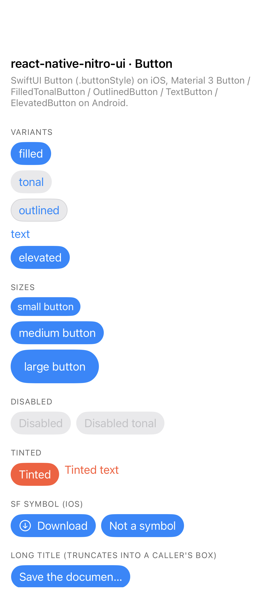
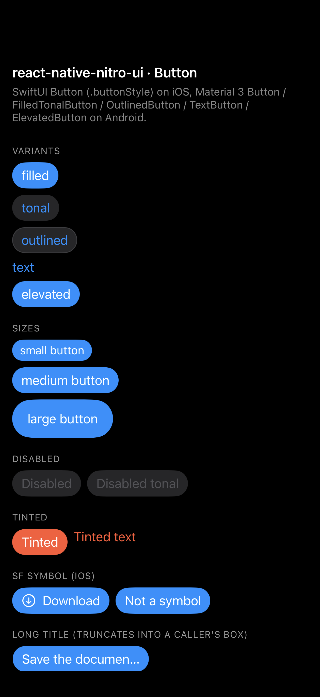
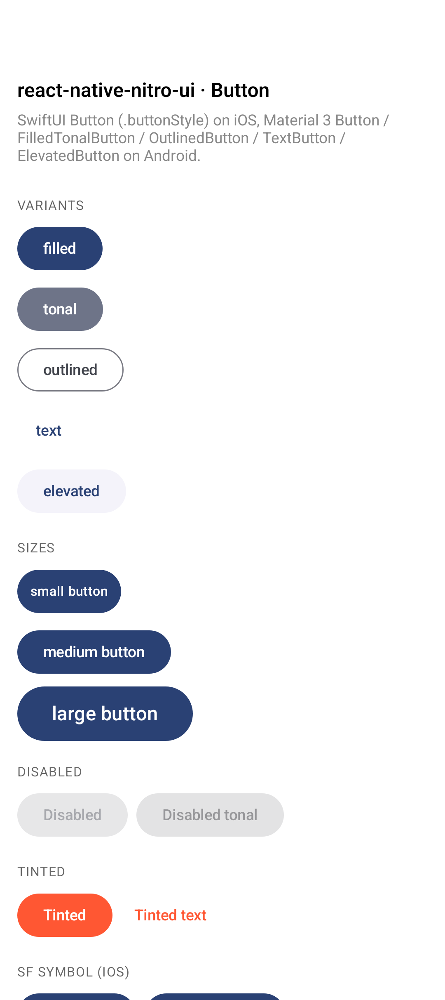
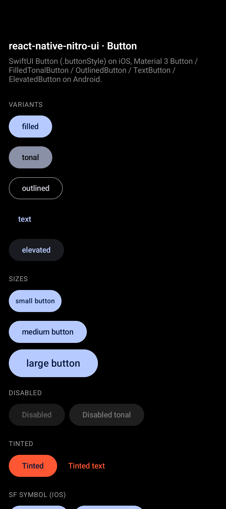

# Button

The platform button: SwiftUI `Button` with a `.buttonStyle(...)` per variant on iOS, Material 3
`Button` / `FilledTonalButton` / `OutlinedButton` / `TextButton` / `ElevatedButton` on Android.
Pressed, hovered and focused states, haptics, accessibility behaviour and dynamic type belong to
the control.

```tsx
import { Button } from 'react-native-nitro-ui';

<Button title="Save" onPress={save} variant="tonal" size="small" />;
```

There are no children: the label is the `title` string. A `Button` can be a child of a `<Host>`
([host.md](host.md)).

## API

| Prop                 | Type                                                        | Default  | Maps to                                                                                                                                                |
| -------------------- | ----------------------------------------------------------- | -------- | ------------------------------------------------------------------------------------------------------------------------------------------------------ |
| `title`              | `string`                                                    | required | The label, and one of the props that decide the width.                                                                                                 |
| `onPress`            | `(() => void) \| undefined`                                 | —        | SwiftUI `Button(action:)` / Compose `onClick`. One per tap.                                                                                            |
| `variant`            | `'filled' \| 'tonal' \| 'outlined' \| 'text' \| 'elevated'` | `filled` | The style per platform; see the table below.                                                                                                           |
| `size`               | `'small' \| 'medium' \| 'large' \| 'xlarge' \| 'xxlarge'`   | `medium` | SwiftUI `.controlSize` / a Material 3 container height.                                                                                                |
| `shape`              | `'round' \| 'square' \| null`                               | `round`  | iOS `.buttonBorderShape` / Compose `shapes = ButtonShapes`.                                                                                            |
| `disabled`           | `boolean \| undefined`                                      | `false`  | SwiftUI `.disabled()` / Compose `enabled = false`.                                                                                                     |
| `tintColor`          | `ColorValue \| undefined`                                   | platform | SwiftUI `.tint()` / the variant's container or label colour.                                                                                           |
| `systemImage`        | `string \| undefined`                                       | —        | iOS `Label` icon. Ignored on Android (see Android icons).                                                                                              |
| `androidIcon`        | `AndroidIconProp \| undefined`                              | —        | `AndroidIconProp` is `string \| number \| ImageURISource`: an imported `.xml` vector drawable, or a drawable name. Ignored on iOS (see Android icons). |
| `style`              | `ViewStyle`                                                 | —        | Overrides the measured box (see Sizing).                                                                                                               |
| `testID`             | `string \| undefined`                                       | —        | iOS `accessibilityIdentifier` (RN's own), Android `View.tag`.                                                                                          |
| `accessibilityLabel` | `string \| undefined`                                       | —        | Label of the control itself; falls back to `title`.                                                                                                    |
| `hybridRef`          | `(view: handle) => void`                                    | —        | Internal. Read-only handle for this repo's harness and benchmarks.                                                                                     |
| `nuiPerfId`          | `number \| null \| undefined`                               | `null`   | Internal. Instance id for perf marks; `null` disables marks.                                                                                           |

`Button` is a `View`, so any other `ViewProps` (`onLayout`, …) work as usual. An unknown
`variant`, `size` or `shape` string resolves to the default, on both platforms and in JS, and so
does `null`.

`hybridRef` and `nuiPerfId` are not app API: the handle is read-only plus `measureContent()`, and
it runs once, when the view mounts.

## Platform mapping

| Concept  | iOS                                               | Android                                                             |
| -------- | ------------------------------------------------- | ------------------------------------------------------------------- |
| Control  | `Button(action:) { Label }` + `.buttonStyle(...)` | One of the five Material 3 button composables                       |
| Host     | `UIHostingController` inside `NitroSwiftUIHost`   | `NitroComposeHost<M>: AbstractComposeView`                          |
| Theme    | system traits, `.tint()`                          | `MaterialTheme` + dynamic color on Android 12+                      |
| Scale    | `.controlSize(.small/.regular/.large)`            | Material 3 container height 32/40/56 dp + `ButtonDefaults.*For(it)` |
| Corner   | `.buttonBorderShape(_:)` per variant              | `shapes = ButtonDefaults.shapesFor(height)` / `ButtonShapes`        |
| Disabled | `.disabled(true)` + native dimming                | `enabled = false` + Material 3 disabled colors                      |
| Test id  | RN's `testID` → `accessibilityIdentifier`         | `host.tag` (Compose has no test id)                                 |
| Label    | `.accessibilityLabel(_:)` on the Button           | `Modifier.semantics { contentDescription }` on the button           |
| Recycle  | hosting controller reused                         | objects reused; composition rebuilt                                 |

### Variants

The variants are named after Material 3's five roles. Each platform draws its closest idiomatic
style, so the two columns do not look alike.

| `variant`  | iOS                                          | Android                      |
| ---------- | -------------------------------------------- | ---------------------------- |
| `filled`   | `.borderedProminent`                         | `Button` (Material 3 filled) |
| `tonal`    | `.bordered`                                  | `FilledTonalButton`          |
| `outlined` | `.bordered` + capsule hairline (`separator`) | `OutlinedButton`             |
| `text`     | `.borderless`                                | `TextButton`                 |
| `elevated` | `.borderedProminent`                         | `ElevatedButton`             |

iOS has no outlined and no elevated button style. `outlined` is `.bordered` with a 1 pt capsule
stroke in the separator colour. `elevated` maps to `.borderedProminent`, so `filled` and
`elevated` are the same control on iOS.

### Corners

`shape` is the corner. A Material `squareShape` button has no corner at all, while every iOS
button style draws a rounded one, so each platform maps the two names to its own nearest shape.
`round` is the default.

| `shape`  | iOS                                                                  | Android                                                                                               |
| -------- | -------------------------------------------------------------------- | ----------------------------------------------------------------------------------------------------- |
| `round`  | each style's own corner: `.automatic`, and `.capsule` for `outlined` | `ButtonDefaults.shapesFor(height)`: the height's corner, morphing toward the square one while pressed |
| `square` | `.roundedRectangle(radius: 8)`; the `outlined` hairline follows it   | `squareShape` at rest, `RoundedCornerShape` while pressed                                             |
| `text`   | ignored: `.borderless` draws no border                               | ignored: the variant rests on `round` whatever the prop says                                          |

Android has Material 3 Expressive's shape morph: the `shapes:` overload takes a resting and a
pressed shape, so pressing a round button squares it off and releasing springs it back. An iOS
`ButtonBorderShape` is static, so there the corner changes only when the prop does.

| iOS light                                    | iOS dark                                   |
| -------------------------------------------- | ------------------------------------------ |
|  |  |

| Android light                                        | Android dark                                       |
| ---------------------------------------------------- | -------------------------------------------------- |
|  |  |

Each screenshot is the example screen (`example/src/ButtonScreen.tsx`) as it opens.

### What `tintColor` recolours

| `variant`            | iOS `.tint()`           | Android `tintColor`                                     |
| -------------------- | ----------------------- | ------------------------------------------------------- |
| `filled`, `elevated` | container colour        | `containerColor`                                        |
| `tonal`              | label + background tint | `containerColor`                                        |
| `outlined`, `text`   | label colour            | `contentColor` (and Material 3's border for `outlined`) |

Material's `outlined` and `text` containers are transparent, so the tint goes to the label there.

## Android icons

iOS draws `systemImage` from SF Symbols. Android has no system icon set, so the app owns the
artwork and `androidIcon` points at it:

```tsx
<Button
  title="Share"
  systemImage="square.and.arrow.up"
  androidIcon={require('./icons/share.xml')}
  onPress={share}
/>
```

Each platform takes its own prop and ignores the other, so one Button needs no `Platform.select`.

This section describes the prop, not the control: `Menu`'s trigger takes the same `androidIcon`,
with the same forms and the same failure table ([menu.md](menu.md), "The trigger's glyph").

### Getting the artwork

Material Symbols is Apache 2.0. On [fonts.google.com/icons](https://fonts.google.com/icons), pick
an icon, open the download panel and choose the Android format: one `.xml` file per icon, an
Android vector drawable. The iOS and Flutter formats are different files.

Expo apps can skip the download:
[`@expo/material-symbols`](https://www.npmjs.com/package/@expo/material-symbols) publishes the set
(outlined style, one file per icon) as `.xml` files in a package, so
`androidIcon={require('@expo/material-symbols/share.xml')}` works. It is optional and not a
dependency of this library.

Put the files anywhere inside your app's source and `require` them. There is no plugin to
register, no folder to keep in step with `prebuild`, and nothing to add to a Gradle file. `xml`
is one of Metro's default asset extensions, and in a release build the file becomes an ordinary
drawable resource with the name Metro derives from its path: `src/assets/icons/share.xml` ships
as `src_assets_icons_share`.

A `require` needs nothing. An app that prefers `import` needs the ambient declaration it already
writes for its images:

```ts
// react-native-xml.d.ts
declare module '*.xml' {
  const assetId: number;
  export default assetId;
}
```

### The drawable-name form

An app that already ships drawables can name them, with no `require`:

```tsx
<Button title="Share" androidIcon="share" onPress={share} />
```

That is `res/drawable/share.xml`, named without the extension. It is an Android resource name:
lower case, digits and underscores, starting with a letter. `-` and `.` are accepted and read as
`_`, so `share-24px` finds `share_24px.xml`. Under `expo prebuild` the `res/drawable/` folder is
generated, so with that workflow use the `require` form, which survives a `--clean`.

In either form the icon is tinted to the control's text colour and sized by the control, so any
24 dp vector works. The glyph fades with the label when the control is disabled and follows
`tintColor` when it is not. A multicolour drawable draws in one colour
(`android/src/main/java/com/margelo/nitro/nitroui/NitroUiIcon.kt`).

### What an icon costs, and what it does not

The icon's size comes from the control's `size`, never from the file. The slot is
`iconSizeFor(size)` wide, so a 24 dp star and a 32 × 12 slab widen the Button by the same amount.
In development the file is still being read while the first frame is laid out: the slot is
reserved and empty, and the glyph appears in it when it arrives. Nothing moves.

An icon that cannot be resolved draws nothing and reserves nothing, so the Button is exactly its
no-icon self, the way iOS treats an SF Symbol name that does not exist:

| What happened                                  | What you see                                               |
| ---------------------------------------------- | ---------------------------------------------------------- |
| `res/drawable/share.xml` is not in the build   | nothing drawn, one line in `adb logcat -s NitroUi`         |
| The `.xml` Metro serves is a 404 or unreadable | nothing drawn, one line in the same log                    |
| The file is XML but not a `<vector>`           | the same, and the log says the file is not a drawable      |
| `androidIcon` is a `.png` or other asset       | nothing drawn, and a development warning says why          |
| A name that could not be a resource name       | a development warning from JavaScript, where it is fixable |

A failed file is remembered, so a renamed icon costs one request, not one per frame. A
`layer-list`, an adaptive icon or a shape with no intrinsic size counts as not found, because it
cannot be drawn at an icon's size, and says so once in the same log.

Release builds read the drawable; development reads the file. In a release build the `require`d
`.xml` is a resource in the APK, loaded once per process through the resource table and shared
by every control that names it. In development the file is the copy Metro serves, and React
Native does not load Android `.xml` assets from the dev server (`assetSupportsNetworkLoads` in
`AssetSourceResolver.js`). The library therefore builds the dev-server URL itself, reads the file
on a worker thread, parses it into a Compose `ImageVector`, caches it per URL for the process,
and draws it through the same `VectorPainter` as any Material icon. It does not patch React
Native's global asset resolver, so how `Image` resolves its sources is unchanged.

A gradient fill (a `<gradient>` inside an `<aapt:attr>`) is not read in development: the parser
refuses the file, so the icon appears in a release build and not in a development one, and the
log says so.

## Sizing

The sizing key is `variant|size|systemImage|androidIcon|title`
(`src/components/Button/Button.tsx`): everything that moves the control's size, nothing that only
repaints it (`disabled`, `tintColor`, `shape`) and no environment inputs, which native adds
through the epoch. Both icon props are in it, because a glyph before the label makes the control
wider. Free-form values are escaped, so a `|` inside one cannot forge a field boundary.

Measured, with `title="Save"` and nothing overridden (iPhone Air / iOS 27 in pt; an API 35
emulator at 420 dpi, in dp):

| `variant`  | iOS S       | iOS M       | iOS L       | Android S   | Android M   | Android L   |
| ---------- | ----------- | ----------- | ----------- | ----------- | ----------- | ----------- |
| `filled`   | 53.3 × 28.0 | 61.0 × 34.3 | 77.0 × 50.3 | 57.9 × 48.0 | 62.5 × 48.0 | 84.2 × 56.0 |
| `tonal`    | 53.3 × 28.0 | 61.0 × 34.3 | 77.0 × 50.3 | 57.9 × 48.0 | 62.5 × 48.0 | 84.2 × 56.0 |
| `outlined` | 53.3 × 28.0 | 61.0 × 34.3 | 77.0 × 50.3 | 57.9 × 48.0 | 62.5 × 48.0 | 84.2 × 56.0 |
| `elevated` | 53.3 × 28.0 | 61.0 × 34.3 | 77.0 × 50.3 | 57.9 × 48.0 | 62.5 × 48.0 | 84.2 × 56.0 |
| `text`     | 33.3 × 18.0 | 37.0 × 20.3 | 37.0 × 20.3 | 57.9 × 48.0 | 57.9 × 48.0 | 60.6 × 48.0 |

The box is what the control measures, so the platforms differ. On Android `size` selects a
Material 3 container token (XS 32 / S 40 / M 56 dp), and the padding, the label style and the
corner are read from that token. It does not set the height: Material floors the container at
`ButtonDefaults.MinHeight` (40 dp) and the box at its 48 dp interactive minimum. So `small` is
the XS token's padding, type and corner, not a 32 dp control; `small` and `medium` share a
height; and `text` is not shorter than `filled`. `large` is the first size the token lifts above
that floor. iOS `.borderless` does not grow at `.large`, which is SwiftUI's own behaviour.

`xlarge` and `xxlarge` are Material's `LargeContainerHeight` (96 dp) and
`ExtraLargeContainerHeight` (136 dp), so the five sizes are Material's XS to XL:

| Material | XS      | S        | M       | L        | XL        |
| -------- | ------- | -------- | ------- | -------- | --------- |
| `size`   | `small` | `medium` | `large` | `xlarge` | `xxlarge` |

iOS has four usable `.controlSize` values. `xlarge` and `xxlarge` both draw `.extraLarge` (iOS
17+) and `.large` before it. On iOS 27 `.large` and `.extraLarge` are the same size for these
styles, so iOS gives three heights to five sizes and Android gives five.

Measured with `title="Rung"` and nothing else overridden (the API 35 emulator at 420 dpi in dp,
the iPhone Air on iOS 27 in pt):

| `size`  |         Android |           iOS |
| ------- | --------------: | ------------: |
| small   |   57.90 × 48.00 | 55.67 × 28.00 |
| medium  |   64.38 × 48.00 | 63.67 × 34.33 |
| large   |   85.71 × 56.00 | 79.67 × 50.33 |
| xlarge  |  150.86 × 96.00 | 79.67 × 50.33 |
| xxlarge | 200.76 × 136.00 | 79.67 × 50.33 |

The Android heights are 48 / 48 / 56 / 96 / 136.

Width is the title's, so the same control at the same size is a different width per label: iOS M
61.0 / 76.7 / 92.7 and Android M 62.5 / 75.1 / 88.0 for `Save` / `Cancel` / `Continue`.

The declared fallback is one pair per component: `77 × 35` pt
(`ios/components/Button/HybridNitroUiButton.swift`) and `75.1 × 48` dp
(`android/.../HybridNitroUiButton.kt`), the middle of the measured table above, because a
fallback smaller than the control makes SwiftUI paint outside its box. The first instance of a
configuration the engine has not measured may show that fallback for one frame and is then
corrected, on either platform; a configuration already in the cache is exact on its first frame.
`prewarm` does not help here: it seeds a component's default (empty) configuration only, and a
Button's key always names its variant, size and title.

Both hosts compare a report with the last size they reported for the instance, and reset that
comparison when `nuiSizingKey` changes, so a new configuration that measures the same as the old
one still gets its correcting report. On iOS every size-affecting setter also calls
`host.noteContentSizeMayHaveChanged()` beside `markDirty()`, because `NitroSwiftUIHost` only
re-measures when its bounds or traits move.

A user `style` wins: `width`, `height` or `flex` fixes the box and the control centres inside
it, and a `width` narrower than the label truncates it (one line, tail). The size the control
reports is still the title's intrinsic one, so a long title is never cached at a narrow box.

A parent's `alignItems: 'stretch'` does not widen a Button; ask for it with
`alignSelf: 'stretch'`. The base style is `alignSelf: 'flex-start'`
(`src/components/Button/Button.tsx`), so that in a column the control takes its measured width.

Text size moves this control: Dynamic Type and `font_scale` change the fitting size. Native picks
up the new size from the trait or configuration change, and the epoch change drops the cached
sizes ([DESIGN.md](../DESIGN.md), section 3.6).

## Accessibility

The accessibility element is the platform's: a UIKit element with the button role and the label
SwiftUI was given on iOS, the Material 3 button's semantics node on Android.

- `accessibilityLabel` goes on the control (`.accessibilityLabel(_:)` /
  `Modifier.semantics { contentDescription }`) and falls back to `title`, so a plain Button is
  already announced. It is not part of the sizing key.
- Keep the label on the control. `accessible`, an `accessibilityRole` or another accessibility
  prop on the container can hide the button from VoiceOver or TalkBack. Style the box; do not
  re-role it.
- `disabled` is the enable/disable API; `aria-label` / `aria-disabled` are not translated, and
  there is no `ref` forwarding. A disabled button emits no `onPress`.
- `testID` is RN's own on iOS (`accessibilityIdentifier`); on Android it lands on the host
  `View.tag`, because Compose has no test id.

## Behaviour notes

- One callback per tap. `onPress` is always sent, with a module-level no-op when the caller
  passes nothing, so a recycled view never holds a previous mount's handler.
- Disabled is native. `.disabled(true)` / `enabled = false` swallow the tap; JS gets nothing, and
  the control dims with its own disabled colours.
- `NitroUiButton` implements `RecyclableView` on both platforms: the model resets,
  `systemImage`/`accessibilityLabel` go back to `null`, and on Android the composition is
  disposed before reuse and rebuilt on the next attach. There is one batched commit per JS
  update, and the hosting view is never recreated per update.
- The Material 3 `ButtonColors` per `(scheme, variant, tint)`, the label style
  `ButtonDefaults.textStyleFor(height)` returns, and the `ButtonShapes` pair per
  `(motion scheme, corner, height)` come from caches keyed on the theme's identity
  (`ButtonColorsCache`, `ButtonLabelStyles` and `ButtonShapesCache` in
  `android/.../HybridNitroUiButton.kt`), so a recomposition builds neither a colour scheme nor a
  shape.
- `shape` is not in the sizing key on either platform: a Button that changes corner repaints and
  costs no size correction.
- Perf marks. With `nitroUiCore.setPerfEnabled(true)` and a `nuiPerfId`, native records
  `propsApplied` and `firstFrame` per instance; drain with `nitroUiCore.drainPerf()`.

## Limits

- `shape='square'` is not a square on iOS. iOS draws `.roundedRectangle(radius: 8)`, the nearest
  border shape SwiftUI offers, and has no press morph. The `text` variant ignores `shape` on both
  platforms (see Corners).
- `systemImage` is iOS-only and `androidIcon` is Android-only; a Button that wants a glyph on
  both passes both (see Android icons).
- `elevated` and `filled` are the same control on iOS, and `outlined` is `.bordered` plus a
  stroke (see Variants).
- The five variants share one declared fallback pair, so the first `text` instance on iOS starts
  from a box larger than it needs and shrinks on its correction.
- Its size is measured, not declared, so the first Button of a new configuration costs one layout
  correction. A cold batch of 200 distinct titles lands over several frames.
- A parent's `alignItems: 'stretch'` does not widen it (see Sizing); stock RN controls do
  stretch.
- Android has no `testID` inside the Compose view; the id lands on the host `View.tag`.
- No `ref` forwarding, and `aria-label`/`aria-disabled` are not translated.
