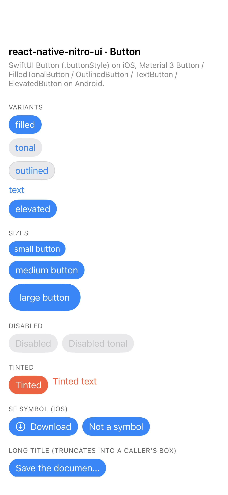
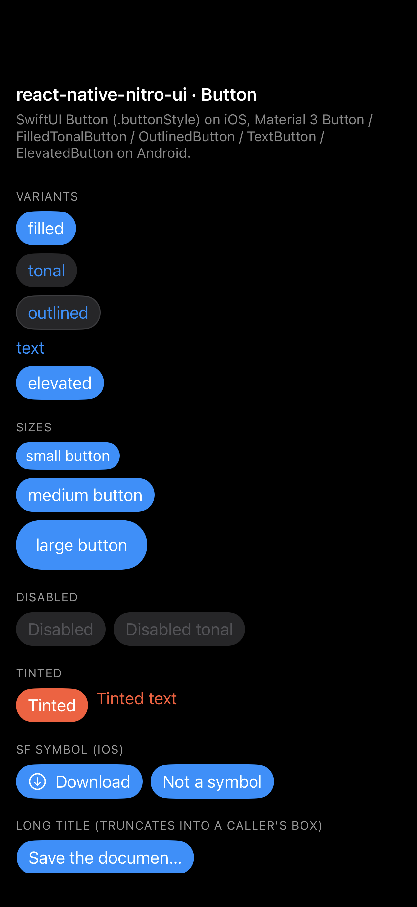
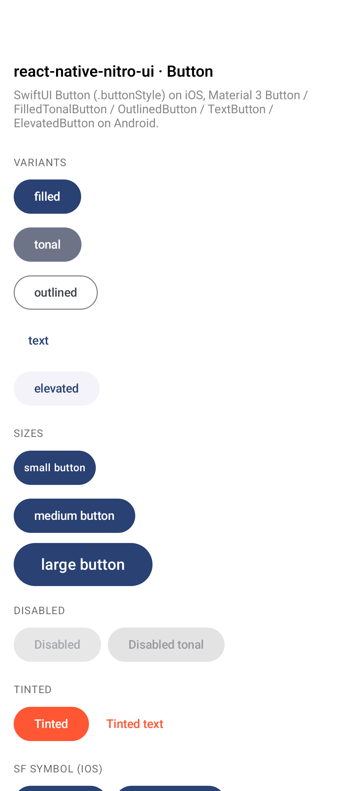
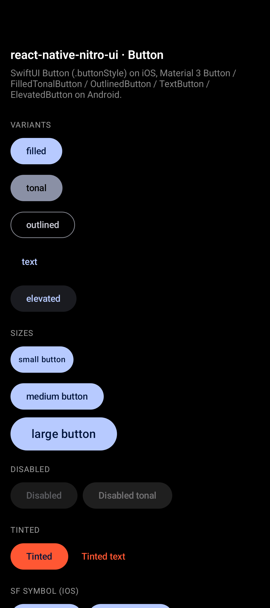

# Button

The platform button: SwiftUI `Button` with a `.buttonStyle(...)` per variant on
iOS, Material 3 `Button` / `FilledTonalButton` / `OutlinedButton` / `TextButton`
/ `ElevatedButton` on Android. Both are hosted by the core runtime
(`docs/architecture/core.md`), so pressed, hovered and focused states, haptics,
a11y behaviour and dynamic type belong to the control, not to us.

```tsx
import { Button } from 'react-native-nitro-ui';

<Button title="Save" onPress={save} variant="tonal" size="small" />;
```

There are no children: the label is the `title` string. (A `Button` can itself be
a child of a `<Host>` since 0.2.0 — `docs/components/host.md`.)

## API

| Prop                 | Type                                          | Default  | Maps to                                                        |
| -------------------- | --------------------------------------------- | -------- | -------------------------------------------------------------- |
| `title`              | `string`                                      | required | The label — and one of the props that decide the width.         |
| `onPress`            | `(() => void) \| undefined`                   | —        | SwiftUI `Button(action:)` / Compose `onClick`. One per tap.     |
| `variant`            | `'filled' \| 'tonal' \| 'outlined' \| 'text' \| 'elevated'` | `filled` | The style per platform — see the table below.       |
| `size`               | `'small' \| 'medium' \| 'large' \| 'xlarge' \| 'xxlarge'` | `medium` | SwiftUI `.controlSize` / a Material 3 container height.    |
| `shape`              | `'round' \| 'square' \| null`                  | `round`  | iOS `.buttonBorderShape` / Compose `shapes = ButtonShapes`.     |
| `disabled`           | `boolean \| undefined`                        | `false`  | SwiftUI `.disabled()` / Compose `enabled = false`.              |
| `tintColor`          | `ColorValue \| undefined`                     | platform | SwiftUI `.tint()` / the variant's container or label colour.    |
| `systemImage`        | `string \| undefined`                         | —        | iOS `Label` icon. **Ignored on Android** (see Android icons).  |
| `androidIcon`        | `AndroidIconProp \| undefined`               | —        | `AndroidIconProp` is `string \| number \| ImageURISource`: an imported `.xml` vector drawable, or a drawable name. **Ignored on iOS** (see Android icons). |
| `style`              | `ViewStyle`                                   | —        | Overrides the measured box (see Sizing).                        |
| `testID`             | `string \| undefined`                         | —        | iOS `accessibilityIdentifier` (RN's own), Android `View.tag`.    |
| `accessibilityLabel` | `string \| undefined`                         | —        | Label of the control itself; falls back to `title`.             |
| `hybridRef`          | `(view: handle) => void`                      | —        | **Internal.** Read-only handle for this repo's harness and benchmarks. |
| `nuiPerfId`          | `number \| null \| undefined`                 | `null`   | **Internal.** Instance id for perf marks; `null` disables marks.  |

`Button` is a `View`, so any other `ViewProps` (`onLayout`, …) work as usual.
An unknown `variant`, `size` or `shape` string resolves to the default rather
than throwing, on both platforms and in JS — and so does `null`, which is how you
say "the platform's own" for `shape`.

`hybridRef` and `nuiPerfId` are not app API (DECISIONS D14): the handle is
read-only plus `measureContent()`, and it runs once, when the view mounts.

## Platform mapping

| Concept         | iOS                                                | Android                                                   |
| ------------- | ---------------------------------------------------- | ----------------------------------------------------------- |
| Control       | `Button(action:) { Label }` + `.buttonStyle(...)`     | One of the five M3 button composables                        |
| Host          | `UIHostingController` inside `NitroSwiftUIHost`       | `NitroComposeHost<M>: AbstractComposeView`                   |
| Theme         | system traits, `.tint()`                             | `MaterialTheme` + dynamic color on Android 12+               |
| Scale         | `.controlSize(.small/.regular/.large)`               | M3 container height 32/40/56 dp + `ButtonDefaults.*For(it)`    |
| Corner        | `.buttonBorderShape(_:)` per variant                   | `shapes = ButtonDefaults.shapesFor(height)` / `ButtonShapes`   |
| Disabled      | `.disabled(true)` + native dimming                   | `enabled = false` + M3 disabled colors                       |
| Test id       | RN's `testID` → `accessibilityIdentifier`            | `host.tag` (Compose has no test id)                          |
| Label         | `.accessibilityLabel(_:)` on the Button              | `Modifier.semantics { contentDescription }` on the button    |
| Recycle       | hosting controller reused                            | objects reused; composition rebuilt (`core.md` §6)          |

### Variants

The roles are named after Material 3 because that is the taxonomy with five
named roles. Each platform gets its closest *idiomatic* style; the two columns
deliberately do not look alike, and neither one fakes the other.

| `variant`  | iOS                                          | Android                        |
| ---------- | ---------------------------------------------- | -------------------------------- |
| `filled`   | `.borderedProminent`                           | `Button` (M3 filled)             |
| `tonal`    | `.bordered`                                    | `FilledTonalButton`              |
| `outlined` | `.bordered` + capsule hairline (`separator`)   | `OutlinedButton`                 |
| `text`     | `.borderless`                                  | `TextButton`                     |
| `elevated` | `.borderedProminent`                           | `ElevatedButton`                 |

iOS has no outlined and no elevated button style. `outlined` is `.bordered` with
a 1 pt capsule stroke in the separator colour, which is the shape an iOS user
reads as an outline and which keeps working in dark mode. `elevated` maps to
`.borderedProminent`, the iOS primary action; Material's shadow has no iOS
analogue, so `filled` and `elevated` are the same control on iOS.

### Corners

`shape` is the corner, and the two platforms cannot draw the same one — a
Material `squareShape` button has no corner at all, while every iOS button style
draws a rounded one. So each side maps the two names to its own nearest shape,
and `round` is what the control drew before the prop existed.

| `shape`    | iOS                                                              | Android                                                     |
| ---------- | ------------------------------------------------------------------ | ------------------------------------------------------------- |
| `round`    | each style's own corner: `.automatic`, and `.capsule` for `outlined` | `ButtonDefaults.shapesFor(height)` — the height's corner, morphing toward the square one while pressed |
| `square`   | `.roundedRectangle(radius: 8)`; the `outlined` hairline follows it   | `squareShape` at rest, `RoundedCornerShape` while pressed      |
| `text`     | ignored — `.borderless` draws no border                             | ignored — the variant rests on `round` whatever the prop says  |

Android gets Material 3 Expressive's shape **morph** for free: the `shapes:`
overload takes a resting and a pressed shape, so pressing a round button squares
it off and releasing springs it back. iOS has nothing to map that to — a
`ButtonBorderShape` is static — so there the corner changes only when the prop
does.

| iOS light                                     | iOS dark                                      |
| ----------------------------------------------- | ----------------------------------------------- |
|    |    |

| Android light                                     | Android dark                                     |
| --------------------------------------------------- | ---------------------------------------------------- |
|  |  |

Each screenshot is the example screen (`example/src/ButtonScreen.tsx`) as it
opens, down to the tinted pair and the SF Symbol row: the five variants, the
three sizes, the disabled pair, the tinted pair and — since `systemImage` is
iOS-only — the symbol row that shows title-only labels on Android. Below the
fold the screen continues with the truncating long title, a title that changes
on a timer, a row of differently sized buttons and a 200-button list.

### What `tintColor` recolours

| `variant`            | iOS `.tint()`          | Android `tintColor`       |
| ---------------------- | ------------------------ | --------------------------- |
| `filled`, `elevated`   | container colour         | `containerColor`            |
| `tonal`                | label + background tint  | `containerColor`            |
| `outlined`, `text`     | label colour             | `contentColor` (and M3's border for `outlined`) |

Material's `outlined` and `text` containers are transparent by design, so the
tint goes to the label there — the same trade the Switch's `tintColor` makes.

## Android icons

iOS draws `systemImage` from SF Symbols. Android has no system icon set, so the
app owns the artwork and `androidIcon` points at it:

```tsx
<Button
  title="Share"
  systemImage="square.and.arrow.up"
  androidIcon={require('./icons/share.xml')}
  onPress={share}
/>
```

Each platform takes its own prop and ignores the other, so one Button reads the
same on both without a `Platform.select`. iOS draws `square.and.arrow.up` and
never looks at `androidIcon`; Android draws your `.xml` and never looks at
`systemImage`.

### Getting the artwork

Material Symbols is the set most apps reach for, and it is Apache 2.0. On
[fonts.google.com/icons](https://fonts.google.com/icons), pick an icon, open the
download panel and choose the **Android** format — you get one `.xml` file per
icon, an Android *vector drawable*. The iOS and Flutter formats are different
files; this prop wants the Android one.

**Expo apps** can skip the download:
[`@expo/material-symbols`](https://www.npmjs.com/package/@expo/material-symbols)
publishes the set (outlined style, one file per icon) as `.xml` files in a package, so
`androidIcon={require('@expo/material-symbols/share.xml')}` works with nitro-ui.
It is an option, not a dependency of this library — nothing here imports it, and
an app that ships its own icons should not have to carry the whole set.

Put the files somewhere inside your app's source, next to the screen that uses
them or in one `assets/icons/` folder, and `require` them. That is the whole
setup: there is no plugin to register, no folder to keep in step with
`prebuild`, and nothing to add to a Gradle file. Metro already knows how to
carry an `.xml` asset (`xml` is one of its default asset extensions), and in a
release build it becomes an ordinary drawable resource with the name Metro
derives from its path — `src/assets/icons/share.xml` ships as
`src_assets_icons_share`.

A `require` needs nothing. An app that prefers `import` over `require` needs the
ambient declaration it already writes for its images:

```ts
// react-native-xml.d.ts
declare module '*.xml' {
  const assetId: number;
  export default assetId;
}
```

### The drawable-name form

An app that already ships drawables can keep naming them, with no `require`:

```tsx
<Button title="Share" androidIcon="share" onPress={share} />
```

That is `res/drawable/share.xml`, named without the extension — an Android
resource name, so lower case, digits and underscores, starting with a letter.
`-` and `.` are accepted and read as `_`, so `share-24px` finds `share_24px.xml`;
`aapt` will not accept a file named with either, so the file has to be renamed
anyway. Under `expo prebuild` the `res/drawable/` folder is generated, so with
that workflow the `require` form above is the one that survives a `--clean`.

Whichever form you use, the icon is tinted to the control's text colour and
sized by the control, so any 24 dp vector works. It is the colour the label
itself paints with, so the glyph fades with the label when the control is
disabled and follows `tintColor` when it is not. A multicolour drawable draws in
one colour
(`android/src/main/java/com/margelo/nitro/nitroui/NitroUiIcon.kt`).

### What an icon costs, and what it does not

**The icon's size comes from the size ladder, never from the file.** The slot is
`iconSizeFor(size)` wide and the label sits beside it, both read from the same
rung that sets the control's height — so a 24 dp star and a 32 × 12 slab widen
the Button by the same amount, and the box never waits for bytes. In development
the file is still being read while the first frame is laid out: the slot is
reserved and empty, and the glyph appears in it when it arrives. Nothing moves.

**An icon that cannot be resolved draws nothing and reserves nothing**, so the
Button is exactly its no-icon self — no slot, no padding change, the same way
iOS treats an SF Symbol name that does not exist. That covers every failure the
same way:

| What happened                                    | What you see                                          |
| ------------------------------------------------ | ----------------------------------------------------- |
| `res/drawable/share.xml` is not in the build     | nothing drawn, one line in `adb logcat -s NitroUi`    |
| The `.xml` Metro serves is a 404 or unreadable   | nothing drawn, one line in the same log               |
| The file is XML but not a `<vector>`             | the same, and the log says the file is not a drawable |
| `androidIcon` is a `.png` or other asset         | nothing drawn, and a development warning says why     |
| A name that could not be a resource name         | a development warning from JavaScript, where it is fixable |

A failed file is remembered, so a renamed icon costs the app one request rather
than one request per frame. A `layer-list`, an adaptive icon or a shape with no
intrinsic size counts as not found for the same reason — it cannot be drawn at an
icon's size — and says so once in the same log.

**Release builds read the drawable; development reads the file.** In a release
build the `require`d `.xml` is a resource in the APK and goes through the
resource table, loaded once per process and shared across every control that
names it. In development the file is not in the APK — it is the copy Metro
serves — and React Native deliberately will not load Android `.xml` assets from
the dev server (`assetSupportsNetworkLoads` in `AssetSourceResolver.js`), so
nitro-ui asks for that file itself: it builds the URL the dev server would
answer, reads it on a worker thread off the main thread, parses it into a Compose
`ImageVector`, caches it per URL for the process, and draws it through the same
`VectorPainter` as any Material icon. It does **not** patch React Native's global
asset resolver to make `.xml` loadable: registering a transformer would change
how every `Image` in your app resolves its sources, for a decision that belongs
to one prop (DECISIONS D43).

A gradient fill — a `<gradient>` inside an `<aapt:attr>` — is the one thing in the
format nitro-ui does not read in development: the parser refuses it rather than
draw it as one flat colour, so the icon appears in a release build and not in a
development one, and the log says which of the two happened.
## Sizing

Button is the library's first control whose size comes from its **props**, so it
owns the R3 verification of `docs/architecture/sizing.md` (D16):
`example/__tests__/Button.harness.tsx` asserts the laid-out box against the
control's own measurement after every `title` and `size` change.

The sizing key is `variant|size|systemImage|androidIcon|title`
(`src/components/Button/Button.tsx`, passed as `nuiSizingKey` at
`src/components/Button/Button.tsx`) — everything that moves the control's
size, nothing that only repaints it (`disabled`, `tintColor`) and no environment
inputs, which native folds in through the epoch. Both icon props are in it: a
glyph before the label makes the control wider, so two Buttons that differ only
in the icon must not share a cached size. Free-form values are escaped, so a `|`
inside one cannot forge a field boundary.

Measured, with `title="Save"` and nothing overridden (iPhone Air / iOS 27 in pt;
an API 35 emulator at 420 dpi, in dp):

| `variant`  | iOS S        | iOS M        | iOS L        | Android S   | Android M   | Android L    |
| ---------- | -------------- | -------------- | -------------- | -------------- | -------------- | -------------- |
| `filled`   | 53.3 × 28.0    | 61.0 × 34.3    | 77.0 × 50.3    | 57.9 × 48.0    | 62.5 × 48.0    | 84.2 × 56.0    |
| `tonal`    | 53.3 × 28.0    | 61.0 × 34.3    | 77.0 × 50.3    | 57.9 × 48.0    | 62.5 × 48.0    | 84.2 × 56.0    |
| `outlined` | 53.3 × 28.0    | 61.0 × 34.3    | 77.0 × 50.3    | 57.9 × 48.0    | 62.5 × 48.0    | 84.2 × 56.0    |
| `elevated` | 53.3 × 28.0    | 61.0 × 34.3    | 77.0 × 50.3    | 57.9 × 48.0    | 62.5 × 48.0    | 84.2 × 56.0    |
| `text`     | 33.3 × 18.0    | 37.0 × 20.3    | 37.0 × 20.3    | 57.9 × 48.0    | 57.9 × 48.0    | 60.6 × 48.0    |

Nothing here is a constant: the box is what the control measured, so the
platforms disagree by design. The Android column moved with the new size ladder
and the iOS column did not. `size` now *selects* a Material 3 container token —
XS 32 / S 40 / M 56 dp — and the padding, the label style and the corner are read
from that token. It does not set the height: Material floors the container at its
own `ButtonDefaults.MinHeight` (40 dp) and the box at its 48 dp interactive
minimum, so `small` is the XS token's padding, type and corner rather than a
32 dp control, `small` and `medium` share a height, and `text` is not smaller than
`filled`. `large` is the first rung the token lifts above that floor. What
changed against the older hand-rolled padding is width: 16 dp off `medium`
(8 dp per side, exactly what `contentPaddingFor(40.dp)` gives up) and 19 dp off
`large`, which grew taller instead. iOS `.borderless` does not grow at `.large`,
which is SwiftUI's own behaviour. Measuring `height(scale.height)` rather than
letting Material floor the box reproduces the token exactly (a 32.0 dp `small`)
and takes the touch target down with the picture, so the ladder is what moves
here and the 48 dp target is what stays.

**The two tallest rungs.** `xlarge` and `xxlarge` are Material's own
`LargeContainerHeight` (96 dp) and `ExtraLargeContainerHeight` (136 dp), so the
ladder now has the five rungs the tokens publish and Material's XS–XL button row
is this ladder under other names:

| Material | XS | S | M | L | XL |
| -------- | -- | - | - | - | -- |
| `size`   | `small` | `medium` | `large` | `xlarge` | `xxlarge` |

iOS has four usable `.controlSize` values against those five rungs, so the top two
ask for one: `xlarge` and `xxlarge` both draw `.extraLarge` (iOS 17+) and `.large`
before it. Measured, they draw that box alongside `large` as well — on iOS 27
`.large` and `.extraLarge` are the same size for these styles — so iOS gives three
heights to five rungs and Android gives five.

Measured with `title="Rung"` and nothing else overridden (the API 35 emulator at
420 dpi in dp, the iPhone Air on iOS 27 in pt):

| `size`  |       Android |           iOS |
| ------- | ------------- | ------------- |
| small   | 57.90 × 48.00 | 55.67 × 28.00 |
| medium  | 64.38 × 48.00 | 63.67 × 34.33 |
| large   | 85.71 × 56.00 | 79.67 × 50.33 |
| xlarge  |  150.86 × 96.00 | 79.67 × 50.33 |
| xxlarge | 200.76 × 136.00 | 79.67 × 50.33 |

The Android heights are the ladder itself — 48 / 48 / 56 / 96 / 136 — and the last
two can only come from the two new container tokens.
`example/__tests__/Button.harness.tsx` ("the top of the ladder") asserts the
ordering, the touch-target floor under every rung, and that the top rungs collapse
on iOS without doing it on Android.

Width is the title's, so the same control at the same size is a different width
per label — measured at iOS M 61.0 / 76.7 / 92.7 and Android M 62.5 / 75.1 /
88.0 for `Save` / `Cancel` / `Continue`. Two Buttons with different titles in
one row therefore get two different widths, which the harness asserts as
cache-key correctness (dropping `title` from the key makes every Button the
width of the first one).

**What the engine starts from.** The fallback is the one number declared before
any measurement exists, and the engine keys fallbacks per component, so it is one
pair: `77 × 35` pt (`ios/components/Button/HybridNitroUiButton.swift`) and
`75.1 × 48` dp (`android/.../HybridNitroUiButton.kt`). Both are the middle of
the measured table above rather than a guess, because a fallback smaller than the
control makes SwiftUI paint outside its box. Per D17 the first instance of a
configuration may show that fallback for one frame and is then corrected; every
instance whose configuration is already exact in the cache must be exact on its
first frame. There is no way yet to make that first mount exact: `prewarm`
seeds a component's default (empty) configuration only, and a Button's key
always names its variant, size and title, so `prewarm(['NitroUiButton'])` does
not cover any real Button.

Whether a prop change is stale is about the *configuration*, not the platform:
changing to one the engine has not measured for this epoch is a cold change on either
platform, and its box may show the declared fallback for one frame before the
correction lands (D17). Changing to a configuration already exact in the cache shows no
stale frame on either platform. iOS may show one further stale frame after an
**environment** change (D16).

What neither platform may do is *keep* the fallback. Both hosts compare a report with
the last size they reported for this instance, so a change whose new configuration
measures the same size as the old one would have its correcting report skipped and the
box left at the fallback; each host therefore resets that comparison when
`nuiSizingKey` changes, and Android additionally asks Compose for a fresh measure,
which nothing else does when only the box moved. On iOS every size-affecting setter
also calls `host.noteContentSizeMayHaveChanged()` next to `markDirty()` — a setter that
forgot it would keep the old box, since `NitroSwiftUIHost` only re-measures when its
bounds or traits move.

A user `style` still wins: `width`, `height` or `flex` fixes the box and the
control centres inside it, and a `width` narrower than the label truncates it
(one line, tail) instead of painting outside — on Android since C1, which until
then measured the title unbounded, centred it in the box and let the host clip
both ends. The *placement* is at the box's width; the size the control reports is
still the title's intrinsic one, so a long title is never cached at a narrow box.
The cross axis is the documented
difference from stock RN: once the engine has written a size, Yoga has nothing
left to stretch, so a parent's `alignItems: 'stretch'` does not widen a Button —
ask for it with `alignSelf: 'stretch'`. The base style is `alignSelf:
'flex-start'` (`src/components/Button/Button.tsx`) for the same reason RN's
own `Switch` has one: in a column, stretch would decide the width for us and the
measurement would never be asked for.

Text size does move this control (unlike the Switch): the label is text, so
Dynamic Type and `font_scale` change the fitting size. Neither platform is told
about that from JS — native picks up the new size from the trait or
configuration change, and the epoch invalidation is what drops the now-wrong
cached sizes (`docs/architecture/sizing.md` §9; the harness drives it through
`invalidateSizingEnvironment()`).

## Accessibility

The button is the platform's, so its accessibility element is: a UIKit element
with the button role and the label SwiftUI was given on iOS, the M3 button's
semantics node on Android.

- `accessibilityLabel` goes on the **control** (`.accessibilityLabel(_:)` /
  `Modifier.semantics { contentDescription }`) and falls back to `title`, so a
  plain Button is already announced. It is not part of the sizing key: it
  repaints the label the reader hears, it does not resize the control.
- The label must stay on the control — `accessible`, an `accessibilityRole` or
  another a11y prop on the container can hide the button from VoiceOver /
  TalkBack (`docs/architecture/core.md` §3). Style the box; do not re-role it.
- `disabled` is the enable/disable API; `aria-label` / `aria-disabled` are not
  translated, and there is no `ref` forwarding. A disabled button emits no
  `onPress` at all, so nothing has to be announced as "did nothing".
- `testID` is RN's own on iOS (`accessibilityIdentifier`); on Android it lands on
  the host `View.tag`, because Compose has no test id.

## Behaviour notes

- **One callback per tap.** `onPress` is a Nitro callback prop that is *always*
  sent — with a module-level no-op when the caller passed nothing — because
  Nitro reads `undefined` as "unset", and a prop that disappears would leave a
  recycled view holding the previous mount's handler.
- **Disabled is native.** `.disabled(true)` / `enabled = false` swallow the tap;
  JS gets nothing, and the control dims with its own disabled colours.
- **Recycling is safe.** `NitroUiButton` implements `RecyclableView` on both
  platforms: the model resets, `systemImage`/`accessibilityLabel` go back to
  `null`, and on Android the composition is disposed before reuse and rebuilt on
  the next attach (`docs/architecture/core.md` §6). One batched commit per JS
  update; no hosting recreation per update.
- **Cached, never rebuilt.** The M3 `ButtonColors` per `(scheme, variant, tint)`,
  the label style `ButtonDefaults.textStyleFor(height)` answers with, and the
  `ButtonShapes` pair per `(motion scheme, corner, height)` are served from caches
  keyed on the theme's identity (`ButtonColorsCache`, `ButtonLabelStyles` and
  `ButtonShapesCache` in `android/.../HybridNitroUiButton.kt`), so a recomposition
  builds neither a colour scheme nor a shape — the same rule the Switch follows.
- **The corner is a paint.** `shape` is not in the sizing key on either platform:
  a Button that changes corner repaints, opens no new size configuration and costs
  no correction (asserted by the `shape` suite in
  `example/__tests__/Button.harness.tsx`).
- **Perf marks.** With `nitroUiCore.setPerfEnabled(true)` and a `nuiPerfId`,
  native records `propsApplied` and `firstFrame` per instance; drain with
  `nitroUiCore.drainPerf()`.

## Limits

- `shape='square'` is not a square on iOS. A Material `squareShape` button has no
  corner at all and no iOS button style draws one, so iOS gets
  `.roundedRectangle(radius: 8)` — the nearest border shape SwiftUI offers — and
  no press morph, because a `ButtonBorderShape` is static. The `text` variant
  ignores `shape` on both platforms (see Corners).
- `systemImage` is iOS-only and `androidIcon` is Android-only; each platform
  ignores the other's prop, so a Button that wants a glyph on both writes both
  names (see Android icons).
- `elevated` and `filled` are the same control on iOS, and `outlined` is
  `.bordered` plus a stroke: iOS has five button styles but not these three
  Material roles (see the mapping above).
- The five variants share one declared fallback pair, so the first `text`
  instance on iOS starts from a box larger than it needs and shrinks on its
  correction (D17). Fallbacks are declared per component, not per variant.
- Its size is measured, not declared, so the first Button of a new configuration
  costs one layout correction. A cold batch of 200 distinct titles lands over
  several frames — logged, not gated (D17).
- A parent's `alignItems: 'stretch'` does not widen it (see Sizing); stock RN
  controls do stretch.
- Android has no `testID` inside the Compose view; the id lands on the host
  `View.tag`, which is what the harness reads.
- No `ref` forwarding, and `aria-label`/`aria-disabled` are not translated. The
  label belongs to the hosted control, so putting `accessible` or another
  `accessibilityRole` on the container can hide that control from VoiceOver or
  TalkBack (`docs/architecture/core.md` §3). Style the box; do not re-role it.
