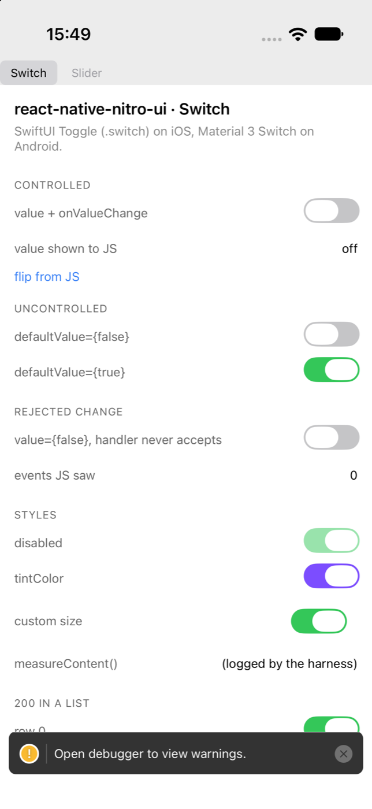
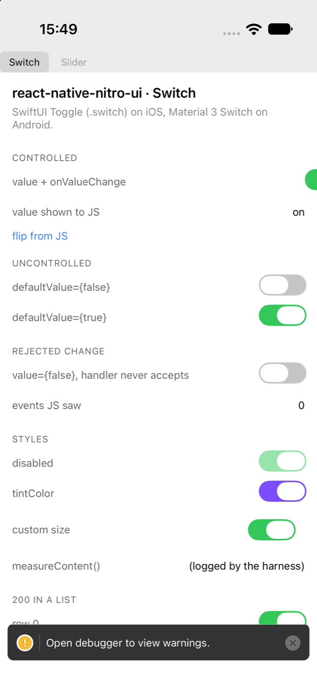

# T15 — Real-input verification: report

**Branch:** `task/T15-real-input` from `main` (`9c66f7c`) · **Rounds:** 2 of 1+2
**Devices used:** iPhone Air `331EF109-…` (shut down at the end) · `nitroui_t02` /
`emulator-5572` on adb server 5042 (shut down at the end) · Metro 8294

## Verdict

Both controls **do** answer real input delivered by the operating system:

- **Switch** — one XCUITest tap flips the hosted SwiftUI `Toggle` and React
  renders the new value; on Android `adb shell input tap` does the same to the
  Material 3 Switch, and a second tap flips it back.
- **Slider** — a real drag moves the thumb and fires `onSlidingStart`,
  `onSlidingChange` and `onSlidingComplete`, on both platforms, on both the
  uncontrolled (phase-counting) and the controlled Slider.

Two findings came out of making that prove-able:

1. **An iOS library bug**: updating the controlled `Switch`'s `value` pushes the
   hosted Toggle out of its row, so it can never be touched a second time.
   `bun run test:real-input:ios` is **red on the Switch check** because of it.
   Reported below with measurements and screenshots, not worked around in the
   test. It is *not* specific to real input — a value change made from JS
   reproduces it.
2. **iOS Sliders only answer a drag that starts on the thumb.** Not a bug, but it
   changes how a UI test (and a VoiceOver rotor-free user) must behave, and it is
   why the two platforms' checks aim differently. Details below.

`bun run test:real-input:android` is green (2/2). `bun run check` is green.

## What the suite is

| Path | What it does |
| --- | --- |
| `scripts/real-input/controls.mjs` | the one table of controls both platforms read |
| `scripts/real-input/ios.mjs` | builds the UI-test target, installs, points the app at Metro, runs `xcodebuild test-without-building`, turns the log into the shared report |
| `example/ios/NitroUiExampleUITests/RealInputTests.swift` | the iOS checks (XCUITest synthesises the touches) |
| `scripts/real-input/android.mjs` | the Android driver and checks (`adb shell input` + `uiautomator dump`) |
| `scripts/real-input/uiautomator.mjs` | parses `uiautomator dump` XML |
| `scripts/real-input/support.mjs` | run selection, evidence dir, Metro, the shared report |

Every assertion reads a `Text` the app renders (`testID` → accessibility
identifier on iOS, `resource-id` on Android). Nothing reads a harness hook, a
Nitro callback or an in-app tracer, and nothing patches the library: the suite
has to prove that a touch that starts outside the app ends up inside a hosted
SwiftUI/Compose view, so the only acceptable witness is what the app renders
afterwards.

`bun run test:real-input:ios` / `:android` need a booted device and are
deliberately **not** in `bun run check` (documented in CONTRIBUTING). Neither
script boots or stops a device, and both refuse an emulator running an AVD other
than the one they were told about. Evidence for each run — the full
`xcodebuild`/`adb` logs, the accessibility hierarchy printed by a failing case,
Metro's log — goes to `.real-input/<platform>/` (gitignored).

### Adding a control

One entry in the table, then `func testRealInput<Id>` in the Swift file and one
key in `CHECKS` in `android.mjs`. Both runners compare their checks against the
table and fail (never skip) in either direction, so a control cannot leave the
suite silently. `button` is deliberately absent: G2 owns the Button fix round,
and its check goes in as one entry plus two checks.

## Results — Android: 2/2

`nitroui_t02` / `emulator-5572`, adb server 5042, Metro 8294:

```
  switch: real tap flips the Switch and JS sees the new value
    · "Controlled switch" occupies 901,759 → 1038,843
    ✓ the Switch starts off — expected off, saw off
    ✓ one real tap flips the Switch (React renders "on") — expected on, saw on
    ✓ a second real tap flips it back (React renders "off") — expected off, saw off

  slider: real drag moves the Slider and fires start, change and complete
    · "Phases slider" occupies 42,1121 → 1038,1247
    ✓ no gesture has been reported yet — expected start=0 change=0 complete=0, saw start=0 change=0 complete=0
    ✓ one drag fires onSlidingStart exactly once — expected start=1, saw start=1
    ✓ one drag fires onSlidingComplete exactly once — expected complete=1, saw complete=1
    ✓ a drag reports the way over, not only the end (change=45)
    ✓ the thumb lands right of centre (value=0.731)
    ✓ a second drag fires both phases again — expected start=2 complete=2, saw start=2 complete=2
    ✓ dragging back moves the value the other way (value=0.266)
    · "Controlled slider" occupies 42,738 → 1038,864
    ✓ the controlled Slider starts at 0.25 — expected 0.25, saw 0.25
    ✓ the controlled value echo follows the real drag (0.25 → 0.778)
```

Note what the last two lines prove: the drag went Compose → Nitro → JS → React
re-render → back down to native, with the thumb ending where React says it
should. That is the round trip G2's `Button` finding made worth testing.

## Results — iOS: 1/2

iPhone Air, Metro 8294:

```
  switch: real tap flips the Switch and JS sees the new value
    · …/RealInputTests.swift:248: error: -[… testRealInputSwitch] : failed -
      switch-controlled is no longer where it was after the first real tap: it was
      drawn at (343.0, 223.3333282470703, 61.0, 28.0) and React reported the new
      value, but the control is now gone from the accessibility tree - so it cannot
      be touched again. See the hierarchy dump above.
    ✗ XCUITest reported "failed" for testRealInputSwitch in 17.038s

  slider: real drag moves the Slider and fires start, change and complete
    ✓ XCUITest reported "passed" for testRealInputSlider in 36.355s

real-input (ios): 1/2 controls passed
```

The Slider check drags twice on the phase-counting Slider (start/changes/complete
each counted separately, so a missing `onSlidingStart` cannot hide behind a
working `onValueChange`), then drags the controlled Slider and requires its echo
to move — the same round trip as on Android.

The Switch check *does* prove the touch arrived: React rendered `on`, which is
only possible if the tap reached SwiftUI and Nitro carried it to JS. It then
fails because the control is no longer anywhere a second touch could be aimed.

## Finding 1 — updating the controlled Switch's `value` throws it out of its row

For the Switch owner. On iOS, when a controlled `Switch` is re-rendered with a
new `value`, the hosted SwiftUI `Toggle` ends up laid out outside the window.

**Measurements** (iPhone Air, 420pt wide window, `example/src/SwitchScreen.tsx`
"Controlled" row):

| | Switch frame | the row's label width |
| --- | --- | --- |
| before any change | `{{343.0, 223.3}, {61.0, 28.0}}`, hittable | 315 |
| after a real tap (React rendered `on`) | `{{431.3, 244.3}, {61.0, 28.0}}` → not queryable, not hittable | 376 |
| after a JS-only update (`js-toggle`, no touch on the Switch) | not queryable, not hittable | 376 |

The label grows by exactly the Switch's 61pt: React Native lays the row out as
though the Switch had no width, and SwiftUI then draws the Toggle at its own
intrinsic size, past the right edge of the screen.




**It is not a real-input bug.** The second row above is `js-toggle` in the
example app: `setControlled(!controlled)` from a `Pressable`, with no touch
anywhere near the Switch. Same result. The touch path is fine; the layout after a
`value` update is not.

**Android is unaffected** — the Material 3 Switch stays in its row across the
same update (see the Android run above: off → on → off, two taps).

**Repro:** `bun run example ios`, tap the top Switch once — it turns green for a
frame and ends up drawn off the right edge; tap "flip from JS" instead for the
same result without touching a Switch. Or `IOS_UDID=<udid> bun run
test:real-input:ios --control switch`, whose failure message carries the frames.

**Question for the owner:** T11 was about intrinsic sizing; a static
`defaultValue` Switch measures correctly (every other row in the screenshot is
fine), so the suspicion is that the measured size is dropped when the props
update rather than recomputed.

## Finding 2 — on iOS a Slider drag must begin on the thumb

Measured in this suite on the phases Slider (`defaultValue={0.5}`, track at
`{{16, 347.7}, {388, 31}}`):

| gesture | start | changes | complete | value |
| --- | --- | --- | --- | --- |
| tap the track at 0.75 | 0 | 0 | 0 | none |
| drag 0.25 → 0.75 | 0 | 0 | 0 | none |
| drag 0.2 → 0.8 (with velocity) | 0 | 0 | 0 | none |
| drag 0.1 → 0.8 (slow, long) | 0 | 0 | 0 | none |
| **drag from the thumb (0.5) → 0.9** | **1** | **40** | **1** | **0.945** |

A SwiftUI Slider ignores a touch that lands on the track beside its thumb, and
React Native does nothing about it — which is the right behaviour for a person
(grab the thumb), and worth knowing for anyone who writes a UI test, an
accessibility flow or a "tap to jump" feature. Compose's Slider does answer a
track touch, which is why `android.mjs` starts its drags a quarter of the way
along the track while `RealInputTests.swift` presses where the value echo says
the thumb is (with the thumb's ~4% inset, so the press stays on it near the
ends). That difference is documented at both call sites.

## Every check can fail

Each check was run against a deliberately wrong expectation, and the runner
reported red and exit 1 — so no check is green by accident or by skipping.

iOS (both checks mutated at once; each failed at its own assertion):

```
XCTAssertEqual failed: ("off") is not equal to ("on") - the Switch should start off before any touch is delivered
XCTAssertEqual failed: ("start=0 change=0 complete=0") is not equal to ("start=0 change=0 complete=1") - no gesture has happened yet, so no phase may be reported
switch: FAIL / slider: FAIL → real-input (ios): 0/2 controls passed (exit 1)
```

Android (same):

```
switch: FAIL
    failed: the Switch starts off — expected on, saw off
slider: FAIL
    failed: no gesture has been reported yet — expected start=1 change=0 complete=0, saw start=0 change=0 complete=0
real-input (android): 0/2 controls passed (exit 1)
```

There is stronger evidence than a mutated expectation for the Slider: the first
iOS run used an off-thumb drag, and the check went red with `("start=0") is not
equal to ("start=1")` — the check failed because the control genuinely had not
reported a gesture. That is exactly the signal the suite exists to give.

The coverage guards, also demonstrated:

```
demo: NO CHECK on ios — the control is listed in scripts/real-input/controls.mjs but this platform does not implement one   (exit 1)
demo: NO CHECK on android — …                                                                                                  (exit 1)
real-input: android.mjs has a check for "switchX" but no control in scripts/real-input/controls.mjs names it.                  (exit 1)
real-input: RealInputTests.swift has "testRealInputSwitchX" but no control in scripts/real-input/controls.mjs names it.        (exit 1)
```

Two runner bugs surfaced by writing those demos, both fixed here: the iOS
coverage check compared against the `--control` selection instead of the whole
table (so `--control switch` reported the Slider's check as rogue), and
`xcodebuild`'s post-failure `simctl diagnose` made a failing run look hung for
up to ten minutes (`-collect-test-diagnostics never`; the log and hierarchy
dumps are the evidence, not an `.xcresult`).

## What `example/src/SliderScreen.tsx` gained

An additive "Drag phases" block: an uncontrolled `slider-phases` Slider with
`slider-start-count` / `slider-change-count` / `slider-complete-count` /
`slider-phase-value` echoes. Nothing existing changed testID, so the harness and
screenshot tasks are unaffected. These echoes are what both platforms assert
through, and they are also what a person sees if they are watching the screen
while a drag happens.

## Questions for the orchestrator

1. **Finding 1 has an owner?** It is the only thing keeping `test:real-input:ios`
   red, it reproduces without any touch, and a user tapping a controlled Switch
   sees it jump off the row. Suggest the Switch/intrinsic-sizing owner (T11's
   area). T15 left it alone as instructed.
2. **Is Finding 2 acceptable product behaviour?** Android moves the thumb to a
   track tap; iOS does not. Consistent-ish with each toolkit, but it is a
   user-visible difference, so it should be a decision rather than an accident.
3. **Button check:** ready to add — one table entry plus one check per platform.
   On iOS a Button will be found by its `testID`; on Android only
   `accessibilityLabel` reaches the accessibility tree for a hosted control
   (`testID` becomes a view tag), which is why the Android checks look up
   `"Controlled switch"` / `"Controlled slider"` / `"Phases slider"` by
   content-desc. G2's fix round should keep the Button's label stable for that.

## Housekeeping

Started and stopped by this task: `nitroui_t02` (`emulator-5572`, adb server
5042), iPhone Air `331EF109-…`, Metro on 8294, and the `adb reverse` for 8294.
`emulator-5560` / `PR1505_Pixel` and T14's iPhone 17 / `nitroui_t01` were never
touched.
