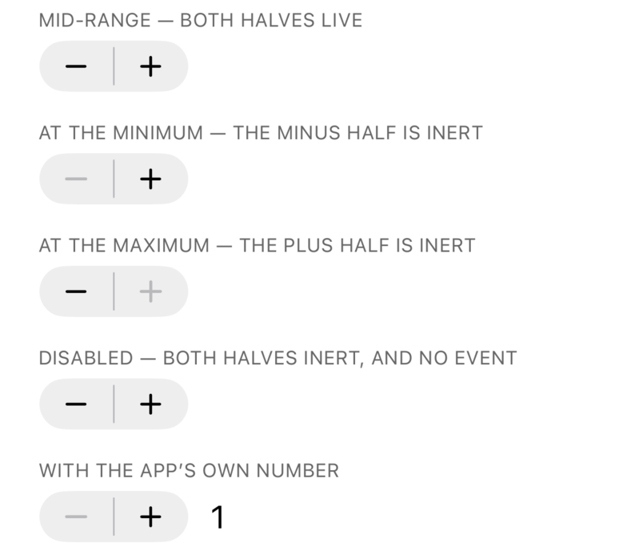
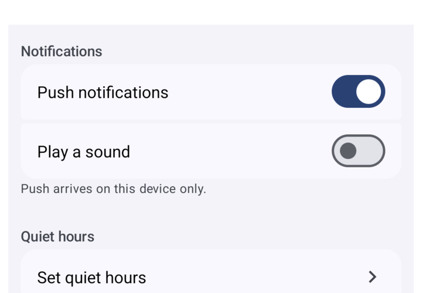
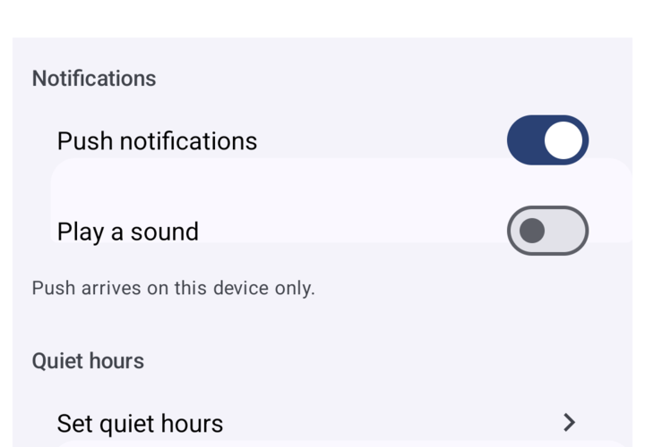
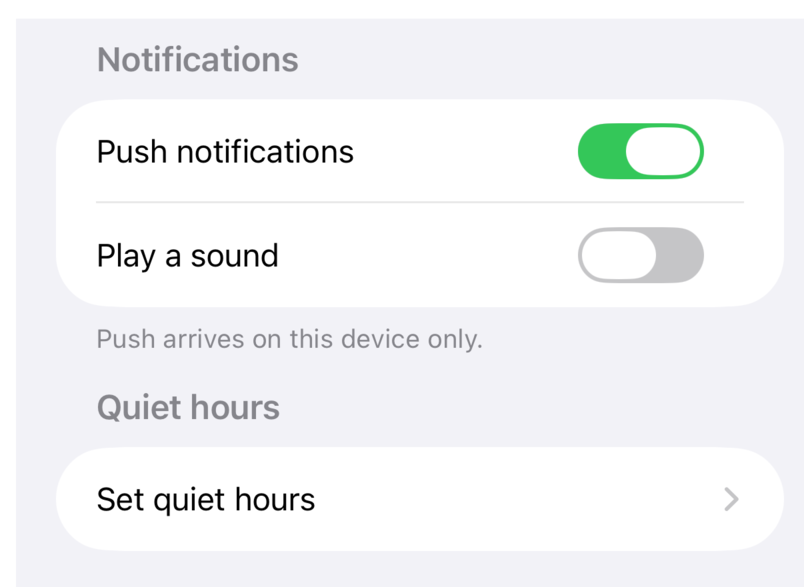
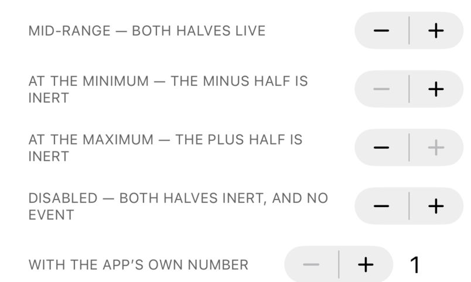
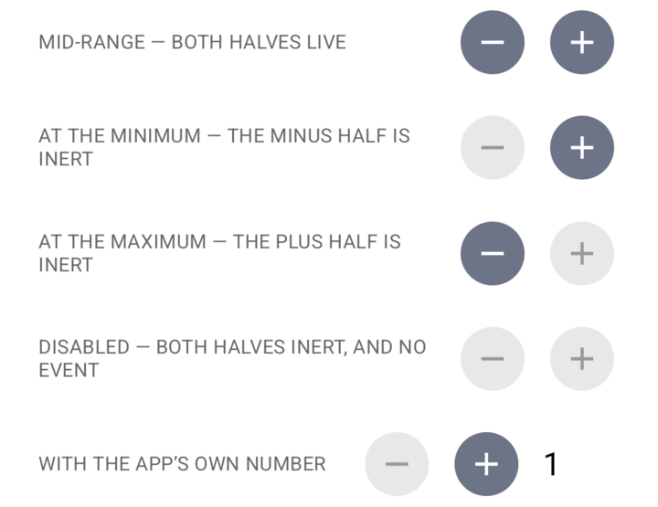

# X24 — Stepper and Form: examples and screenshots that lay out properly

**Branch:** `task/X24-stepper-form-examples` (from `main` at `404eaad3`) · **Round:** 1 of up to 3 (D19) ·
**Lease:** none — `acquire --task X24 --boot --wait-minutes 240` timed out twice, ≈5 h queued (see "Device half pending")

## Summary

**Was Form's misalignment a component bug? Not horizontally, and the vertical half is not
`Form.Row`'s either.** `Form.Row` is `flexDirection: 'row'` with `alignItems: 'center'`, at the
cell's content width (`src/components/Form/Form.tsx:581`, `:590`), so the README's
`<Text style={{ flex: 1 }} /><Switch />` pair does reach the row's trailing edge. The `Sections`
story never used `flex: 1` at all: it put a plain `<Text>` beside the `Switch`, so the picture
was not the code the README prints.

The vertical half is real and general: 14 components carry `{ alignSelf: 'flex-start' }` as
their base style (React Native's own `Switch` has the same defence, and it is load-bearing — a
stretched box decides an intrinsic control's size, so the measurement is never asked). A child's
`alignSelf` beats its parent's `alignItems`, so in any row taller than its content — every Form
row is, at `minHeight: 44` / `56` — the control sticks to the row's top edge while the label
centres. That is why the examples and `docs/components/form.md` now wrap a row's content in
`{ alignItems: 'center', flex: 1, flexDirection: 'row' }`: the box hugs its content, so the two
rules have no leftover room to disagree about. A component-level fix is cross-cutting, so it is
a question below, not a guess.

**The squashed Android steppers are a starved box, not a clipped drawing bug.** In
`showcase.tsx`'s `Row` the caption may not shrink and the content wrapper is the only thing
allowed to, so a long caption leaves the Stepper a box narrower than the width the engine
measured. iOS paints outside that box (sizing.md §9 — SwiftUI refuses to shrink); Android's
C1 placement pass re-measures the content *under* the box width, `Modifier.size()` clamps to
the constraints, and the two `FilledTonalIconButton`s come out as ellipses. The story now
gives the caption a column and the control `flexShrink: 0`.

The Stepper `States` and Form `Sections` stories read as one settings list each, and README,
`readme-examples.tsx` and `form.md` agree with each other. **What did not happen is the
photography and the device gates:** with no pair, the four PNGs are still the ones on `main` and
the new case has never run, so the claims above rest on the components' styles rather than a
measurement, and the red proof is un-run too. The other twenty pairs are swept below; that part
needed no device.

## Gates

| Gate | Result | Counts | Code tree | Duration | Load |
| --- | --- | --- | --- | --- | --- |
| `check` | **PASS** | 2013 tests / 85 suites | `c6648f07c513` | 2 m 55 s | start 13.8 / med 19.6 / max 25.3 |
| `harness:ios` | missing | — | — | — | — |
| `harness:android` | missing | — | — | — | — |
| `real-input:ios` | missing | — | — | — | — |
| `real-input:android` | missing | — | — | — | — |

`need --for review`: 2 gate(s) missing for review: harness:ios, harness:android — `check` green
on `c6648f07c513`, the whole device half outstanding.

## Before / after

What the README shows today, from `main`, byte-identical to `docs/images/components/`:

| | iOS | Android |
| --- | --- | --- |
| Stepper |  |  |
| Form |  |  |

There is no `after` row yet: the retake needs a simulator and an emulator, and the committed
`docs/images/components/{stepper,form}-{ios,android}.png` are these same four files. Every
defect the brief describes is visible here — iOS's steppers overlap their own captions and run
off the right edge, Android's `+` halves are ellipses at three rows in five, and each Form
switch sits against its label instead of at the trailing edge.

## Red proofs

None run: `Form row content (X24)` has never been on a device, because there was never a lease.
The mutations are chosen, so one filtered run each proves them — `gate.mjs harness:ios -- Form`
and `harness:android -- Form`, which record as `harness:*:Form` and satisfy nothing:

- `TrailingEdgeForm`'s row two, drop the box (label and control become the row's children and
  the control's wrapper carries `x24SelfSizing`) → expect `the control is centred at y=… while
  its label is centred at y=…`.
- `x24Styles.label` from `{ flex: 1 }` to `{}` → expect `the control ends at x=… while the
  row's content ends at x=…`, and the same for the box-less row-three pair.

The fixture is what gets broken, not `Form`, because the claim is about what a row gives its
content: a mutation inside `Form` cannot redden the boxed pair, since the box hugs its content
and so the row's `alignItems` moves the pair without moving it — which is the same reason the
boxed pattern is the advice. The case's own `X24 BARE pair` / `X24 BOX pair` lines carry the
numbers the summary is missing.

## Files changed

- `example/src/stories/Form.stories.tsx`, `example/src/readme-examples.tsx`, `README.md`,
  `docs/components/form.md` — a Form row's content goes in a box that fills the row and
  centres what it holds; the three copies of the example are the same code again.
- `example/src/stories/Stepper.stories.tsx` — `States` becomes a caption column with the
  controls on one trailing edge (`flexShrink: 0` keeps a control its measured width).
- `example/__tests__/Form.harness.tsx` — `Form row content (X24)`: a probe row measures the
  row's content box, and the case asserts the trailing edge and the label's middle.
- `docs/tasks/X24/before/` — the four shots that are on `main`, copied so an `after` can be read
  against them. `docs/images/components/{stepper,form}-{ios,android}.png` are unchanged: the
  retake is what a device pair still owes.

## Sweep of the other pairs

The other twenty pairs reviewed at README width and at full size. No other control is clipped or
squashed by a component; what is wrong is either a crop or `showcase.tsx`'s `Row`:

- `icon-button-{ios,android}`: "each one disabled" and "the toggle form" hand four controls
  to `Row`, whose content box is a *column*, so the strip is four tall and its caption
  floats alone at the left; on Android the strip runs to the crop's bottom edge.
- `button-group-android`: the crop ends across the last caption ("each variant at the
  medium ring"), so its row is below the fold.
- `confirmation-dialog-android`: the trigger is sliced across its top edge by the crop.
- `date-picker-android`: a band of calendar background with no dates in it under the last
  row, inside the dashed frame — a measured height larger than what the calendar draws.
- `checkbox-ios`: the picture is iOS `Switch`es, because iOS's Checkbox *is* a switch-style
  `Toggle` today — already decided as D47 and being changed by G31, which owes this pair a
  retake.
- `menu`, `picker`, `popover`, `context-menu`: a presentation drawn over the caption under
  its trigger. Inherent to photographing a presentation on a populated page, and the
  CONTRIBUTING note about `Confirmation Plain` is the recipe for avoiding it.
- Root cause for the two the brief sent me: `Row`'s `content: { flexShrink: 1 }` with a
  caption that may not shrink. 13 story files use `Row`; the one-line change
  (`label: { flexShrink: 1 }`, `content: { flexShrink: 0 }`) is honest but retakes about ten
  pairs, so it is not mine to make from a screenshots task.

## Device half pending

One pair, in this order — everything here is scripted, so it is ~45 min of device time:

1. `node scripts/build-app.mjs --platform 
`: both artifacts are already stamped for
   `c6648f07c513`, so this is a no-op unless a story changes on the way.
2. Retake the four PNGs by CONTRIBUTING's recipe (`stepper--states`, `form--…`). For the Form
   pair pick **one** story and shoot both platforms from it: `form--sections` renders `push` /
   `sound` uncontrolled (both switches off) while the README's state is `useState(true)` /
   `useState(false)`, and the pair on `main` already mixes the two — the iOS half reads like
   `form--playground` (first switch on) and the Android half like `form--sections` (both off).
   `form--playground` on both is the closer match to the README code, and its
   `quiet-hours presses:` line sits under a 420 pt form, below the crop.
3. `harness:ios`, `harness:android`, `real-input:ios`, `real-input:android` — the brief asks for
   all four because `example/__tests__/Form.harness.tsx` changed.
4. The red proofs above, last: a mutated fixture changes the code tree, so the app gets rebuilt
   for them and the stamp stops matching the round.
5. Undo the scratch `initialSelection`, `RCT_jsLocation`, `debug_http_host` and the
   `tcp:<port>` reverse; then `gate.mjs table`, `export --task X24` and `task-ready`.

Worth 30 s while the pair is up: `form--sections` on iOS. If iOS really draws the *first*
uncontrolled `Switch` on and the second off, that is a component question, not a story one, and
the `main` pair hints at exactly that.

## Follow-ups

- pool: three device tasks (G29, G30, G31, then X24) against `maxDeviceLeases: 2`; X24 queued
  ≈5 h and twice watched a pair released and re-taken by another task within seconds.
- docs/images: the Form pair on `main` is two different stories — one switch on in the iOS half,
  none on in the Android half — so the two halves are not the same example.
- sizing/Android: an `intrinsic` control whose box is narrower than its measured width is
  laid out *inside* that box by the C1 placement pass, and `Modifier.size()` clamps — a
  fixed-shape control (Stepper's two icon buttons) draws squashed where iOS overflows. A
  min-size for fixed-shape content, or an opt-out of the placement pass, would match iOS;
  `clipChildren` means the drawing is clipped either way, so the app-side layout rule is
  what users actually need.
- showcase: `Row` lets its content wrapper shrink under a caption that cannot (13 story
  files, ~10 README pairs affected if changed).
- docs/images: `button-group-android` and `confirmation-dialog-android` are cropped inside
  content; `date-picker-android` shows a calendar band it does not draw into.
- docs/images: `checkbox-ios` needs a retake when G31's checkmark lands (D47).

## Questions for orchestrator

- **Where should a control in a `Form.Row` be centred?** The fact, from the styles: a self-sizing
  control directly in a row takes the row's top edge while its label centres, because its base
  `{ alignSelf: 'flex-start' }` beats the row's `alignItems: 'center'` (the new case logs the
  delta in dp on both platforms; it has not run yet, so the number belongs to the next round).
  Options: (a) leave it and document the content box — what this round did, because it
  matches React Native, costs nothing, and touches no other component's layout;
  (b) give `Form.Row` an internal content wrapper — fixes the bare pattern too, but adds a
  Yoga node per row (Form is benched at N=200) and quietly changes what a row's `style`
  applies to; (c) change `SELF_SIZING_BASE_STYLE` to `{ alignSelf: 'center' }` — fixes every
  row, but left-aligns nothing in a column any more, so every control in a settings column
  moves to the middle and every screenshot pair moves with it. Recommendation: (a) now, and
  if the owner wants the bare pattern to centre, (b) as its own task with a Form benchmark
  run — G31 and G30 (`ListItem`) are both in row layout right now and would want the same
  answer.
- **How does X24 get an hour of device time?** The code, docs and the new case are committed and
  `check` is green on `c6648f07c513`; what is missing is a screenshot session and four device
  gates, and `need --for review` cannot pass without the two harness runs. Options: (a) re-run
  the device half as a fix round when a pair is free — recommended, nothing has to be redone;
  (b) an `--exclusive` lease out of hours, which waits for both other tasks to end and then
  holds the machine; (c) `maxDeviceLeases: 3` on this box, which buys capacity with the load
  that D21 kept two leases for. Recommendation: (a) now, and (c) only if the queue stays three
  deep.

## Fix round 1

**Decision (b) is in `Form.Row`.** A row's children now sit in one internal wrapper —
`flexDirection: 'row'`, `alignItems: 'center'`, `flex: 1`, no `minHeight` — which the row's own
`minHeight` centres, so the bare `<Form.Row><Text style={{ flex: 1 }} /><Switch /></Form.Row>`
lays out right without the app knowing about `alignSelf`. README, `readme-examples.tsx`,
`Form.stories.tsx` and `docs/components/form.md` are back to that pattern — README's block and
`example/src/readme-examples.tsx` byte-identical, which `scripts/readme-examples-check.mjs`
enforces; the Stepper story keeps its caption column and `flexShrink: 0`.

The first shape was wrong and `Form measure (E7)` caught it: the row's `style` landed on the
wrapper, so `alignItems: 'stretch'` stretched only the wrapper — fourteen measures of 17 pt
inside 44 pt rows, all `off by 13.7 pt`. The rule now travels in with the children (`f320547c`).

**Both pairs retaken from one story each** (`Form/Playground`, `Stepper/States`), so a pair's
halves are the same example — the Form pair on `main` was not.

**Was the misalignment a component bug?** The switch sitting at the label was the story's (no
`flex: 1`); the vertical half was `Form.Row`'s and is fixed; the Android cards and the
`mount.form` crash below are pre-existing.

### Before / after

| | Before (`main`) | After (this branch) |
| --- | --- | --- |
| Stepper iOS |  |  |
| Stepper Android |  |  |
| Form iOS |  |  |
| Form Android |  |  |

### Red proofs

- `Form row content (X24)` → `main`'s `Form.Row` back in the tree → iOS `X24 BARE pair: row
  content x=40.0..380.0, control x=319.0..380.0, centre delta -8.0` and Android
  `X24 BARE pair: row content x=28.2..383.6, control x=331.4..383.6, centre delta -4.0`, one
  failed test on each platform (`1 failed, 120 passed`), the only issue
  `a bare row: the control is centred at y=… while its label is centred at y=…`.
- The same case, wrapper back in → `centre delta 0.0` / `-0.2` and the suite green: it fails on
  the bare pair and nothing else, on both platforms. Both width claims passed even with `main`'s
  row — round 1's "not horizontal" answer, measured rather than argued.
- `Form measure (E7)` → the wrapper shipped without the row's own `alignItems` →
  `measureInWindow …,340.0,17.0 … off by 13.7 pt`, fourteen times.

### Gates

| Gate | Result | Counts | Code tree | Duration | Load |
| --- | --- | --- | --- | --- | --- |
| `check` | **PASS** | 2013 tests / 85 suites | `cc46c2f26071` | 2 m 49 s | start 6.7 / med 9.5 / max 15.9 |
| `harness:ios` | **PASS** | 594 tests / 31 suites + isolated 6 tests / 3 suites | `cc46c2f26071` (ios tree) | 14 m 51 s | start 12.5 / med 19.8 / max 181.4 |
| `harness:android` | **PASS** | 650 tests / 31 suites + isolated 6 tests / 3 suites | `cc46c2f26071` (android tree) | 18 m 32 s | start 10.0 / med 5.2 / max 11.5 |
| `real-input:ios` | **PASS** | — | `cc46c2f26071` (ios tree) | 47 m 15 s | start 27.4 / med 17.1 / max 378.1 |
| `real-input:android` | **PASS** | — | `cc46c2f26071` (android tree) | 63 m 47 s | start 7.0 / med 7.2 / max 50.8 |
| `harness:android:Form` | stale | 1 failed of 121 tests / 3 suites | 8eb501e66342 (not this tree) | 3 m 38 s | start 7.6 / med 7.3 / max 10.1 |
| `harness:ios:Form` | stale | 1 failed of 121 tests / 3 suites | 8eb501e66342 (not this tree) | 3 m 37 s | start 12.5 / med 12.6 / max 20.0 |
| `harness:ios:Form:--background` | stale | — | 8eb501e66342 (not this tree) | 1.8 s | start 12.7 / med 12.7 / max 12.7 |

Both `real-input:android` runs are in the ledger: the row above is the re-run, and the older
line for the same tree is a 62 m 54 s failure of `hosted-picker` (Follow-ups). The `stale` `harness:*:Form` rows are the red proofs against the
`main`-row tree `8eb501e66342`; `harness:ios:Form:--background` is a mistyped argument that
reached jest in 1.8 s, not a result, and an earlier `harness:ios` RED line is two gates sharing
one lease's `METRO_PORT` (`EADDRINUSE`).

### Bench

`--plan quick --component form --only nitro-ui` (4 launches × 20 measured iterations),
`maintainer-mac-2`, load 4-11 over 10 cores — above the 5.0 ceiling, so `--force`. Two verified
runs per column (Android: each APK's bundle checked for the wrapper; iOS: `main.jsbundle` is
rewritten by the bundle phase every run). Medians, Android first:

| Cell | presented | mounted | JS commit | JS CPU/op | UI CPU/op |
| --- | --- | --- | --- | --- | --- |
| Android mount N=20 | 32.59 → 32.24 ms (−1 %) | 24.83 → 24.78 ms (0 %) | 2.20 → 2.63 ms (**+20 %**) | 5.04 → 6.03 ms (**+20 %**) | 14.43 → 14.98 ms (+4 %) |
| Android mount N=50 | 43.80 → 42.83 ms (−2 %) | 32.07 → 31.47 ms (−2 %) | 4.14 → 5.29 ms (**+28 %**) | 9.00 → 10.89 ms (**+21 %**) | 27.39 → 27.09 ms (−1 %) |
| Android update N=50 | 30.22 → 30.92 ms (+2 %) | 15.85 → 15.77 ms (0 %) | 2.45 → 2.95 ms (**+20 %**) | 2.70 → 3.17 ms (**+18 %**) | 4.73 → 5.04 ms (+7 %) |
| iOS update N=50 | 16.06 → 16.06 ms (0 %) | 2.39 → 3.16 ms (**+32 %**) | 2.14 → 2.86 ms (**+34 %**) | 2.35 → 3.04 ms (**+29 %**) | 4.25 → 4.69 ms (+10 %) |

iOS is three runs a side (Android, two); its first `main`-row run is the outlier (2.84 ms
mounted) and the other two agree within 1 %. `memory.form N=200` is 163.7 → 169.4 KiB/inst on
iOS (+3.5 %, and iOS repeats to 0.6 %) and 219 → 224 KiB on Android, where the same APK measured
twice spread by 12 % — so Android has no memory signal to quote, iOS has a small one. The node is
the cost, not the JS around it: dropping the per-row `alignItems` lookup returns only 0.07 ms.

So: over the 5 % bar on the JS thread (≈+20 % Android, ≈+32 % iOS), invisible in Android's
wall-clock `presented`/`mounted`, visible in iOS's because its update op is 6× shorter and the
extra commit lands on the measured path. `mount.form` cannot be measured on iOS at all (below),
which is the gap in this answer. Only a native-side fix — the row cell taking the content
directly — buys the JS time back.

### Follow-ups

- `mount.form:nitro-ui` crashes the bench app on iOS on `main`'s own code: 8/8 launches abort in
  `-[UICollectionView reconfigureItemsAtIndexPaths:]` under `HybridNitroUiForm.readoptRowlessCells()`
  at N=20 and N=50, with and without the wrapper — Form has no iOS mount numbers, before or after.
- Android's `:app:createBundleReleaseJsAndAssets` does not see library sources: with only
  `../../src/components/Form/Form.tsx` changed, Gradle reported the task `UP-TO-DATE`, rebuilt
  nothing in 4 s, and the APK kept the previous JS bundle — so a library-only bench run on
  Android silently re-measures the old code. Every Android bench number taken across a
  library-only change is suspect; forcing it needs the generated bundle moved aside.
- `bench/src/implementations/shared.ts:444` requires `../assets/circle.png`, which is
  `bench/src/assets/`; the fixtures live in `bench/assets/`, so the bench app cannot bundle on
  either platform as committed. Pointing the requires at the real folder fixes iOS, but one
  fixture name in two formats merges into one Android drawable (`src_assets_circle`, "Duplicate
  resources"), so it needs a real fix, not a path edit. This round's runs used PNG copies under
  `bench/src/assets/`, with the two `.xml` requires aimed at those PNGs, removed afterwards.
- `real-input:android`'s `hosted-picker` check is positional: menu row "Gamma" at y=2241 against
  an anchor top of y=2242 on a 2424-px screen — the anchor had been scrolled to the bottom edge
  and the popup had nowhere to go. The re-run passed with the anchor mid-screen, as G31's and
  G29's logs did; `HostScreen.tsx` has no Form in it either way.
- Android draws each Form section card ≈147 px (56 dp) too low and one row tall, byte-identically
  with `main`'s `Form.stories.tsx` and `Form.tsx` served against the same binary, while the
  harness's geometry cases stay green: the drawing layer disagrees with what the component
  reports. Suspects: `eb867e45`, `63c517f4`, `06ee2982`, `ba2fa41e`, `43136665`.
- The Popover section's closing paragraph ("Your content is laid out in your own tree at up to
  `maxWidth`…") sits at the end of the README's **Form** section, on `main` as here
  (`README.md:1268`).

## Fix round 2

**Centring without the node.** The wrapper is gone. `src/core/useSelfSizing.ts` now holds the base
style all eleven self-sizing controls carry: `alignSelf: 'center'` when a `Form.Row` provides its
context (exported from core), `'flex-start'` elsewhere — one `useContext` read, no node, the row
back to its own `alignItems: 'center'`. `Popover` and `BottomSheet` clear the context. `form.md`
says what a row gives its children, and that a control carrying its own `alignSelf` (React
Native's `Switch`) keeps it. No JS-thread cell moved out
of noise; the wrapper's +20-32 % is gone.

**The Android cards were a component bug.** `FormSection` applied a row's offset twice — the
`Modifier.offset` it computed and the placement Compose had already performed — so each card sat a
row-box below its rows. One layout pass that both measures and places the box fixes it.

**iOS `disabled` did reach SwiftUI**: `.disabled(model.disabled)` is on the chain and a `Toggle`
beneath it visibly dims. SwiftUI's `Stepper` keeps drawing itself live, so iOS now draws it at 0.5
opacity, read back by the harness. Pixels were unavailable: the probe reads one flat grey from
its box, its parent and the window crop.

All four PNGs retaken from one story each, same state on both platforms.

### Before / after

| | Before (start of this round) | After (this branch) |
| --- | --- | --- |
| Form Android — cards off the rows |  |  |
| Form iOS |  |  |
| Stepper iOS — DISABLED drawn live |  |  |
| Stepper Android |  |  |

### Red proofs

- `harness:{ios,android}:Form` → `Form.tsx` swapped for `origin/main`'s (its `InsideRowContext` is
  a different object, so the controls keep `flex-start`) → `Form row content (X24)` red both sides,
  `1 failed, 121 passed`, iOS `X24 BARE pair: row content x=40.0..380.0, control x=319.0..380.0,
  centre delta -8.0`, Android `… x=28.2..383.6, control x=331.4..383.6, centre delta -4.0` (tree
  `16f94c973dfa`); the same case is green inside both full harness runs at `07021b2ead49`. The
  probe now reads `useSelfSizingBaseStyle()` rather than retyping the style, so it follows whatever
  the row actually gives a control — which is what makes it go red on `main`'s row at all.
- `harness:android:FormFidelity` → `Modifier.placedPixelBox` out of the section's card layout →
  red `row 0: its container is drawn at y=77 while the row starts at y=37.3 …; its card starts at
  x=24.4 while the row starts at x=12.2` (tree `cd8ab58b8853`, both axes exactly doubled), 2/2
  green after `6754384f`; the case also passes with `main`'s `Form.tsx` in place, because the fix
  is Kotlin-side.
- `harness:ios:Stepper` → `nitroUiStepperDisabledOpacity` mutated to `1.0` → red `a disabled iOS
  stepper is drawn dimmed … (displayed=5;up=0;down=0;opacity=1.00;probes=0;merged=unavailable;
  a11y=none): expected '1.00' to be '0.50'` (tree `b8b1039c537d`), green 15/15 now.
- `check` → the new core file trips the packaging guard: `package-files: +src/core/useSelfSizing.ts
  would be published (not in the manifest)` (tree `d235a43d3fb3`), green after `manifest:update`.
- Two ledger lines are not results: `harness:ios:Form:--background` (1.6 s — `--background` behind
  `--` reached jest) and `harness:ios` FAIL at `d0d0881421c8` (2.0 s — a bench edit in the tree met
  "refusing to run against a stale app").

### Gates

| Gate | Result | Counts | Code tree | Duration | Load |
| --- | --- | --- | --- | --- | --- |
| `check` | **PASS** | 2028 tests / 86 suites | `07021b2ead49` | 3 m 10 s | start 6.3 / med 19.3 / max 26.6 |
| `harness:ios` | **PASS** | 595 tests / 31 suites + isolated 6 tests / 3 suites | `07021b2ead49` (ios tree) | 14 m 50 s | start 7.5 / med 9.6 / max 29.1 |
| `harness:android` | **PASS** | 651 tests / 31 suites + isolated 6 tests / 3 suites | `07021b2ead49` (android tree) | 18 m 20 s | start 26.0 / med 5.1 / max 26.0 |
| `real-input:ios` | **PASS** | — | `07021b2ead49` (ios tree) | 43 m 03 s | start 6.2 / med 10.9 / max 223.7 |
| `real-input:android` | **PASS** | — | `07021b2ead49` (android tree) | 63 m 19 s | start 9.4 / med 7.4 / max 122.9 |
| `harness:android:FormFidelity` | stale | 2 tests / 1 suites | bb035c8f3251 (not this tree) | 15.3 s | start 10.6 / med 11.1 / max 11.1 |
| `harness:ios:SegmentedControl` | stale | 21 tests / 1 suites | b4bb12d817e6 (not this tree) | 26.6 s | start 17.8 / med 15.5 / max 17.8 |
| `harness:ios:Stepper` | **PASS** | 15 tests / 1 suites | `07021b2ead49` (ios tree) | 25.8 s | start 7.0 / med 7.8 / max 8.0 |

`harness:ios:Stepper` is the mutation's green counterpart; the two `harness:*:Form` red proofs and
the two other filtered runs are in the ledger and satisfy nothing. `need --for review` is satisfied
on this tree.

### Bench

`--plan quick --component form --only nitro-ui` on `maintainer-mac-2`, load 4.3-5.3 over 10 cores
(ceiling 5.0, so `--force`), two runs per platform, medians. The left number is `main` as fix round
1 measured it on this machine, same plan, same cells; the right is this tree.

| Cell | presented | mounted | JS commit | JS CPU/op | UI CPU/op |
| --- | --- | --- | --- | --- | --- |
| Android mount N=20 | 32.59 → 32.53 ms (0 %) | 24.83 → 24.79 ms (0 %) | 2.20 → 2.17 ms (**−1 %**) | 5.04 → 4.97 ms (−1 %) | 14.43 → 13.72 ms (−5 %) |
| Android mount N=50 | 43.80 → 42.35 ms (−3 %) | 32.07 → 31.56 ms (−2 %) | 4.14 → 4.06 ms (**−2 %**) | 9.00 → 8.88 ms (−1 %) | 27.39 → 25.66 ms (−6 %) |
| Android update N=50 | 30.22 → 30.37 ms (+0.5 %) | 15.85 → 15.86 ms (0 %) | 2.45 → 2.56 ms (**+4 %**) | 2.70 → 2.75 ms (+2 %) | 4.73 → 4.61 ms (−3 %) |
| iOS update N=50 | 16.06 → 16.08 ms (0 %) | 2.39 → 2.43 ms (**+1.5 %**) | 2.14 → 2.17 ms (**+1 %**) | 2.35 → 2.33 ms (0 %) | 4.25 → 4.21 ms (−1 %) |

Nothing here is resolvable, which is the answer: the same code twice puts Android mount N=20 JS
commit at 2.06 and 2.27 ms (10 % apart) and mount N=50 at 3.98 and 4.14 ms (4 %), so every delta
above sits inside the bench's own repeatability. What was resolvable — the wrapper — was +20 %,
+28 % and +20 % on the Android JS thread and +34 % on iOS's, and each cell now sits 13-24 % under
the wrapper's number. `mount.form` stays unmeasurable on iOS: 8 of 8 launches per run abort in
`HybridNitroUiForm.readoptRowlessCells()` at N=20 and N=50, unchanged from `main` and not
investigated, on instruction.

`memory.form N=200`: iOS 163.7 → 164.9 KiB/inst (+0.7 %, where iOS repeats to 0.6 %); Android's
cell reads 135 KiB here against 219 KiB two hours earlier on this machine with nothing in this diff
that could move it, so it is not quoted across rounds. The Android APK used for these runs was
checked rather than trusted: its Hermes bundle contains `useSelfSizingBaseStyle` and
`InsideRowContext`, so round 1's `createBundleReleaseJsAndAssets` staleness did not bite here.

### Follow-ups (this round)

- `nuiTestPixelProbe` cannot see a hybrid Stepper: its own box, its parent and the window crop all
  read one flat grey (`flat view=#808080 spread=0 parent=#808080 spread=0 window=#0A1628 spread=0`)
  while SegmentedControl's box in the same harness answers a tint. A Stepper pixel case needs a
  different capture path; the state-report assertion is what stands in for it now.
- Android's `memory.form` cell is not comparable across rounds (135 KiB vs 219 KiB on one machine).
  Only iOS memory should be quoted in a report.
- `origin/main` (`8ae6cada`) already carries `alignItems: 'center'` on `Form.Row` and its own local
  `InsideRowContext`, so X24's row shape matches what merged; the difference this round is that the
  flag travels in core where the controls can read it.
- `gate.mjs export --task X24` rebuilds `docs/tasks/X24/gates.jsonl` from the current branch's
  ledger alone, so it dropped the 14 lines from `task/X24-stepper-form-examples` and
  `task/X24-fix1`; they are re-appended here above this round's. Export should merge what is
  already committed rather than rewrite it.
- The bench fixtures still need the round-1 workaround (PNG copies under `bench/src/assets/` with
  the two `.xml` requires aimed at them, removed after the runs). Unchanged as a fix request.
