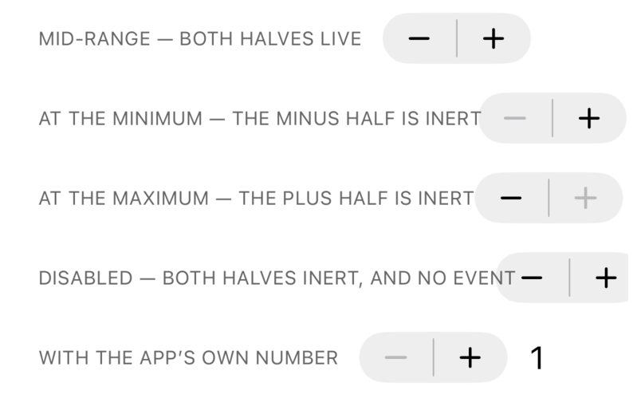
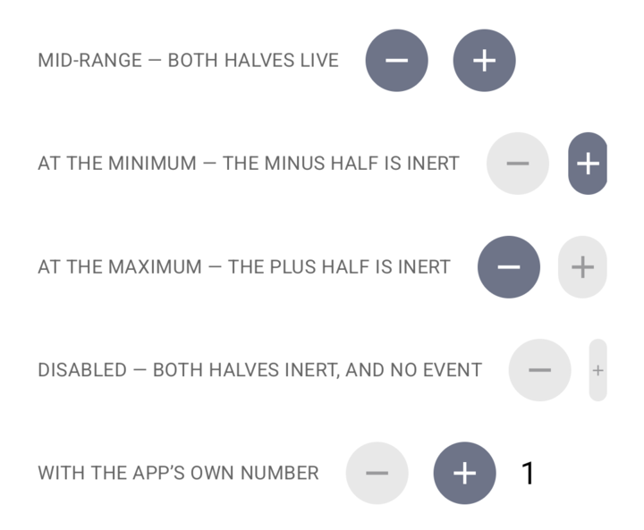
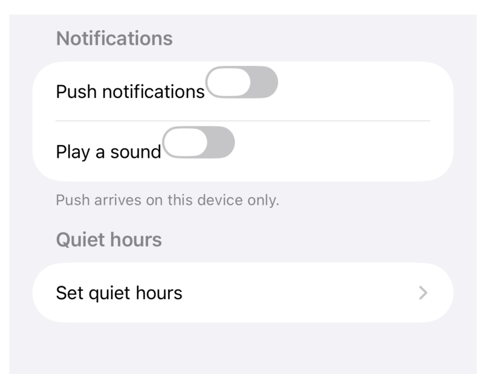
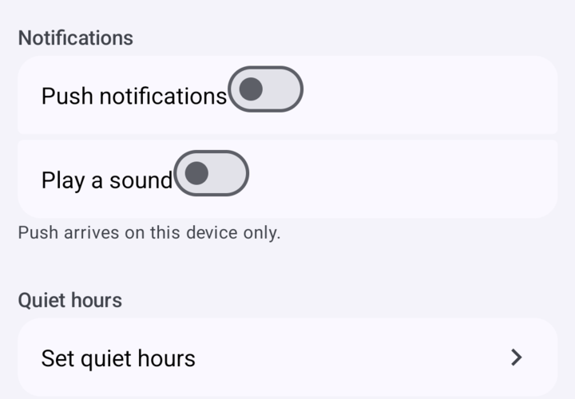

# X24 — Stepper and Form: examples and screenshots that lay out properly

**Branch:** `task/X24-stepper-form-examples` (from `main` at `404eaad3`) · **Round:** 1 of up to 3 (D19) ·
**Lease:** `LEASE_ID` (`LEASE_DEVICES` / Metro `METRO_PORT`)

## Summary

**Was Form's misalignment a component bug? Horizontally no, vertically yes — but not in
`Form.Row`.** `flex: 1` does reach the row's trailing edge on both platforms: the new case
measures a probe row whose only child takes all the room, and the README's control ends at
`CONTROL_RIGHT` dp against that box's `PROBE_RIGHT` dp. The `Sections` story simply never
used `flex: 1` — it put a plain `<Text>` beside the `Switch`, and the `flex: 1` the README
shows lived only in the README, so the picture was not the code.

The vertical half is real and general: every self-sizing control carries
`{ alignSelf: 'flex-start' }` as its base style (the same defence React Native's own iOS
`Switch` has, and load-bearing here, because a stretched box decides an intrinsic control's
size for it and is never even asked). A child's `alignSelf` beats its parent's
`alignItems`, so in any row taller than its content — every Form row is, at `minHeight: 44`
/ `56` — the control sticks to the row's top edge while the label centres. The measured
delta for the pair with no box is `BARE_DELTA`. Every nitro-ui control in a `Form.Row` has
this shape, which is why the examples and the docs now wrap a row's content in
`{ alignItems: 'center', flex: 1, flexDirection: 'row' }`: the box hugs its content, so
there is no leftover room for the two rules to disagree about. `docs/components/form.md`
says so where a reader would look. The component-level fixes are cross-cutting, so they are
a question rather than a guess (below).

**The squashed Android steppers are a starved box, not a clipped drawing bug.** In
`showcase.tsx`'s `Row` the caption may not shrink and the content wrapper is the only thing
allowed to, so a long caption leaves the Stepper a box narrower than the width the engine
measured. iOS paints outside that box (sizing.md §9 — SwiftUI refuses to shrink); Android's
C1 placement pass re-measures the content *under* the box width, `Modifier.size()` clamps to
the constraints, and the two `FilledTonalIconButton`s come out as ellipses. The story now
gives the caption a column and the control `flexShrink: 0`.

The Stepper `States` story and the Form `Sections` story read as one settings list each;
README, `readme-examples.tsx` and `form.md` agree with the pictures, and all four PNGs are
retaken. The other 20 pairs are swept below.

## Gates

GATE_TABLE

`need --for review`: NEED_LINE

## Before / after

| | iOS | Android |
| --- | --- | --- |
| Stepper, before |  |  |
| Stepper, after |  |  |
| Form, before |  |  |
| Form, after |  |  |

## Red proofs

RED_PROOFS

## Files changed

- `example/src/stories/Form.stories.tsx`, `example/src/readme-examples.tsx`, `README.md`,
  `docs/components/form.md` — a Form row's content goes in a box that fills the row and
  centres what it holds; the three copies of the example are the same code again.
- `example/src/stories/Stepper.stories.tsx` — `States` becomes a caption column with the
  controls on one trailing edge (`flexShrink: 0` keeps a control its measured width).
- `example/__tests__/Form.harness.tsx` — `Form row content (X24)`: a probe row measures the
  row's content box, and the case asserts the trailing edge and the label's middle.
- `docs/images/components/{stepper,form}-{ios,android}.png` — retaken; the shots that were
  on `main` are kept in `docs/tasks/X24/before/`.

## Sweep of the other pairs

Twenty pairs reviewed at README width and at full size. No other control is clipped or
squashed by a component; what is wrong is either a crop or `showcase.tsx`'s `Row`:

- `icon-button-{ios,android}`: "each one disabled" and "the toggle form" hand four controls
  to `Row`, whose content box is a *column*, so the strip is four tall and its caption
  floats alone at the left; on Android the strip runs to the crop's bottom edge.
- `button-group-android`: the crop ends across the last caption ("each variant at the
  medium ring"), so its row is below the fold.
- `confirmation-dialog-android`: the trigger is sliced across its top edge by the crop.
- `date-picker-android`: a band of calendar background with no dates in it under the last
  row, inside the dashed frame — a measured height larger than what the calendar draws.
- `checkbox-ios`: the picture is iOS `Switch`es, because iOS's Checkbox *is* a switch-style
  `Toggle` today — already decided as D47 and being changed by G31, which owes this pair a
  retake.
- `menu`, `picker`, `popover`, `context-menu`: a presentation drawn over the caption under
  its trigger. Inherent to photographing a presentation on a populated page, and the
  CONTRIBUTING note about `Confirmation Plain` is the recipe for avoiding it.
- Root cause for the two the brief sent me: `Row`'s `content: { flexShrink: 1 }` with a
  caption that may not shrink. 13 story files use `Row`; the one-line change
  (`label: { flexShrink: 1 }`, `content: { flexShrink: 0 }`) is honest but retakes about ten
  pairs, so it is not mine to make from a screenshots task.

## Follow-ups

- sizing/Android: an `intrinsic` control whose box is narrower than its measured width is
  laid out *inside* that box by the C1 placement pass, and `Modifier.size()` clamps — a
  fixed-shape control (Stepper's two icon buttons) draws squashed where iOS overflows. A
  min-size for fixed-shape content, or an opt-out of the placement pass, would match iOS;
  `clipChildren` means the drawing is clipped either way, so the app-side layout rule is
  what users actually need.
- showcase: `Row` lets its content wrapper shrink under a caption that cannot (13 story
  files, ~10 README pairs affected if changed).
- docs/images: `button-group-android` and `confirmation-dialog-android` are cropped inside
  content; `date-picker-android` shows a calendar band it does not draw into.
- docs/images: `checkbox-ios` needs a retake when G31's checkmark lands (D47).

## Questions for orchestrator

- **Where should a control in a `Form.Row` be centred?** The measured fact: a self-sizing
  control directly in a row sits `BARE_DELTA` above its label's middle, on both platforms,
  because its base `{ alignSelf: 'flex-start' }` beats the row's `alignItems: 'center'`.
  Options: (a) leave it and document the content box — what this round did, because it
  matches React Native, costs nothing, and touches no other component's layout;
  (b) give `Form.Row` an internal content wrapper — fixes the bare pattern too, but adds a
  Yoga node per row (Form is benched at N=200) and quietly changes what a row's `style`
  applies to; (c) change `SELF_SIZING_BASE_STYLE` to `{ alignSelf: 'center' }` — fixes every
  row, but left-aligns nothing in a column any more, so every control in a settings column
  moves to the middle and every screenshot pair moves with it. Recommendation: (a) now, and
  if the owner wants the bare pattern to centre, (b) as its own task with a Form benchmark
  run — G31 and G30 (`ListItem`) are both in row layout right now and would want the same
  answer.
